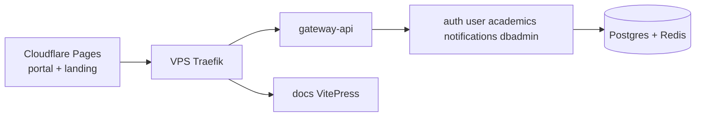

# uniZ Documentation

Use search (**Ctrl/Cmd + K**) or the [Search index](/search-index) to find **how something is implemented** and **what to change**.

- **[System architecture](/system/overview)** — Mermaid maps of Pages, Traefik, gateway-api, and data stores
- **[Action flows](/system/action-flows)** — Sign-in, first-login email code, webadmin tools, grievance, academics
- **[Search index](/search-index)** — Keyword table for every major topic
- **[Webadmin workspace](/admin/webadmin)** — Roles, database browser, website editor, shared tables
- **[Deploy & ops](/ops/deploy)** — VPS GHCR deploy, Cloudflare Pages, runbooks
- **[API gateway map](/api/platform/gateway)** — Every `/api/v1` prefix → upstream service
- **[Docs service](/services/docs)** — VitePress at `api-uniz.rguktong.in/docs`
- **[Student guide](/students/login)** — Sign-in, first-login email code, academics, profile
- **[How to add an API](/howto/add-api-route)** — Service → gateway → portal → docs checklist

The portal is **light-only**. After sign-in, an account with `mustChangePassword` stops on **Set a new password** and must enter the email code before anything else.

## Production shape (one glance)

::: info
Outpass and outing are **not enabled** in production. Student menus hide them, and non-grievance `/api/v1/requests/*` returns `503 OUTPASS_OUTING_DISABLED`. Grievances stay live on the user service. See [Feature flags](/ops/feature-flags).
:::
