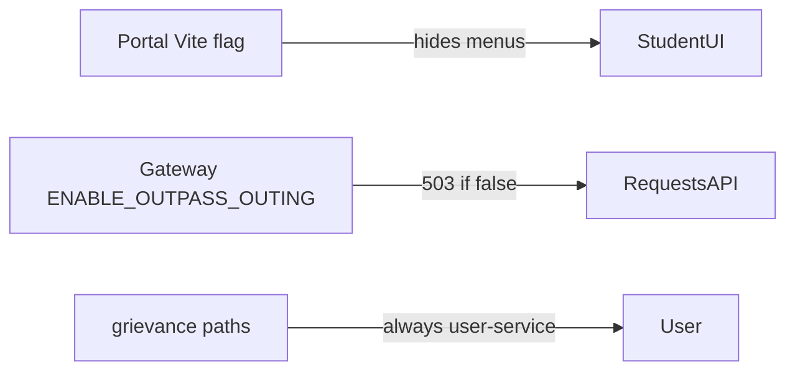

::: warning
Outpass and outing are **not on**. Both flags below default to false. Do not document the approval chain as a live student or staff workflow. Grievances do not use these flags.
:::

| Flag | Layer | Default | Effect |
|------|-------|---------|--------|
| `VITE_ENABLE_OUTPASS_OUTING` | Portal **build** | `false` | Hide outpass/outing UI |
| `ENABLE_OUTPASS_OUTING` | Gateway **runtime** ConfigMap | `false` | Allow `/api/v1/requests/*` except grievance |
| `VITE_MAINTENANCE_MODE` | Portal **build** | `false` | Show maintenance interstitial |

## How to enable outpass (not a current step)

Outpass is **not enabled**. The checklist in [Revive outpass](/howto/revive-outpass) is how it would be turned on later. It is not an operating procedure for today. Both flags, a scaled Deployment, and a portal rebuild are required together.

## Where configured

- GitHub secrets / Pages workflow env
- VPS ConfigMap `uniz-config` (`ENABLE_OUTPASS_OUTING`)
- Example: `secrets.env.example`
