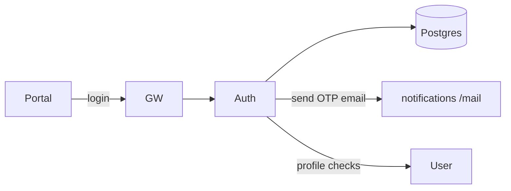

## Role

Issues JWTs and owns credential/OTP flows.

| | |
|--|--|
| **Code** | `apps/uniz-auth/` |
| **Entry** | `src/index.ts` |
| **K8s** | `uniz-auth-service` HPA 1–2 |
| **Gateway** | `/api/v1/auth/*` |

## Main routes

| Method | Path (service-local) | Purpose |
|--------|----------------------|---------|
| POST | `/login`, `/login/student`, `/login/admin` | Authenticate. Production requires `captchaToken`. Response includes `mustChangePassword`, and `student_token` or `admin_token`. |
| POST | `/signup` | Registration (if enabled) |
| POST | `/otp/request`, `/otp/request-email`, `/otp/verify` | Forgot-password email OTP. Captcha on `/otp/request` only. |
| POST | `/password/change/otp` | First-login email code. Auth required. Stored mailbox only. |
| POST | `/password/reset`, `/password/change` | Reset (min 6) or change (min 8). Change returns a new `token`. |
| POST | `/admin/reset-password`, `/admin/global-reset-password`, `/admin/suspend` | Admin ops |
| POST | `/logout` | Logout. Allowed during the password-change gate. |
| GET | `/health` | Probe |
| * | `/internal/*` | Service-to-service (INTERNAL_SECRET) |

Public docs: [Login](/api/auth/login), [OTP](/api/auth/otp), [Password](/api/auth/password).

## Session gate

`AuthCredential` stores `mustChangePassword`, `tokenVersion`, and `realEmail` (`apps/uniz-auth/prisma/schema.prisma`). The JWT includes `tokenVersion`.

`rejectStaleSession` in `packages/uniz-shared/src/session-gate.ts`:

- Version mismatch → `401 AUTH_TOKEN_REVOKED` ("Your session has ended. Please sign in again.").
- Flag set, and the call is not an exempt POST → `403 PASSWORD_CHANGE_REQUIRED` ("Set a new password before continuing.").
- Exempt POSTs: `/password/change`, `/password/change/otp`, `/logout`.

Gateway and auth both enforce this (`enforceCredentialSession` on the gateway).

## Two email selections

Forgot-password (`resolveProfileEmail` / `chooseOtpEmail`): stored `realEmail`, then profile email, then the campus mailbox `<id>@rguktong.ac.in`.

First-login (`resolveStoredMailbox`): stored `realEmail` or profile email only. It does not invent `<id>@rguktong.ac.in`. If that mailbox is empty the code is `OTP_EMAIL_MISSING`.

Students now receive mail at `<id>@rguktong.ac.in`. That string is the campus mailbox, not a password.

## Student reset already applied

`scripts/ops/login-revamp.js` (dry-run by default) was already applied for students: 2,711 accounts must set a new password at next sign-in, `tokenVersion` was bumped, and previous student sessions no longer work. Admin, webadmin, and the shared role accounts were not touched. Faculty `firstname.lastname` logins were **not** created. Do not re-run apply from this note. See [Runbooks](/ops/runbooks).

## Dependencies

## Env (important)

`DATABASE_URL`, `JWT_SECURITY_KEY`, `INTERNAL_SECRET`, `REDIS_URL`, `USER_SERVICE_URL`, `MAIL_SERVICE_URL` / `NOTIFICATION_SERVICE_URL`, `TURNSTILE_SECRET_KEY`, `GATEWAY_URL`.

## Change checklist

1. Add route in auth router/controller under `apps/uniz-auth/src/`
2. Ensure gateway already prefixes `/auth` (no gateway change if path stays under `/api/v1/auth`)
3. Update API MDX under `apps/uniz-docs/api/auth/`
4. Deploy via `deploy.yml` (auth image rebuild)
