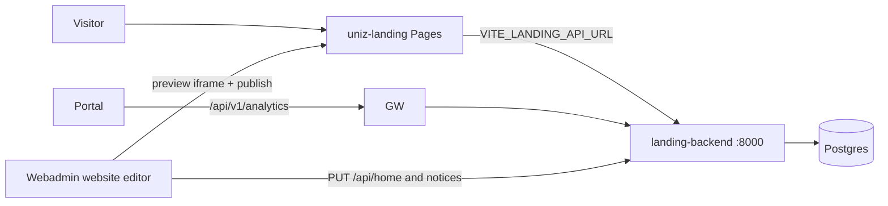

## Two pieces

| Piece | Runs on | Host |
|-------|---------|------|
| SPA | Cloudflare Pages | `rguktong.in` |
| FastAPI CMS | VPS Docker Compose | `landing-api.rguktong.in` |

## SPA

- Code: `apps/uniz-landing/`
- Routes: home, institute/academics pages, departments, notifications
- Deploy: [Cloudflare Pages](/ops/cloudflare-pages)

## FastAPI

- Code: `apps/uniz-landing-backend/`
- Entry: `main.py`
- Prefixes: `/api/home`, `/api/institute`, `/api/academics`, `/api/departments`, `/api/notifications`, `/api/analytics/*`, `/health`
- Compose (VPS): `docker-compose.yml.vps`
- Env refresh: `scripts/deploy/refresh-landing-backend-env.sh`
- K8s: Service + Endpoints → host IP `:8000` (`landing-backend.yaml`)

## Webadmin live preview

The portal **Website editor** is how webadmin changes `rguktong.in`. It is not the student portal.

- Iframe: `VITE_LANDING_PREVIEW_URL` or `https://rguktong.in/?preview=1`
- Publish writes the live site (`PUT /api/home/`, notices, banners, updates). Discard drops the draft.
- The Website Updates live-editor chrome can auto-publish section edits. The UI says "Edits auto-publish to the live RGUKT landing site".
- Preview messages: `apps/uniz-portal/src/lib/preview-protocol.ts` and `apps/uniz-landing/src/lib/preview-protocol.ts`, rendered through `apps/uniz-landing/src/components/preview/EditRegion.tsx`.

Guide: [Website editor](/admin/website-editor).

## Gateway bridges

- `/api/v1/analytics/*` → landing `/api/analytics/*`
- `/api/v1/cms/api/*` → landing-backend
