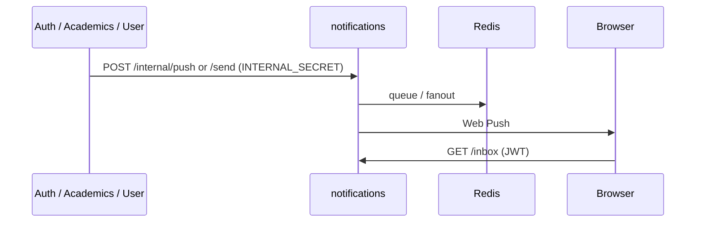

## Role

Campus communications: browser push subscriptions, in-app inbox, and SMTP/SES email (`MAIL_SERVICE_URL` points here).

| | |
|--|--|
| **Code** | `apps/uniz-notifications/` |
| **Entry** | `src/index.ts` |
| **Mail code** | `src/mail/*` (folded from uniz-mail) |
| **Gateway** | `/api/v1/notifications/*`, `/api/v1/mail/*` |
| **Replicas** | 1 (fixed) |

## Flows

## Routes

| Method | Path | Auth |
|--------|------|------|
| POST | `/subscribe` | JWT |
| GET | `/inbox` | JWT |
| POST | `/internal/push`, `/push/send` | Internal |
| GET | `/push/subscribers` | Admin/internal |
| POST | `/send` | Internal (mail) |
| GET | `/health` | Public probe |

## Email layout

One shared light, table-based layout lives in `packages/uniz-shared/src/email-layout.ts`. Inline CSS: navy bar, uniZ wordmark (`https://uniz.rguktong.in/email/uniz-wordmark.png`), title, body, optional large OTP, optional single navy button, and a footer — "Rajiv Gandhi University of Knowledge Technologies, Ongole" plus "You got this because …". A plain-text alternative is always produced.

Template ids from `previewCampusEmails()` in `packages/uniz-shared/src/email-messages.ts`:

`otp`, `login_alert`, `outpass_request`, `outing_request`, outpass approval, outing approval, `checkpoint`, `results`, `attendance_report`, `admin_alert`, `grievance_submission`, `grievance_resolved`, `grievance_closed`, `admin_action_confirmation`, `password_change`, `profile_update`, `plain_notice`.

That fixture list is about 17 messages, counting both grievance-resolved variants (`actionable` true → `grievance_resolved`, false → `grievance_closed`).

**What actually sends today**

| Send | Templates |
|------|-----------|
| Live | On-demand OTP, operational `plain_notice`, and the SWO grievance resolved/closed mail (`sendGrievanceResolvedNotification`) |
| Suppressed | Login alert, outpass/outing request and approval, checkpoint, results, attendance, admin alert, grievance submission ack, admin confirmation, password-change alert, profile-update alert |

Results and attendance stay suppressed unless `ENABLE_RESULT_EMAILS=true`. Outpass-themed templates exist in code. Outpass is not a live product, so those mails do not go out. Do not document a suppressed template as something students currently receive.

## Env

`VAPID_PUBLIC_KEY`, `VAPID_PRIVATE_KEY`, `EMAIL_USER` / pool, `AWS_*` (SES optional), `FORCE_GMAIL`, `DATABASE_URL` / `NOTIFICATION_DATABASE_URL`, `REDIS_URL`, `INTERNAL_SECRET`, `JWT_SECURITY_KEY`.

Do **not** fold this into user-service casually — mail/push failure modes should stay isolated from profile reads.
