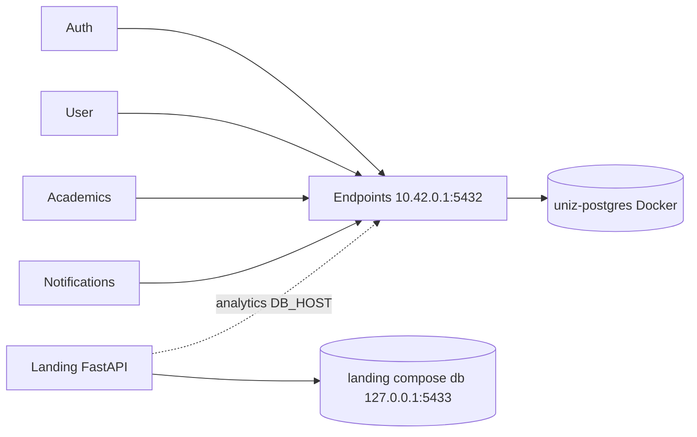

## Postgres

Production uses a **host Docker container** `uniz-postgres`, not an in-cluster Postgres pod.

**Publish bind (hardened):** `127.0.0.1:5432` and `10.42.0.1:5432` only — **not** `0.0.0.0` / public eth0. UFW + `DOCKER-USER` still drop internet hits on admin ports.

K8s Service `uniz-postgres` uses Endpoints pointed at **`10.42.0.1:5432`** (cni0) so pods can reach the host Docker proxy. Vault / `uniz-secrets` `*_DATABASE_URL` hosts are rewritten to that address by `scripts/deploy/sync-k8s-secret-from-vault.sh` on deploy. Prisma migrate on the VPS host rewrites to `127.0.0.1` in `scripts/deploy/prisma-migrate-deploy-all.sh`.



| Consumer | Typical DB usage |
|----------|------------------|
| Auth | Users, credentials, OTP state |
| User | Profiles, CMS banners/notices, grievances, file metadata |
| Academics | Grades, attendance, subjects, semester registration |
| Notifications | Push subscriptions, inbox, mail attribution |
| Landing backend | CMS on landing DB; analytics may query main uniZ DB via `DB_*` |

Prisma schemas live per service under `apps/uniz-*/prisma/`. Migrations: [Database migrations](/howto/database-migrations).

### Backup

```bash
bash scripts/ops/backup-postgres.sh
```

Also CronJob: `infra/kubernetes/base/core/postgres-backup-job.yaml`.

## Redis

Service URL (ConfigMap): `REDIS_URL=redis://uniz-redis:6379`.

| Use | Service |
|-----|---------|
| Gateway GET response cache | gateway-api |
| System health aggregate cache | gateway-api |
| BullMQ / job queues | academics, user (bulk), notifications |
| Rate / session helpers | auth / academics as implemented |

## Landing dual-DB note

Compose `apps/uniz-landing-backend/docker-compose.yml.vps` runs CMS Postgres on **`127.0.0.1:5433`**. Landing API publishes `127.0.0.1` + `10.42.0.1:8000`. Analytics may use main uniZ Postgres via `DB_HOST=10.42.0.1`.
