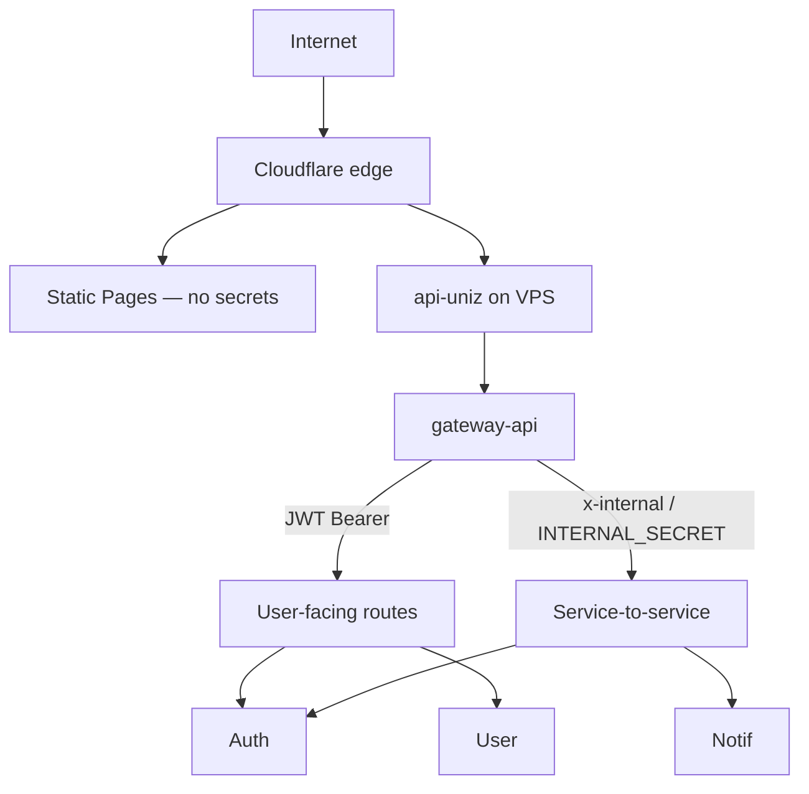

## Trust boundaries

## Authentication

| Mechanism | Where |
|-----------|--------|
| JWT (`JWT_SECURITY_KEY`) | Issued by auth; validated by services. Claim `tokenVersion` must match `AuthCredential.tokenVersion` or the call is `401 AUTH_TOKEN_REVOKED`. |
| Password-change gate | While `mustChangePassword` is set, gateway and auth return `403 PASSWORD_CHANGE_REQUIRED` except POST `/password/change`, `/password/change/otp`, and `/logout`. Code: `packages/uniz-shared/src/session-gate.ts`. |
| Single webadmin | `isWebadmin()` is only username `webadmin` with mailbox `webadmin@rguktong.ac.in`. Any other `webadmin` role string is `faculty` via `accessRole()`. |
| Role claims | Student / faculty / admin / security / etc. — see [Roles](/roles). Gate roles are parked. |
| Turnstile | Production **login** and **`POST /auth/otp/request`** require `captchaToken`. Failure is `400 AUTH_CAPTCHA_FAILED` and is checked before the password. `/otp/request-email` does not need a fresh captcha. Portal prefetch: `apps/uniz-portal/src/utils/prefetchTurnstile.ts`. |
| Internal secret | `INTERNAL_SECRET` for `/internal/*` and mail send. Header name only; never a value in docs. |

## Secrets management

- VPS: encrypted `/root/uniz-secrets.env.sops` (plaintext `/root/uniz-secrets.env` is the fallback). Never commit either. See `docs/ops/SECRETS.md`.
- GitHub Actions: repository secrets for CI/deploy/Pages
- Helpers: `scripts/ops/vps-vault.sh`, `scripts/deploy/render-vps-secrets.sh`
- Example keys: `secrets.env.example`

## CORS

- Gateway: `CLIENT_URL` comma list (must include Pages origin `https://uniz.rguktong.in`)
- Landing API: allowlist includes `https://rguktong.in`

## Network

- Origin IP preferably behind Cloudflare Tunnel (`scripts/deploy/setup-cloudflare-tunnel.sh`) — tunnel hosts are **API only** (`api-uniz`, `landing-api`), not portal/landing (those are Pages)
- Ingress TLS via cert-manager DNS-01 with Cloudflare token

## What not to put in the frontend

Vite `VITE_*` values are **public**. Never put `JWT_SECURITY_KEY`, DB URLs, or `INTERNAL_SECRET` in portal/landing builds.
