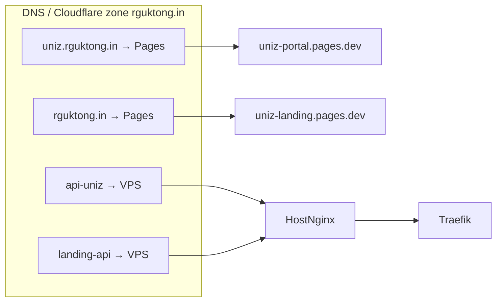
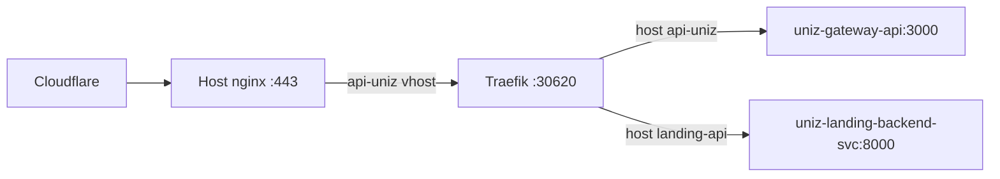

Canonical ops doc in the repo: [`docs/architecture/PRODUCTION_TOPOLOGY.md`](https://github.com/uniz-rguktong/uniz-master/blob/main/docs/architecture/PRODUCTION_TOPOLOGY.md). Manifests under `infra/kubernetes/base/`. Day-to-day checklist: [`docs/ops/INDEX.md`](https://github.com/uniz-rguktong/uniz-master/blob/main/docs/ops/INDEX.md).

## Hosts

| Layer | Where | Hostname |
|-------|--------|----------|
| Portal SPA | Cloudflare Pages | `https://uniz.rguktong.in` |
| Landing SPA | Cloudflare Pages | `https://rguktong.in` |
| API | Host nginx → Traefik → gateway-api | `https://api-uniz.rguktong.in` |
| Landing CMS API | Host nginx → Traefik → landing-backend | `https://landing-api.rguktong.in` |
| Docs (VitePress) | VPS pod, proxied by gateway | `https://api-uniz.rguktong.in/docs` |
| Postgres | Host Docker `uniz-postgres` | `127.0.0.1` + `10.42.0.1:5432` (not public NIC) |
| Redis | Cluster Deployment | `redis://uniz-redis:6379` |
| Observability | Netdata + Uptime Kuma | `127.0.0.1:19999` / `:3001` (SSH tunnel only) |

## Always-on VPS Deployments

| Deployment | Min | Max (HPA) | Notes |
|------------|-----|-----------|--------|
| `uniz-gateway-api` | 1 | 3 | Express router + Redis cache |
| `uniz-auth-service` | 1 | 2 | Login / OTP |
| `uniz-user-service` | 1 | 3 | Profiles, CMS, files, grievance |
| `uniz-academics-service` | 1 | 3 | Grades, attendance, registration |
| `uniz-notification-service` | 1 | 2 | Push + inbox + mail |
| `uniz-docs-service` | 1 | — | VitePress (this site) |
| `uniz-redis` | 1 | — | Cache / queues |

Landing FastAPI runs as **Docker Compose on the host**, published on `127.0.0.1` + `10.42.0.1:8000`, exposed into the cluster via Endpoints Service `uniz-landing-backend-svc:8000`.

## Parked or removed

| Deployment | Status |
|------------|--------|
| `uniz-gateway` (nginx hop) | Parked at 0 — Traefik → gateway-api |
| `uniz-portal` / `uniz-landing` | Parked at 0 — Cloudflare Pages |
| `uniz-outpass-service` | Parked at 0 — feature gated; Service kept for DNS |
| Legacy `uniz-api` monolith | **Deleted** — not on ingress |
| Mail / files / always-on cron Deploy | Folded into notifications / user / CronJobs |

CI belt-and-suspenders: `scripts/ci/ci-remote-deploy.sh` re-scales parked Deployments to 0 after every successful VPS deploy.

## Ingress path

- Host nginx site `uniz-api-uniz` is ensured by `scripts/deploy/ensure-nginx-api-uniz.sh` on every deploy (prevents 308 loops).
- Cluster Ingress: `infra/kubernetes/base/shared/ingress.yaml` (`ingressClassName: nginx`, Traefik provider).
- TLS via cert-manager + Cloudflare DNS challenge (`letsencrypt-prod-dns`).

## Capacity note (4 vCPU / ~15Gi)

Honest resource requests leave headroom; HPA is for **short bursts**, not sustained max load. Spare idle CPU is the HPA budget. Bottleneck order: Postgres → academics/auth CPU → Redis under queue pressure.

See [Scale & HPA](/howto/scale-and-hpa).
