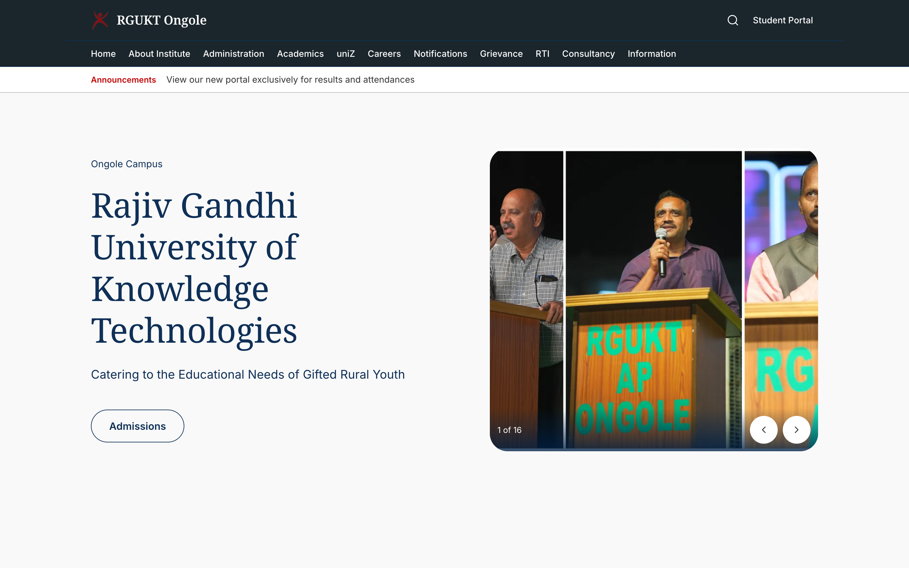

# RGUKT Ongole Public Website (`uniz-landing`)

Official public institutional website for Rajiv Gandhi University of Knowledge Technologies (RGUKT) Ongole Campus, deployed at [`https://rguktong.in`](https://rguktong.in) via Cloudflare Pages.



## Stack

- **Framework:** React 19 + TypeScript + Vite 7 (`apps/uniz-landing`)
- **Styling:** Tailwind CSS v4 + Framer Motion + Three.js (`@react-three/fiber`)
- **Routing:** React Router v7 (`/` home, `/institute/:pageName`, `/academics/:pageName`, `/departments/:deptCode`, `/notifications/:type`, `/uniz/:slug`, `/grievance/:slug`, `/information/:slug`, `/admissions`, `/consultancy`, `/about/rti-act`)
- **Content Backend:** Powered by [`apps/uniz-landing-backend`](../uniz-landing-backend/README.md) via `uniz-gateway` (`/api/v1/cms/api/*`, `/api/v1/analytics/*`)

## Commands

```bash
npm install
npm run dev        # local Vite dev server
npm run build      # tsc -b && vite build && prerender-og.mjs
npm run lint       # eslint . && npm run lint:hex
npm run lint:hex   # design-token hex enforcement
npm test           # node tests + OG metadata assertion
```

> Part of [`uniz-master`](../../README.md).
