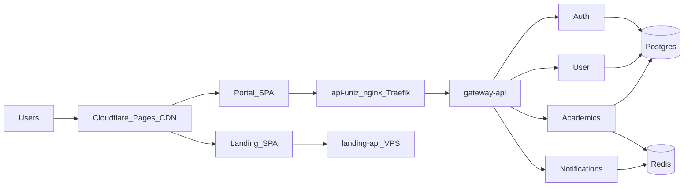

# UniZ Production Topology & Scaling

**Source of truth:** this doc + Kubernetes manifests under `infra/kubernetes/base/` + [`docs/ops/INDEX.md`](../ops/INDEX.md).

## Where things run

| Layer | Where | Hosts |
|-------|--------|--------|
| **Portal SPA** | Cloudflare Pages | `uniz.rguktong.in` |
| **Landing SPA** | Cloudflare Pages | `rguktong.in` (RGUKT Ongole look: `#C00404`, `#1b262c`, `#0f3057`, `#f9f9f9`) |
| **API gateway + services** | VPS (K3s) via host nginx → Traefik | `api-uniz.rguktong.in` |
| **Landing CMS API** | VPS Docker + Traefik | `landing-api.rguktong.in` |
| **Docs** | VPS `uniz-docs-service` (VitePress) | `api-uniz.rguktong.in/docs` |
| **Postgres** | Host Docker, bind `127.0.0.1` + `10.42.0.1` | Endpoints → `10.42.0.1:5432` |
| **Redis** | In-cluster | `uniz-redis:6379` |
| **Observability** | Netdata + Uptime Kuma | localhost / SSH tunnel only |



## Always-on VPS services

| Deployment | Replicas | Notes |
|------------|----------|-------|
| uniz-gateway-api | HPA 1–3 | Express router + Redis cache |
| uniz-auth-service | HPA 1–2 | Login |
| uniz-user-service | HPA 1–3 | Profiles, CMS, files, grievance |
| uniz-academics-service | HPA 1–3 | Grades, attendance, registration |
| uniz-notification-service | HPA 1–2 | Push + mail |
| uniz-docs-service | 1 | VitePress |
| uniz-redis | 1 | Cache / queues |
| landing-backend | 1 (compose) | FastAPI CMS |

## Parked or removed

| Unit | Why |
|------|-----|
| uniz-gateway (nginx hop) | Traefik → gateway-api |
| uniz-portal / uniz-landing | Cloudflare Pages |
| uniz-outpass-service | Feature gated; grievance on user |
| uniz-mail / uniz-files / uniz-cron Deploy | Folded / CronJob-only |
| **uniz-api monolith** | **Removed** — not on ingress |

## Frontend deploy + DNS

```bash
gh workflow run "Deploy Frontends to Cloudflare Pages" -f target=all
# or: CLOUDFLARE_API_TOKEN=... bash scripts/deploy/deploy-cloudflare-pages.sh
```

- Portal: `VITE_API_URL=https://api-uniz.rguktong.in/api/v1`
- Landing: `VITE_LANDING_API_URL=https://landing-api.rguktong.in`

## Feature flags

| Flag | Default | Effect |
|------|---------|--------|
| `VITE_ENABLE_OUTPASS_OUTING` | false | Portal outpass UI |
| `ENABLE_OUTPASS_OUTING` | false | Gateway `/requests` (non-grievance) |
| `VITE_MAINTENANCE_MODE` | false | Portal maintenance page |

## Ops

```bash
bash scripts/ops/post-deploy-smoke.sh
# Observability tunnels: ssh -L 19999:127.0.0.1:19999 -L 3001:127.0.0.1:3001 root@<vps>
```

Git remotes kept to **`main`** + **`backup/main-2026-11-15`** only.
