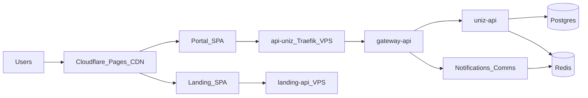

# UniZ Production Topology & Scaling

**Source of truth:** this doc + Kubernetes manifests under `infra/kubernetes/base/`.

> VPS baseline (2026-10-23): always-on pods = gateway-api, auth, user, academics, notifications, docs, redis. Parked at 0 = portal, landing, outpass, files, mail, cron Deploy, nginx gateway. Target after simplify: replace auth+user+academics with **uniz-api**.

## Where things run

| Layer | Where | Hosts |
|-------|--------|--------|
| **Portal SPA** | Cloudflare Pages | `uniz.rguktong.in` |
| **Landing SPA** | Cloudflare Pages | `rguktong.in` |
| **API gateway + services** | VPS (K3s) | `api-uniz.rguktong.in` |
| **Landing CMS API** | VPS | `landing-api.rguktong.in` |
| **Postgres + Redis** | VPS | internal only |



## Always-on VPS services (target)

| Deployment | Replicas | Notes |
|------------|----------|-------|
| uniz-gateway-api | HPA 1–2 | Express router + Redis cache (edge = Traefik) |
| **uniz-api** | HPA | auth + user (profiles/CMS/files/grievance) + academics |
| uniz-notification-service | 1 | Push + mail (comms) |
| uniz-docs-service | 1 | VitePress at `/docs` |
| landing-backend | 1 | FastAPI for website CMS (host/Endpoints) |
| uniz-redis | 1 | Cache + BullMQ |

## Parked on VPS (replicas 0)

| Unit | Why |
|------|-----|
| uniz-gateway (nginx) | Traefik → gateway-api directly |
| uniz-portal / uniz-landing | Cloudflare Pages |
| uniz-outpass-service | Feature-gated; grievance on user/api |
| uniz-auth / uniz-user / uniz-academics | Superseded by uniz-api after cutover |
| uniz-mail / uniz-files / uniz-cron Deploy | Folded / CronJob-only; apps removed from monorepo |

## Frontend deploy + DNS cutover

```bash
# CI: .github/workflows/deploy-cloudflare-pages.yml
CLOUDFLARE_API_TOKEN=... bash scripts/deploy/deploy-cloudflare-pages.sh
```

Build env:
- Portal: `VITE_API_URL=https://api-uniz.rguktong.in/api/v1`
- Landing: `VITE_LANDING_API_URL=https://landing-api.rguktong.in`

## Feature flags

| Flag | Default | Effect |
|------|---------|--------|
| `VITE_ENABLE_OUTPASS_OUTING` | false | Portal outpass UI |
| `ENABLE_OUTPASS_OUTING` | false | Gateway `/requests` (non-grievance) |
| `VITE_MAINTENANCE_MODE` | false | Portal maintenance page |

## VPS capacity (use the box)

Single-node ~4 vCPU Hostinger. Prefer **fewer always-on processes** with higher requests over many tiny pods:

| Workload | Requests (guide) | Notes |
|----------|------------------|-------|
| uniz-api | 400m–2 CPU / 512Mi–2Gi | Auth+user+academics; HPA 1–4 |
| gateway-api | 100–500m | Thin router + Redis cache |
| notifications | 100–500m | BullMQ workers in-process |
| redis + postgres | host/local | Do not over-replica |

Parked Deployments stay at 0. CronJobs for backup/analyze/cleanup. Secrets: [docs/ops/SECRETS.md](../ops/SECRETS.md).

## Ops

```bash
bash scripts/ops/post-deploy-smoke.sh
kubectl get deploy,hpa,pods
npm run vault:vps -- status   # maintainers only
```
