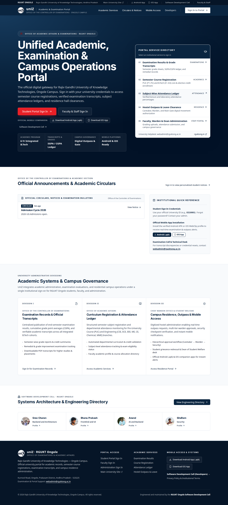
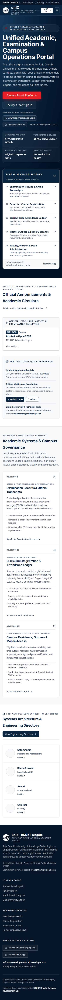
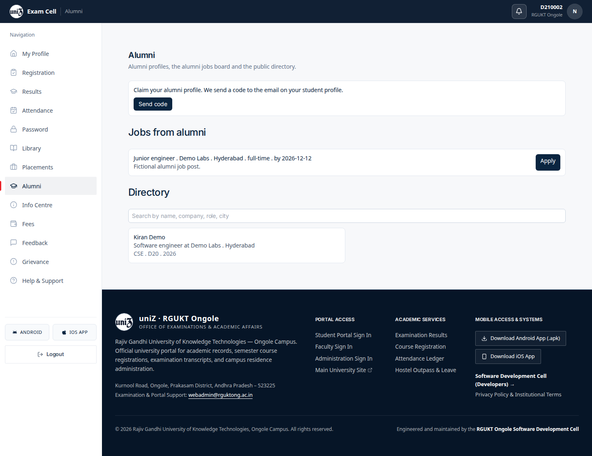
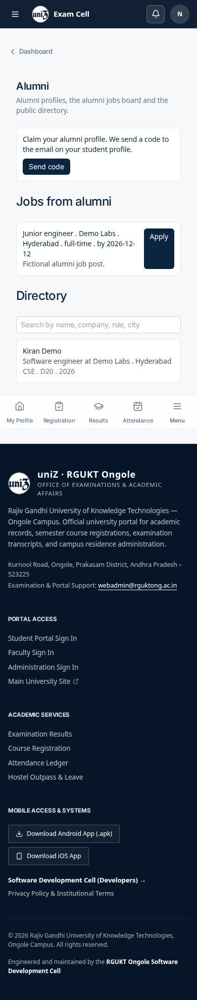
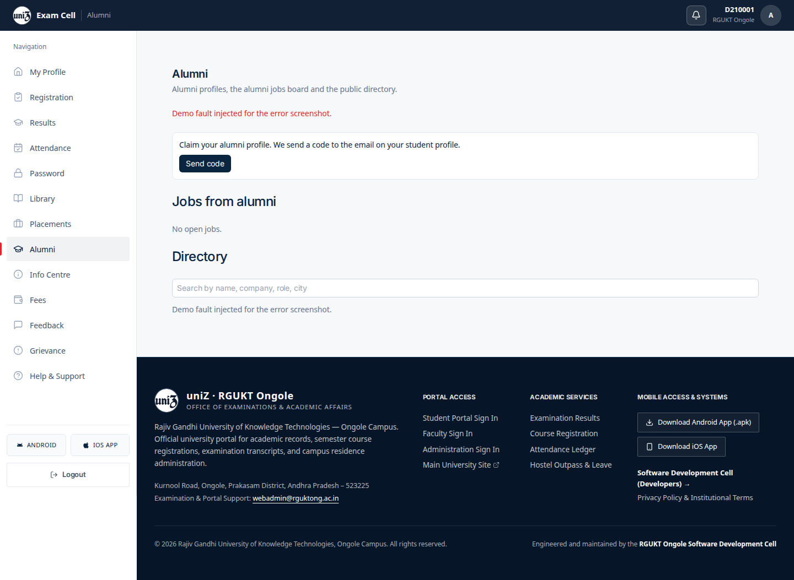
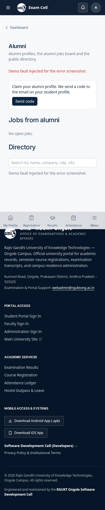
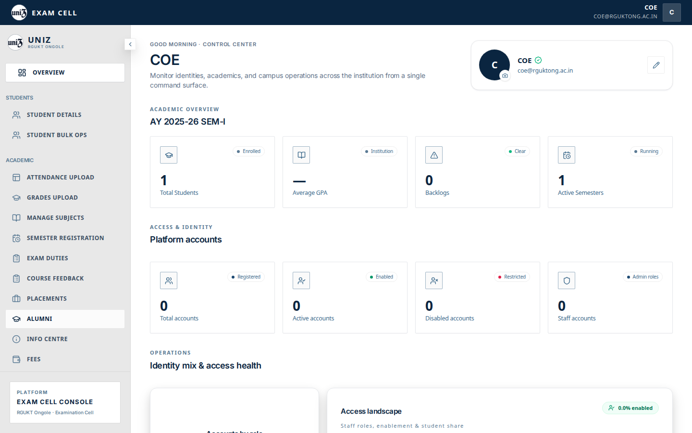
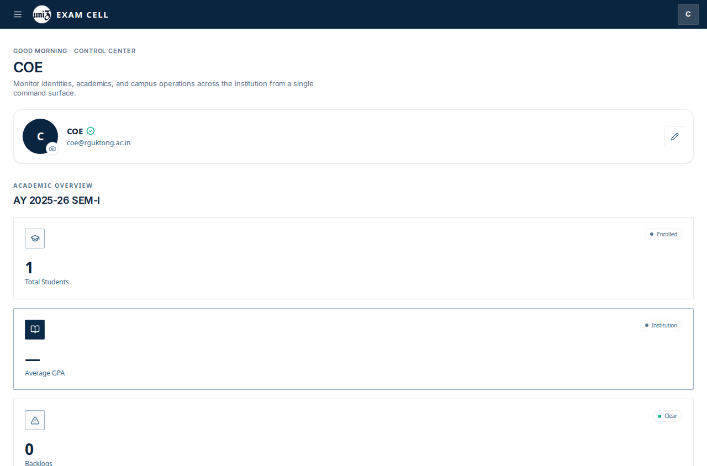
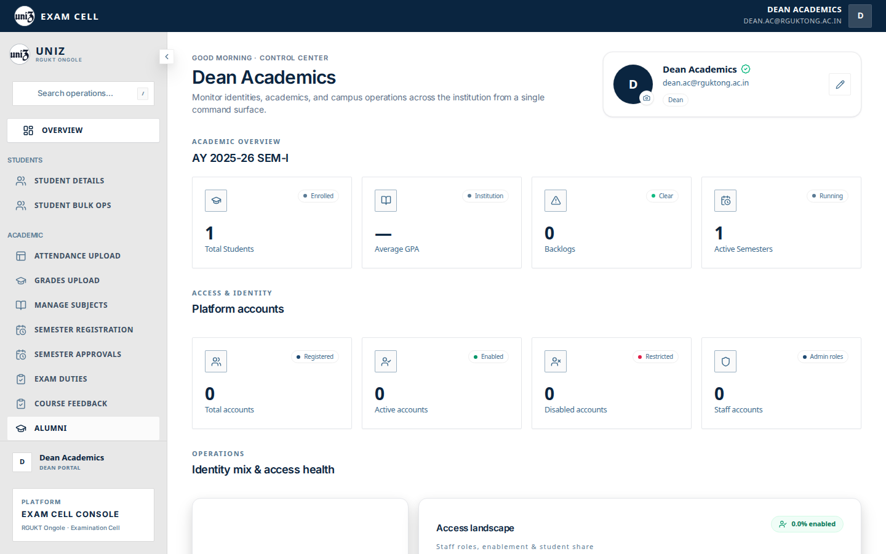
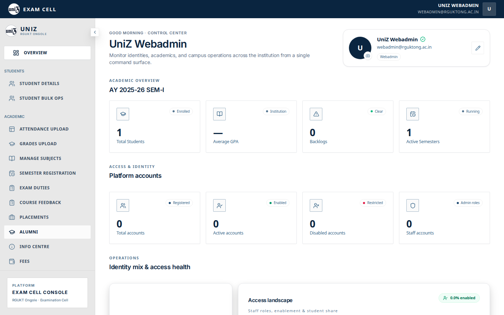

# Alumni

## Public and student

`/alumni` is the public directory. `/student/alumni` is the signed-in page.

The signed-in page has three parts:

1. “Claim your alumni profile.” Send code emails the address on the student profile. Local mail is not configured, so this capture did not complete a claim.
2. Jobs from alumni. The fixture post is “Junior engineer” at Demo Labs, Hyderabad, full-time, apply by 2026-12-12.
3. Directory. Kiran Demo, software engineer at Demo Labs, Hyderabad, CSE, batch D20, 2026. Kiran Demo is a fixture row, not a campus record.

## Admin shell

The Alumni item in the webadmin and dean shells has no URL mapping, so the click returns to the overview.

## Captured screens

1. Desktop. `01 public directory desktop`.

2. Mobile. `01 public directory mobile`.

3. Desktop. `02 student empty desktop`.

4. Mobile. `02 student empty mobile`.

5. Desktop. `02 student populated desktop`.

6. Mobile. `02 student populated mobile`.

7. Desktop. `03 error desktop`.

8. Mobile. `03 error mobile`.

9. Desktop. Clicking this item does not open its panel. `adminSectionRoutes.ts` has no path for this tab, so `setActiveTab` navigates to `/admin` and the overview stays on screen. The row is under the pointer, which is why it looks pressed. File `11 alumni coe desktop`.

10. Mobile. Clicking this item does not open its panel. `adminSectionRoutes.ts` has no path for this tab, so `setActiveTab` navigates to `/admin` and the overview stays on screen. The row is under the pointer, which is why it looks pressed. File `11 alumni coe mobile`.

11. Desktop. Clicking this item does not open its panel. `adminSectionRoutes.ts` has no path for this tab, so `setActiveTab` navigates to `/admin` and the overview stays on screen. The row is under the pointer, which is why it looks pressed. File `11 alumni dean desktop`.

12. Mobile. Clicking this item does not open its panel. `adminSectionRoutes.ts` has no path for this tab, so `setActiveTab` navigates to `/admin` and the overview stays on screen. The row is under the pointer, which is why it looks pressed. File `11 alumni dean mobile`.

13. Desktop. Clicking this item does not open its panel. `adminSectionRoutes.ts` has no path for this tab, so `setActiveTab` navigates to `/admin` and the overview stays on screen. The row is under the pointer, which is why it looks pressed. File `11 alumni webadmin desktop`.

14. Mobile. Clicking this item does not open its panel. `adminSectionRoutes.ts` has no path for this tab, so `setActiveTab` navigates to `/admin` and the overview stays on screen. The row is under the pointer, which is why it looks pressed. File `11 alumni webadmin mobile`.

