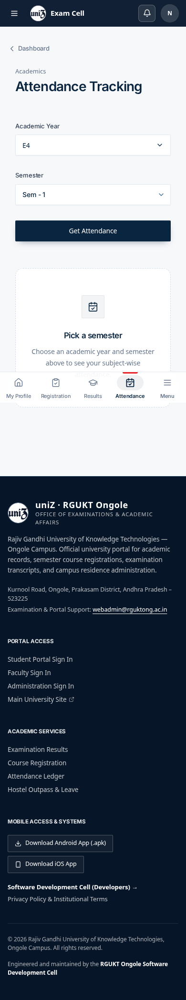
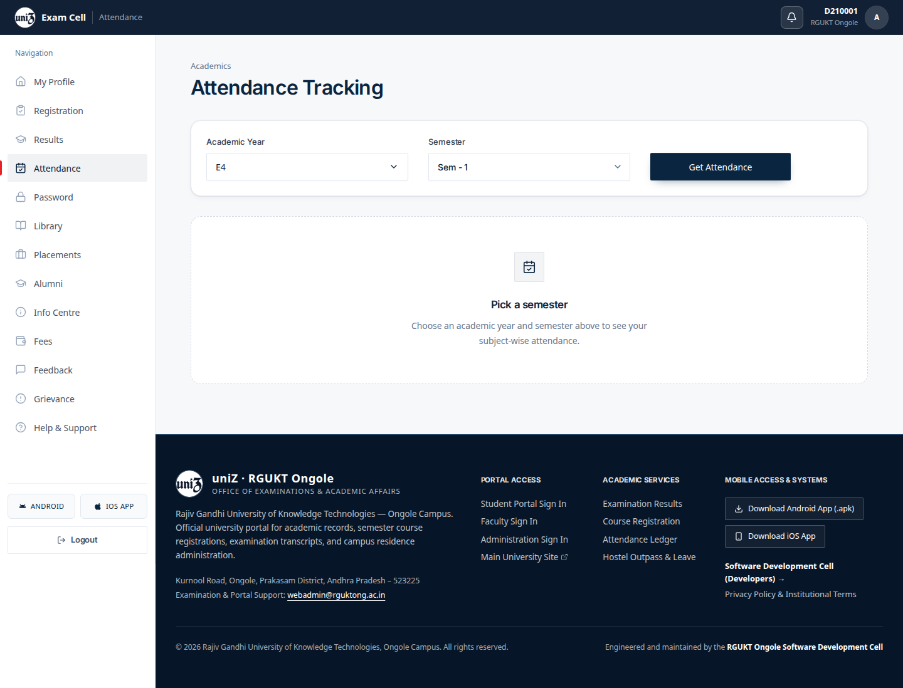
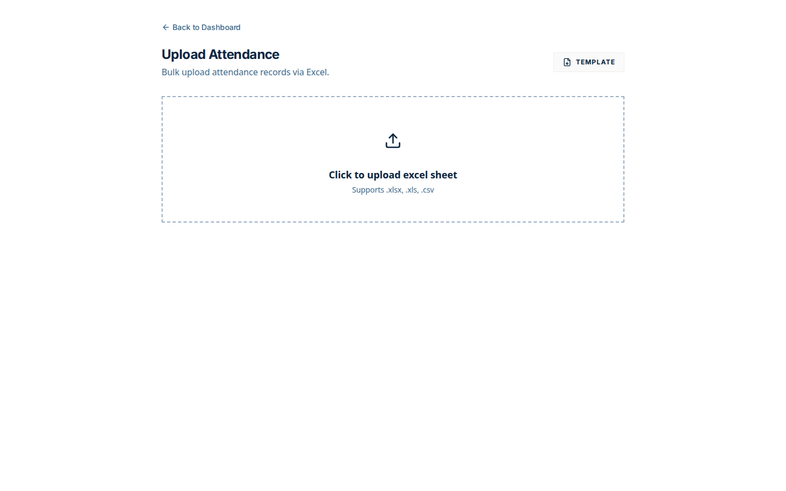
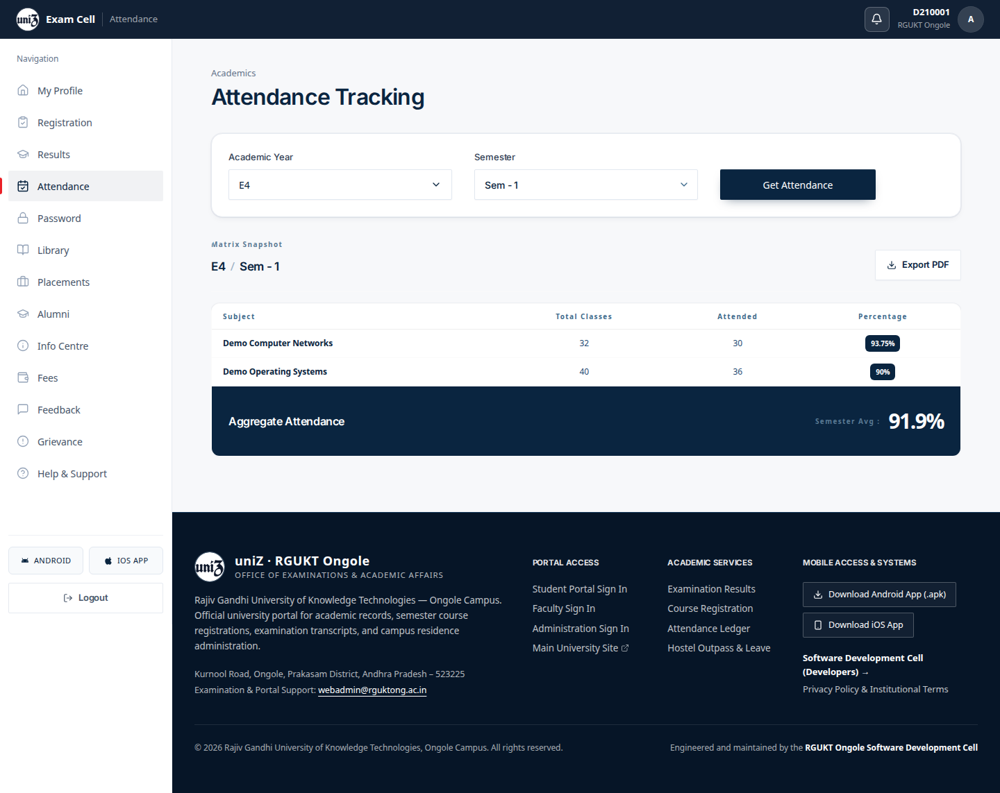
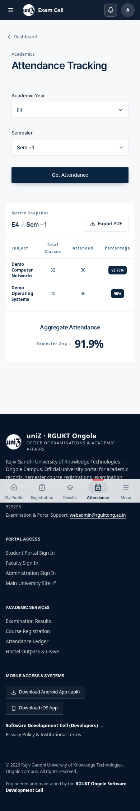
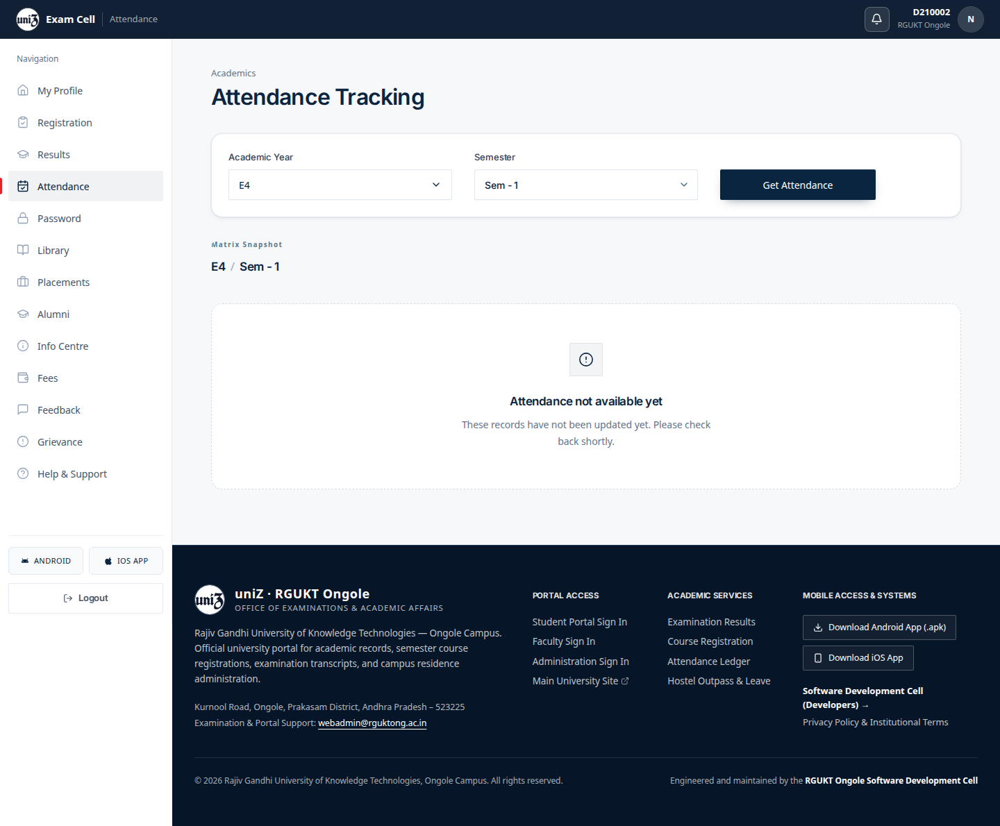
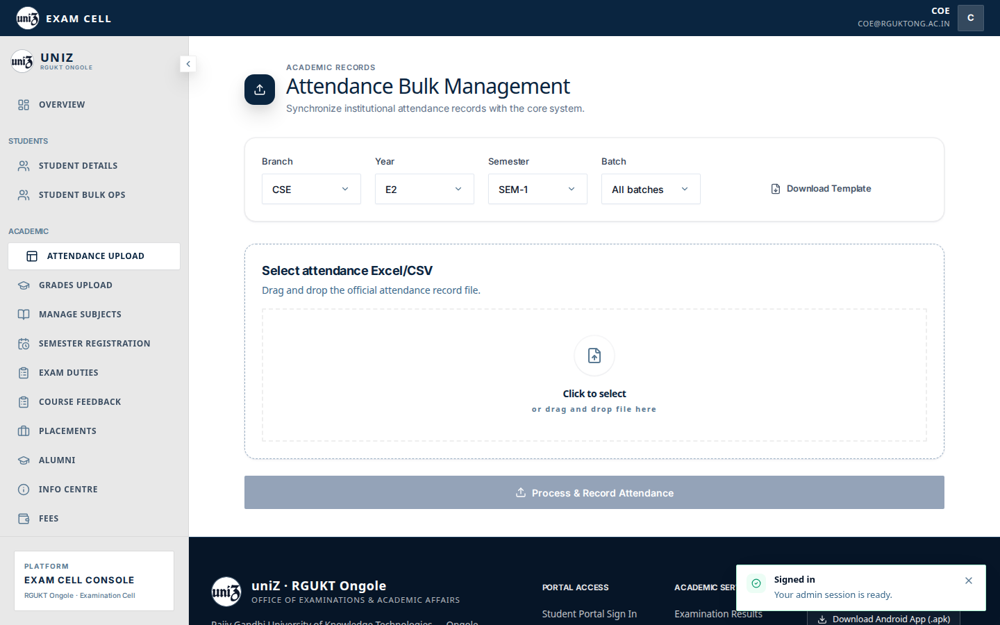
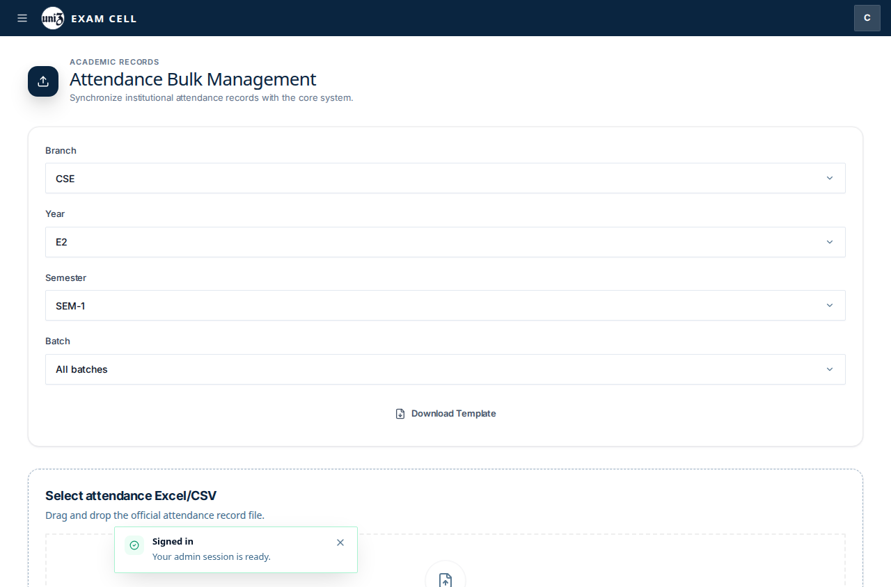
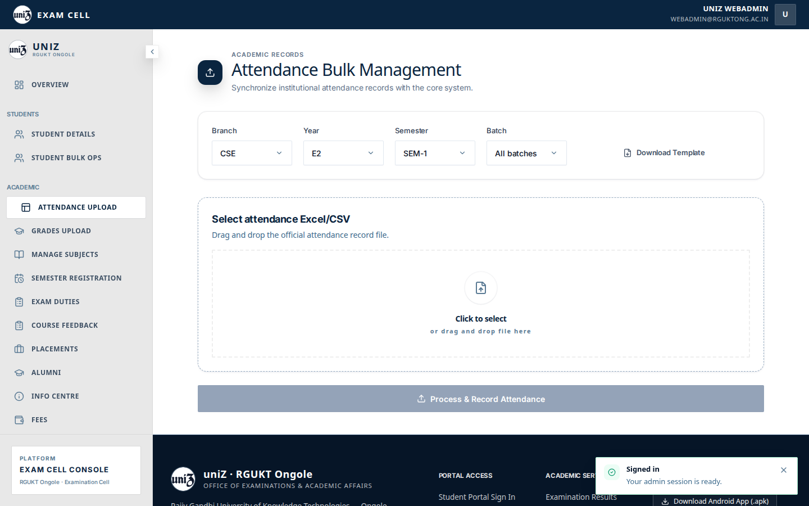

# Attendance

## Student

1. Open `/student/attendance`. The page waits until you pick a year and semester and press Get Attendance. The idle copy is “Pick a semester”.
2. For `D210001`, E4 / Sem - 1 returns the fixture ledger: Demo Computer Networks 30/32 (93.75%) and Demo Operating Systems 36/40 (90%), aggregate 91.9%. Export PDF is on the page.
3. The same request for `D210002` has no rows. The empty capture is `attendance/06-ledger-empty-desktop.png`.
4. Holding the grades-style request is not how this page loads. It fetches when Get Attendance is pressed. The earlier `02-loading` and `03-error` files were taken on navigation, before that click, so they still show the idle picker.

## Staff

Webadmin, CoE, dean, and director open Attendance Upload from the admin shell. That tab is mapped to `/admin/attendance`. The screen is “Attendance Bulk Management”: branch, year, semester, batch, Download Template, and a drop zone for the Excel or CSV file. The legacy route `/admin/addattendance` is the same kind of upload page.

## Captured screens

1. Desktop. `01 ledger empty desktop`.

2. Mobile. `01 ledger empty mobile`.

3. Desktop. `01 ledger populated desktop`.

4. Mobile. `01 ledger populated mobile`.

5. Desktop. `02 loading desktop`.

6. Mobile. `02 loading mobile`.

7. Desktop. `03 error desktop`.

8. Mobile. `03 error mobile`.

9. Desktop. `04 legacy upload desktop`.

10. Desktop. `05 ledger loaded desktop`.

11. Mobile. `05 ledger loaded mobile`.

12. Desktop. `06 ledger empty desktop`.

13. Desktop. `04 attendance upload coe desktop`.

14. Mobile. `04 attendance upload coe mobile`.

15. Desktop. `04 attendance upload dean desktop`.

16. Mobile. `04 attendance upload dean mobile`.

17. Desktop. `04 attendance upload director desktop`.

18. Mobile. `04 attendance upload director mobile`.

19. Desktop. `04 attendance upload webadmin desktop`.

20. Mobile. `04 attendance upload webadmin mobile`.

