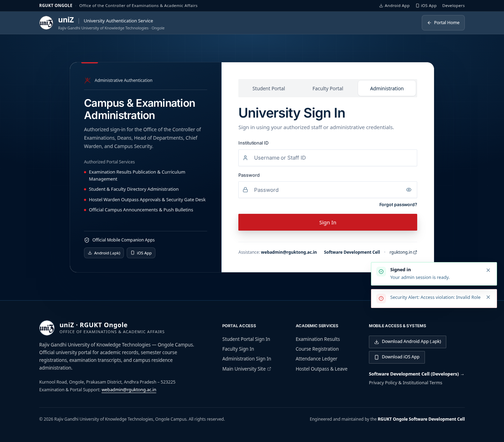
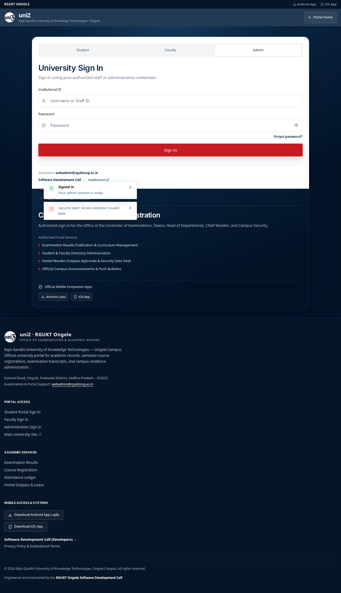
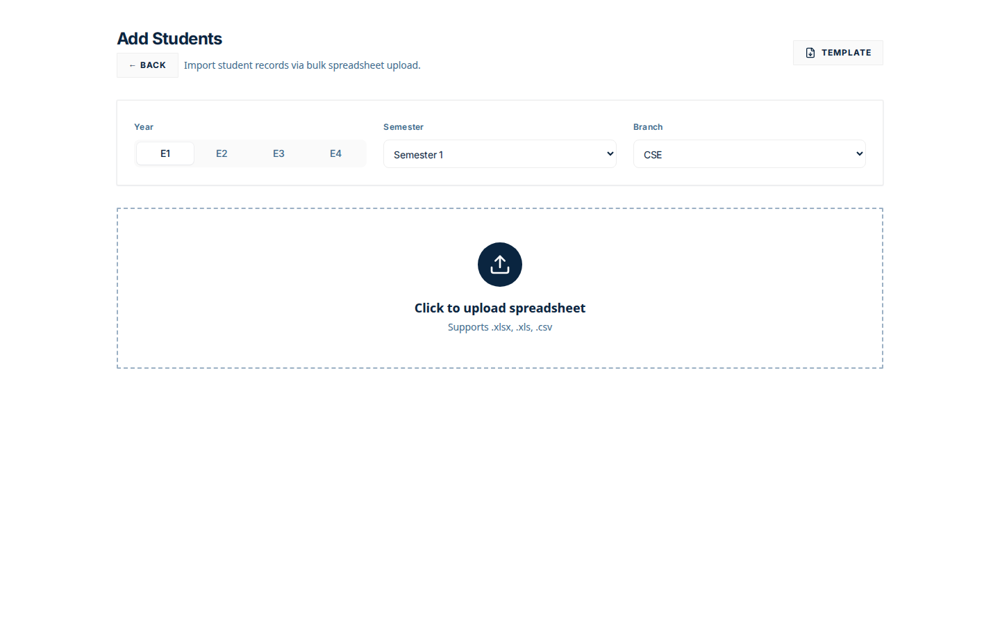
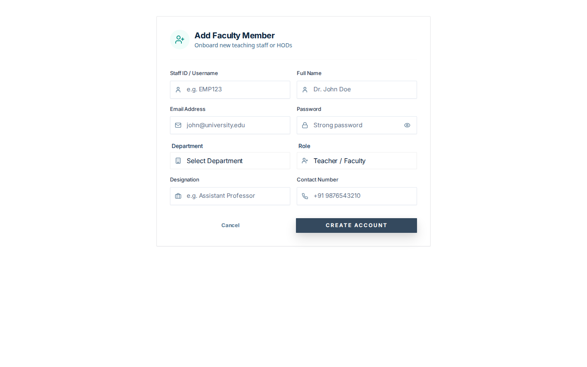

# Establishment

There is no establishment module screen.

`FEATURE_ESTABLISHMENT` is a flag in `packages/uniz-shared/src/flags.ts`. It defaults on. No page reads it.

The local `ao` account cannot enter the portal. `useIsAuth` rejects the role and toasts “Access violation: Invalid Role”. The screenshots under `establishment/00-home-ao-*` are that sign-in result, not an establishment desk.

The legacy pages that do exist for creating people are:

- `/admin/addstudents`
- `/admin/addfaculty`

Those are webadmin routes for adding records. They are not an establishment workflow.

## Captured screens

1. Desktop. `00 home ao desktop`.

2. Mobile. `00 home ao mobile`.

3. Desktop. `01 add students desktop`.

4. Desktop. `02 add faculty desktop`.

