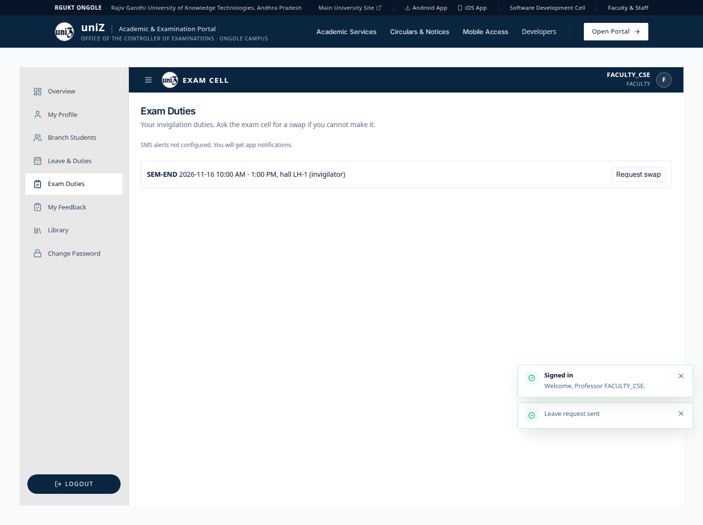
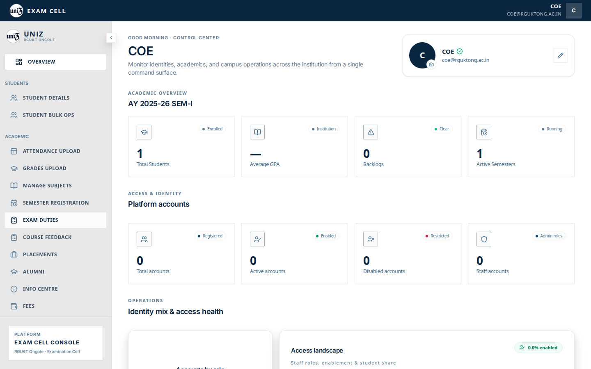
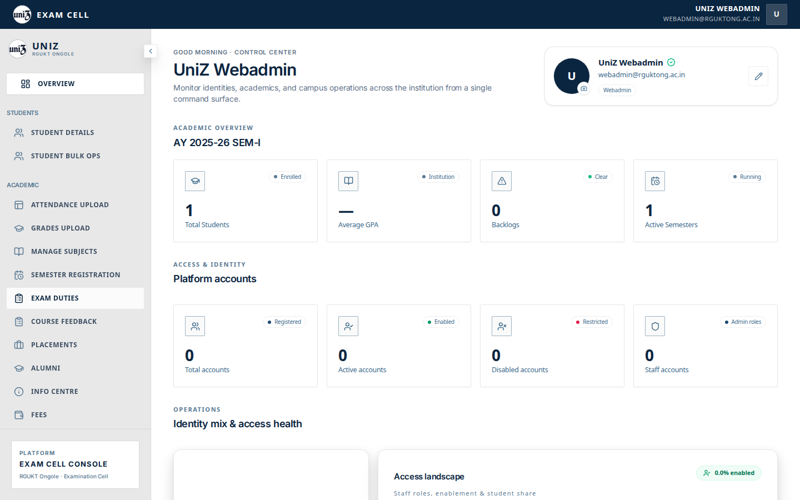
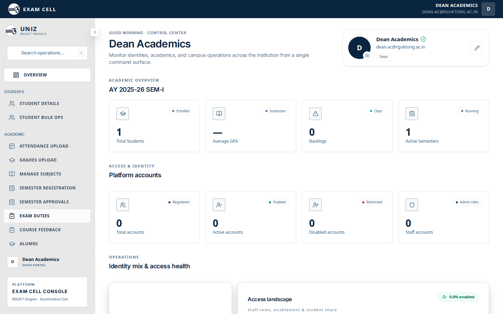

# Exam duties

## Faculty

`FACULTY_CSE` opens Exam Duties on the faculty dashboard. The local fixture assigns one invigilation: SEM-END, hall LH-1, in the academics schema. The faculty screen is `exam-duties/01-faculty-desktop.png`.

## Admin shell

Webadmin, CoE, and dean list Exam Duties. The tab id `exam_duties` is not in `adminSectionRoutes.ts`, so the click returns to the overview. The exam-duty admin component is not shown by that click. The screenshots under `profile/` for this item record that bounce.

Student seating is on the student profile (Demo Operating Systems, LH-1), not on this admin tab.

## Captured screens

1. Desktop. `01 faculty desktop`.

2. Desktop. Clicking this item does not open its panel. `adminSectionRoutes.ts` has no path for this tab, so `setActiveTab` navigates to `/admin` and the overview stays on screen. The row is under the pointer, which is why it looks pressed. File `08 exam duties coe desktop`.

3. Mobile. Clicking this item does not open its panel. `adminSectionRoutes.ts` has no path for this tab, so `setActiveTab` navigates to `/admin` and the overview stays on screen. The row is under the pointer, which is why it looks pressed. File `08 exam duties coe mobile`.

4. Desktop. Clicking this item does not open its panel. `adminSectionRoutes.ts` has no path for this tab, so `setActiveTab` navigates to `/admin` and the overview stays on screen. The row is under the pointer, which is why it looks pressed. File `08 exam duties webadmin desktop`.

5. Mobile. Clicking this item does not open its panel. `adminSectionRoutes.ts` has no path for this tab, so `setActiveTab` navigates to `/admin` and the overview stays on screen. The row is under the pointer, which is why it looks pressed. File `08 exam duties webadmin mobile`.

6. Desktop. Clicking this item does not open its panel. `adminSectionRoutes.ts` has no path for this tab, so `setActiveTab` navigates to `/admin` and the overview stays on screen. The row is under the pointer, which is why it looks pressed. File `09 exam duties dean desktop`.

7. Mobile. Clicking this item does not open its panel. `adminSectionRoutes.ts` has no path for this tab, so `setActiveTab` navigates to `/admin` and the overview stays on screen. The row is under the pointer, which is why it looks pressed. File `09 exam duties dean mobile`.

