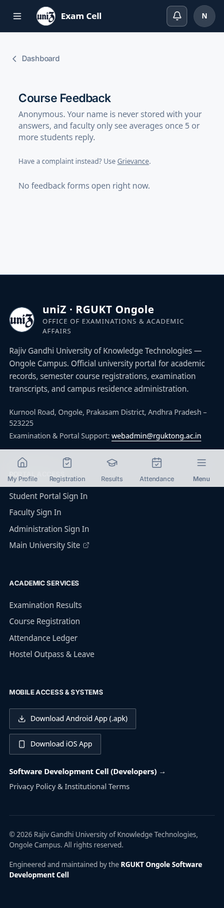
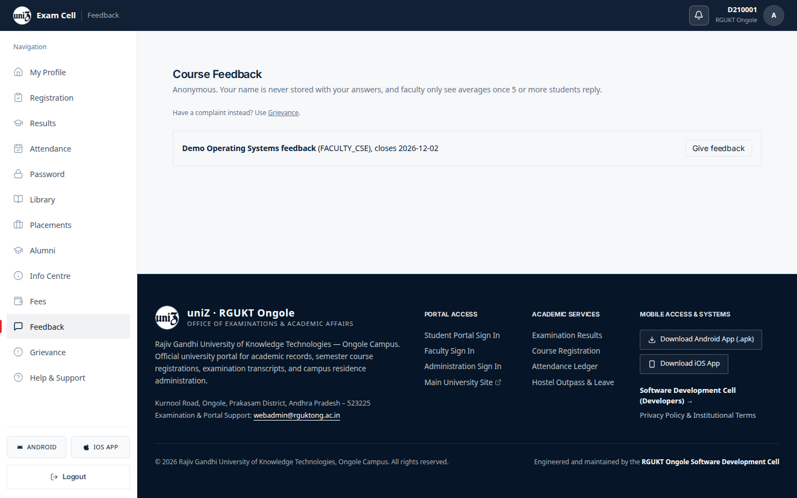
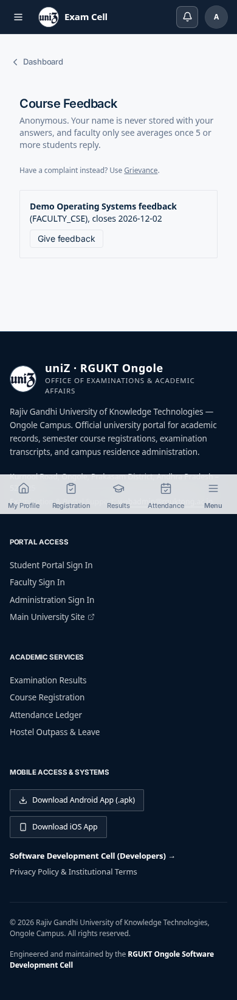
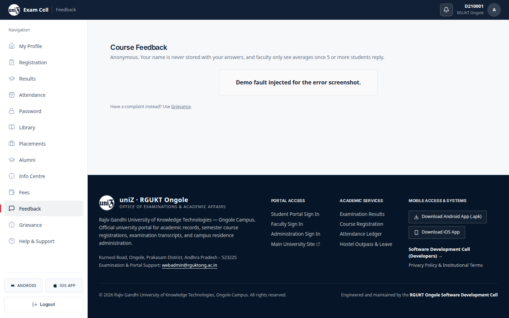
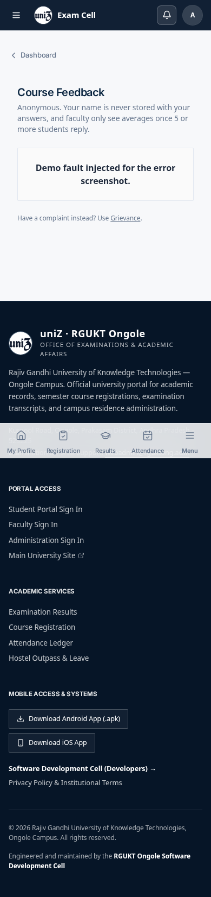
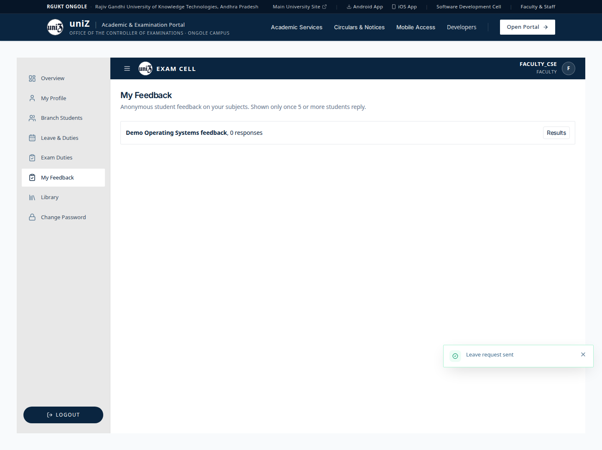
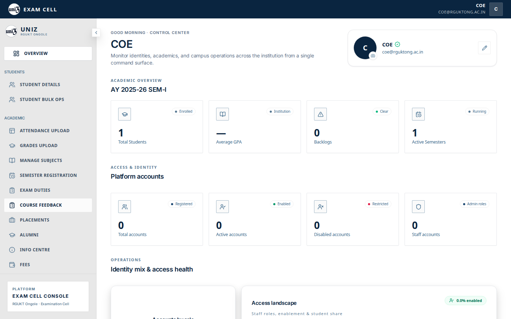
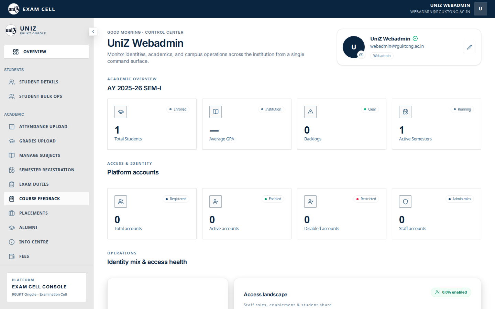
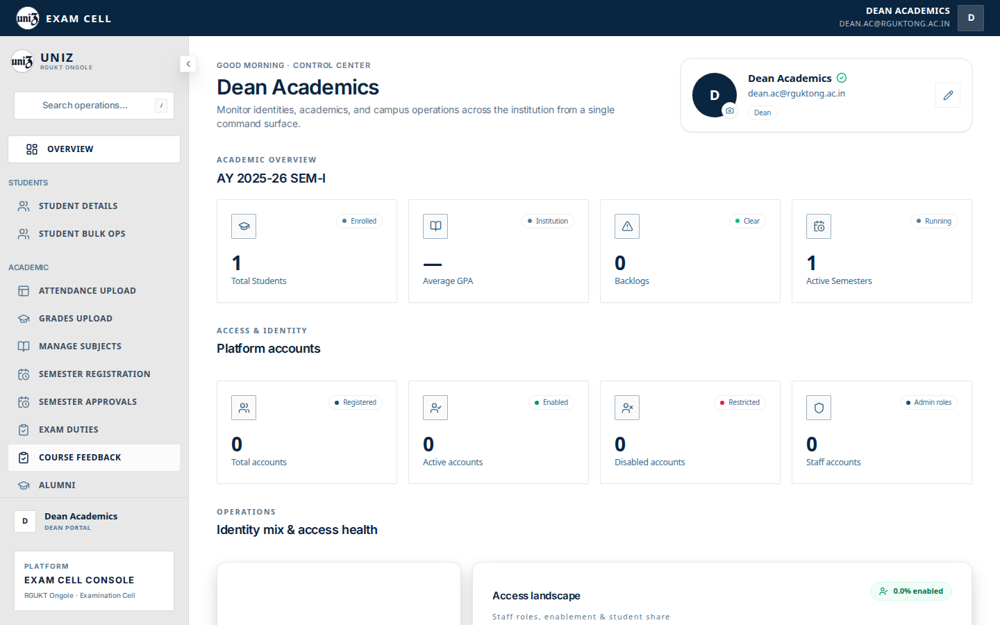

# Feedback

## Student

`/student/feedback` tells the student that answers are anonymous and that faculty see averages only after 5 or more replies. It links complaints to the grievance form.

The open form in this fixture is “Demo Operating Systems feedback” for `FACULTY_CSE`, closing 2026-12-02, with a Give feedback button. The API returns the question as an object (`id`, `text`, `scale`). The component renders each question with `{question}` as if it were a string. Opening Give feedback throws and the page goes blank. That is the behaviour this capture hit, so there is no successful submit screenshot.

## Faculty and admin

Faculty “My Feedback” is on `/faculty`. The admin shell lists Course Feedback for webadmin, CoE, and dean. That tab has no URL mapping, so the click returns to the overview.

## Captured screens

1. Desktop. `01 student empty desktop`.

2. Mobile. `01 student empty mobile`.

3. Desktop. `01 student populated desktop`.

4. Mobile. `01 student populated mobile`.

5. Desktop. `02 submit desktop`.

6. Desktop. `03 error desktop`.

7. Mobile. `03 error mobile`.

8. Desktop. `04 faculty results desktop`.

9. Desktop. Clicking this item does not open its panel. `adminSectionRoutes.ts` has no path for this tab, so `setActiveTab` navigates to `/admin` and the overview stays on screen. The row is under the pointer, which is why it looks pressed. File `09 course feedback coe desktop`.

10. Mobile. Clicking this item does not open its panel. `adminSectionRoutes.ts` has no path for this tab, so `setActiveTab` navigates to `/admin` and the overview stays on screen. The row is under the pointer, which is why it looks pressed. File `09 course feedback coe mobile`.

11. Desktop. Clicking this item does not open its panel. `adminSectionRoutes.ts` has no path for this tab, so `setActiveTab` navigates to `/admin` and the overview stays on screen. The row is under the pointer, which is why it looks pressed. File `09 course feedback webadmin desktop`.

12. Mobile. Clicking this item does not open its panel. `adminSectionRoutes.ts` has no path for this tab, so `setActiveTab` navigates to `/admin` and the overview stays on screen. The row is under the pointer, which is why it looks pressed. File `09 course feedback webadmin mobile`.

13. Desktop. Clicking this item does not open its panel. `adminSectionRoutes.ts` has no path for this tab, so `setActiveTab` navigates to `/admin` and the overview stays on screen. The row is under the pointer, which is why it looks pressed. File `10 course feedback dean desktop`.

14. Mobile. Clicking this item does not open its panel. `adminSectionRoutes.ts` has no path for this tab, so `setActiveTab` navigates to `/admin` and the overview stays on screen. The row is under the pointer, which is why it looks pressed. File `10 course feedback dean mobile`.

