# Fees

Online payment is coming soon. The student page says so in the description, under the balance, and on the pay button (`Payments coming soon`).

## Student

1. `D210001` has one invoice, “Demo tuition 2025-26”, Rs 25,000.00 due, status `due`, paid Rs 0.00. The pay control is a disabled-looking button labelled “Pay online (Payments coming soon)”.
2. `D210002` has balance Rs 0.00 and the line “No fee invoices yet.” The coming-soon line is still shown.
3. Pressing pay does not start a payment. The handler toasts the coming-soon message when the API returns `PAYMENTS_DISABLED`.

## Staff

The webadmin shell lists Fees. That tab id is not in `adminSectionRoutes.ts`, so the click returns to `/admin` and the fees admin panel does not open. The screenshots of that click show the overview. The fee admin component exists in the webadmin and dean switch statements; this capture could not reach it through the navigation.

## Captured screens

1. Desktop. `01 invoices empty desktop`.

2. Mobile. `01 invoices empty mobile`.

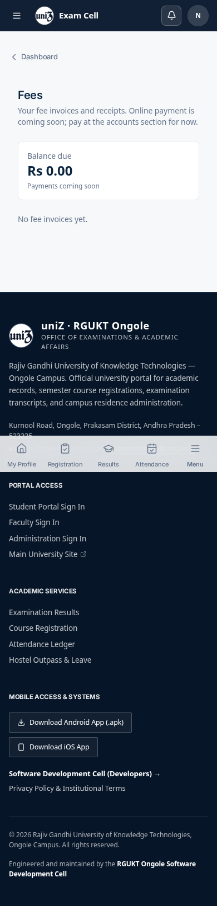

3. Desktop. `01 invoices populated desktop`.

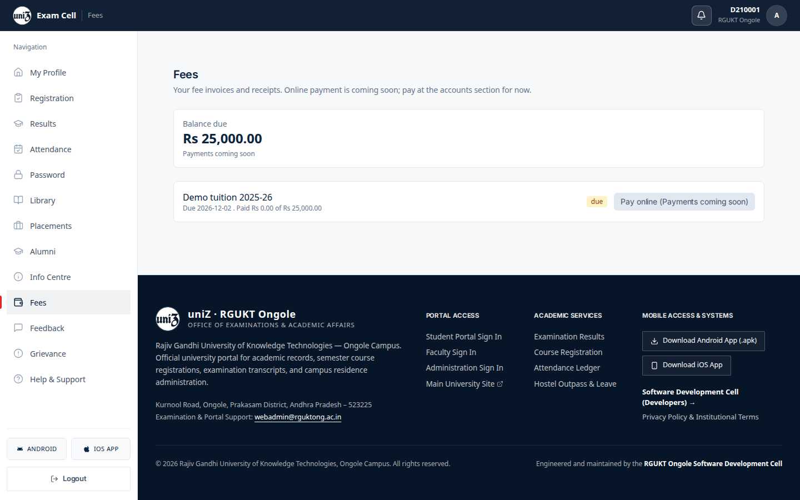

4. Mobile. `01 invoices populated mobile`.

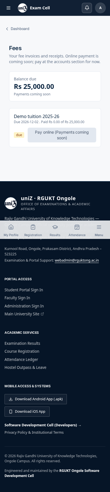

5. Desktop. `02 pay coming soon desktop`.

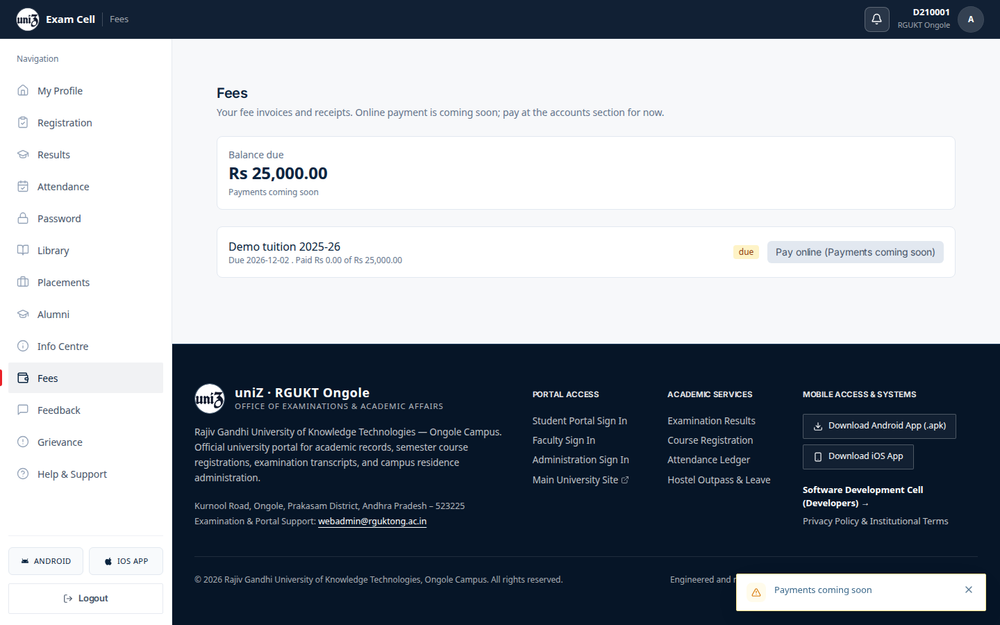

6. Desktop. `03 loading desktop`.

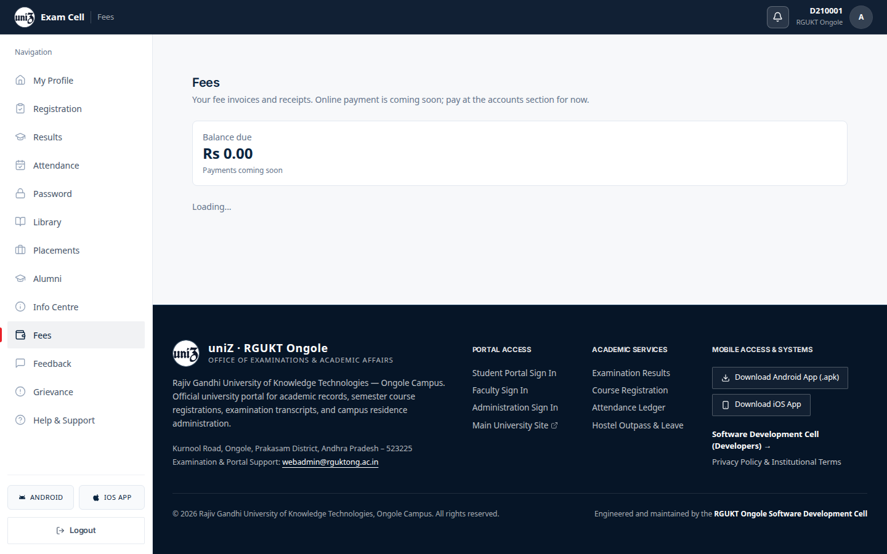

7. Mobile. `03 loading mobile`.

8. Desktop. `04 error desktop`.

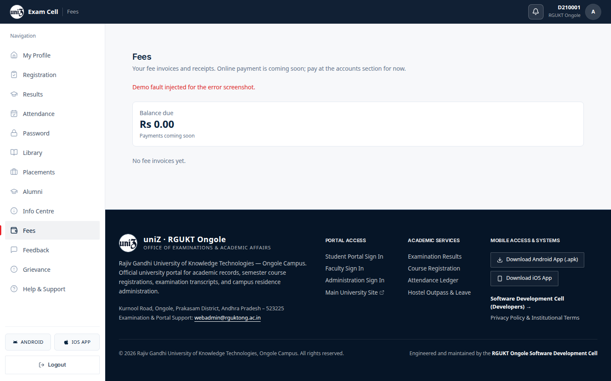

9. Mobile. `04 error mobile`.

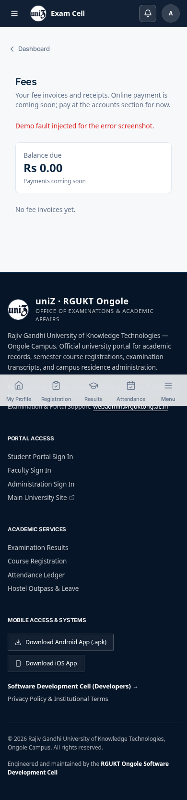

10. Desktop. Clicking this item does not open its panel. `adminSectionRoutes.ts` has no path for this tab, so `setActiveTab` navigates to `/admin` and the overview stays on screen. The row is under the pointer, which is why it looks pressed. File `13 fees coe desktop`.

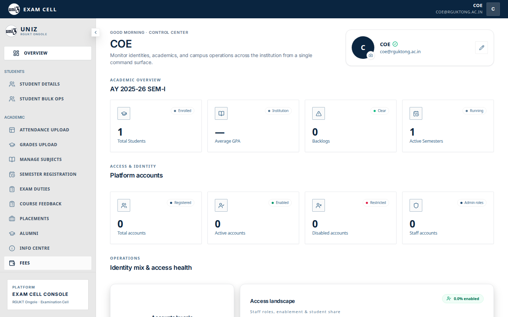

11. Mobile. Clicking this item does not open its panel. `adminSectionRoutes.ts` has no path for this tab, so `setActiveTab` navigates to `/admin` and the overview stays on screen. The row is under the pointer, which is why it looks pressed. File `13 fees coe mobile`.

12. Desktop. Clicking this item does not open its panel. `adminSectionRoutes.ts` has no path for this tab, so `setActiveTab` navigates to `/admin` and the overview stays on screen. The row is under the pointer, which is why it looks pressed. File `13 fees webadmin desktop`.

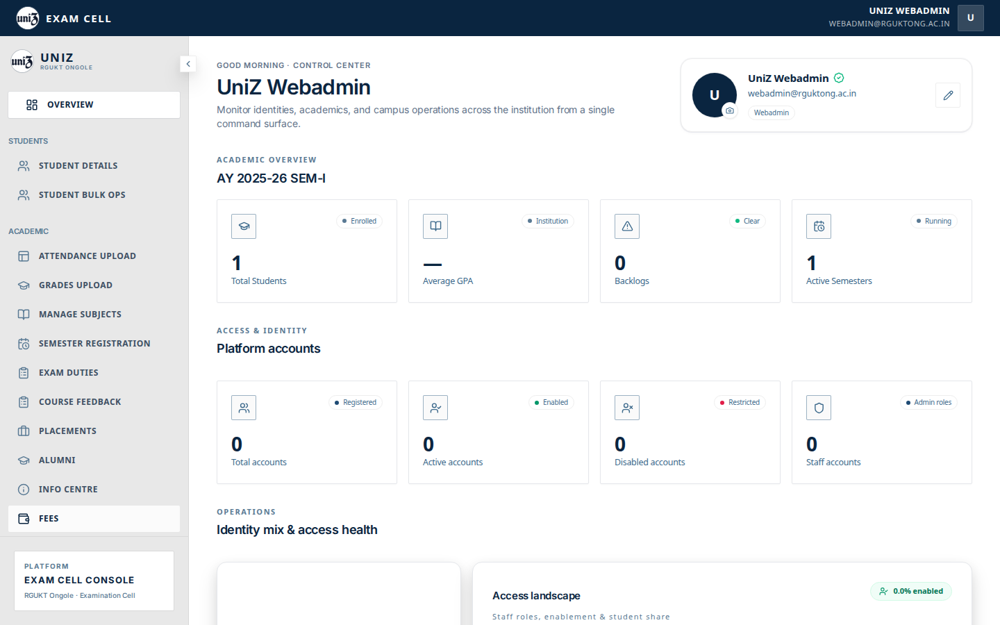

13. Mobile. Clicking this item does not open its panel. `adminSectionRoutes.ts` has no path for this tab, so `setActiveTab` navigates to `/admin` and the overview stays on screen. The row is under the pointer, which is why it looks pressed. File `13 fees webadmin mobile`.

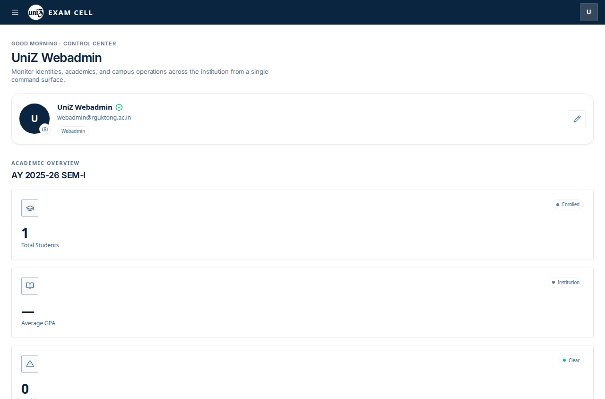

14. Desktop. Clicking this item does not open its panel. `adminSectionRoutes.ts` has no path for this tab, so `setActiveTab` navigates to `/admin` and the overview stays on screen. The row is under the pointer, which is why it looks pressed. File `14 fees dean desktop`.

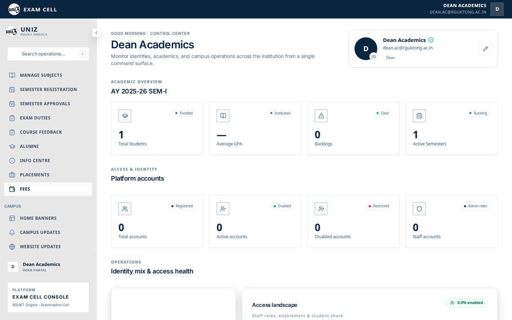

15. Mobile. Clicking this item does not open its panel. `adminSectionRoutes.ts` has no path for this tab, so `setActiveTab` navigates to `/admin` and the overview stays on screen. The row is under the pointer, which is why it looks pressed. File `14 fees dean mobile`.

