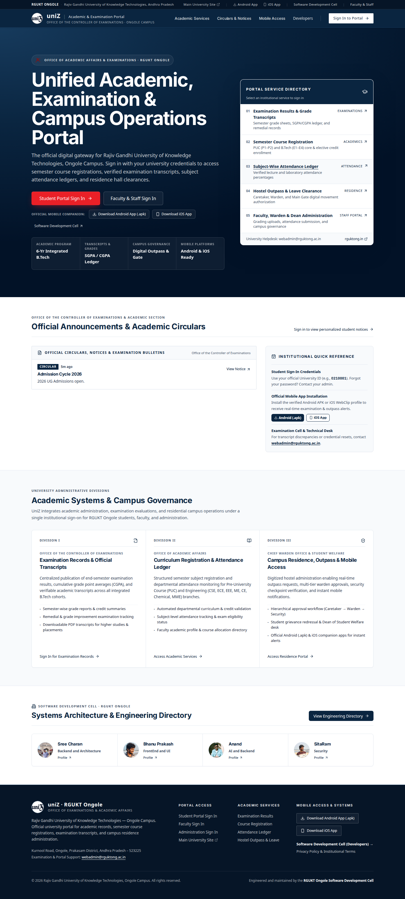
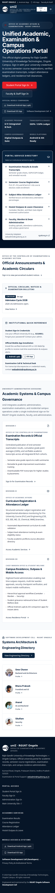
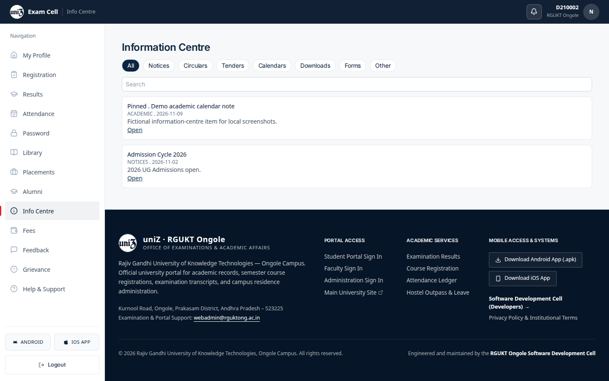
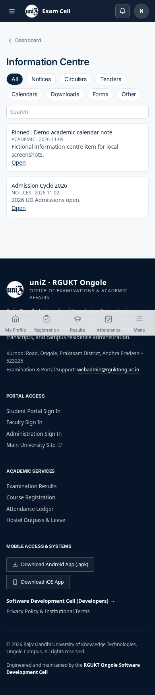
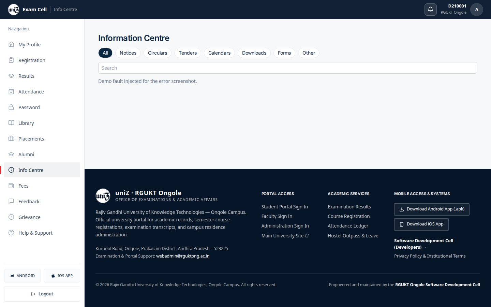
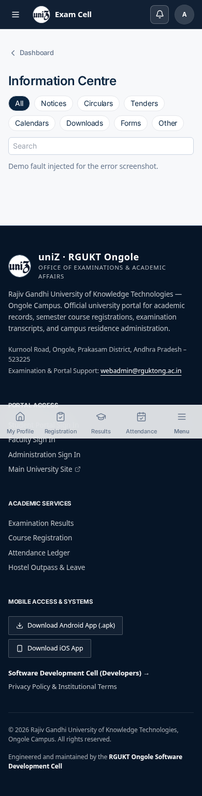
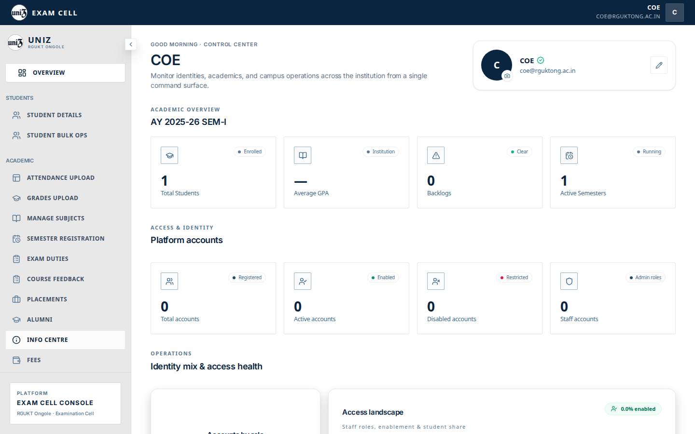
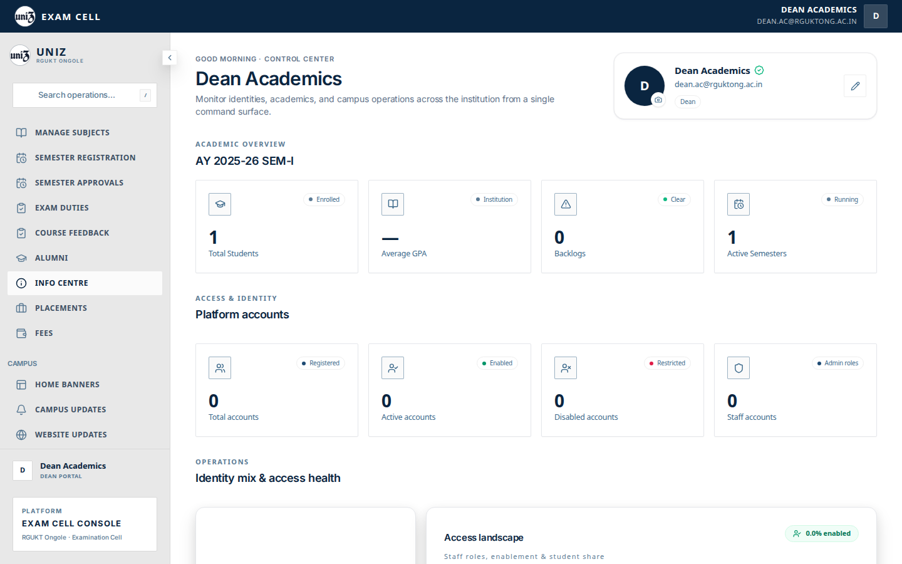
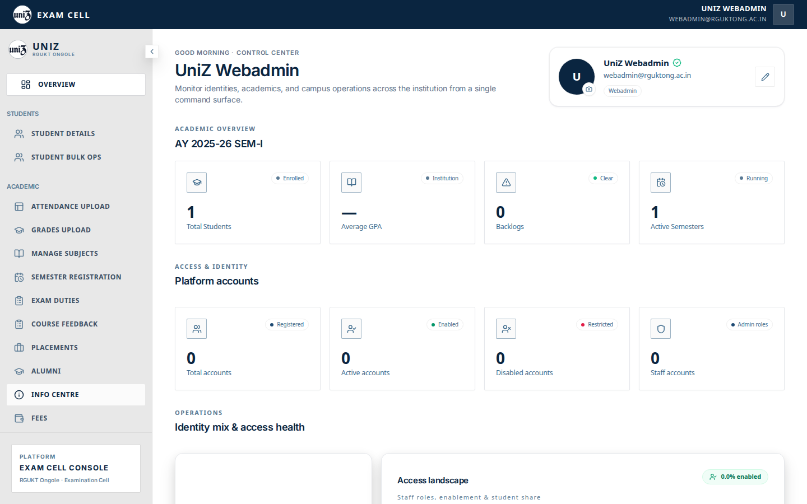

# Information centre

`/info` is public. `/student/info` is the signed-in centre.

The signed-in page has category chips (All, Notices, Circulars, Tenders, Calendars, Downloads, Forms, Other) and a search box.

In this capture the list contains:

- Pinned “Demo academic calendar note” (academic), with the fixture summary.
- “Admission Cycle 2026” (notices): “2026 UG Admissions open.” That row is the seeded public notification, not a separate admissions module.

The webadmin and dean shells list Info Centre. That tab has no URL mapping, so the click returns to the overview.

## Captured screens

1. Desktop. `01 public desktop`.

2. Mobile. `01 public mobile`.

3. Desktop. `02 student empty desktop`.

4. Mobile. `02 student empty mobile`.

5. Desktop. `02 student populated desktop`.

6. Mobile. `02 student populated mobile`.

7. Desktop. `03 error desktop`.

8. Mobile. `03 error mobile`.

9. Desktop. Clicking this item does not open its panel. `adminSectionRoutes.ts` has no path for this tab, so `setActiveTab` navigates to `/admin` and the overview stays on screen. The row is under the pointer, which is why it looks pressed. File `12 info centre coe desktop`.

10. Mobile. Clicking this item does not open its panel. `adminSectionRoutes.ts` has no path for this tab, so `setActiveTab` navigates to `/admin` and the overview stays on screen. The row is under the pointer, which is why it looks pressed. File `12 info centre coe mobile`.

11. Desktop. Clicking this item does not open its panel. `adminSectionRoutes.ts` has no path for this tab, so `setActiveTab` navigates to `/admin` and the overview stays on screen. The row is under the pointer, which is why it looks pressed. File `12 info centre dean desktop`.

12. Mobile. Clicking this item does not open its panel. `adminSectionRoutes.ts` has no path for this tab, so `setActiveTab` navigates to `/admin` and the overview stays on screen. The row is under the pointer, which is why it looks pressed. File `12 info centre dean mobile`.

13. Desktop. Clicking this item does not open its panel. `adminSectionRoutes.ts` has no path for this tab, so `setActiveTab` navigates to `/admin` and the overview stays on screen. The row is under the pointer, which is why it looks pressed. File `12 info centre webadmin desktop`.

14. Mobile. Clicking this item does not open its panel. `adminSectionRoutes.ts` has no path for this tab, so `setActiveTab` navigates to `/admin` and the overview stays on screen. The row is under the pointer, which is why it looks pressed. File `12 info centre webadmin mobile`.

