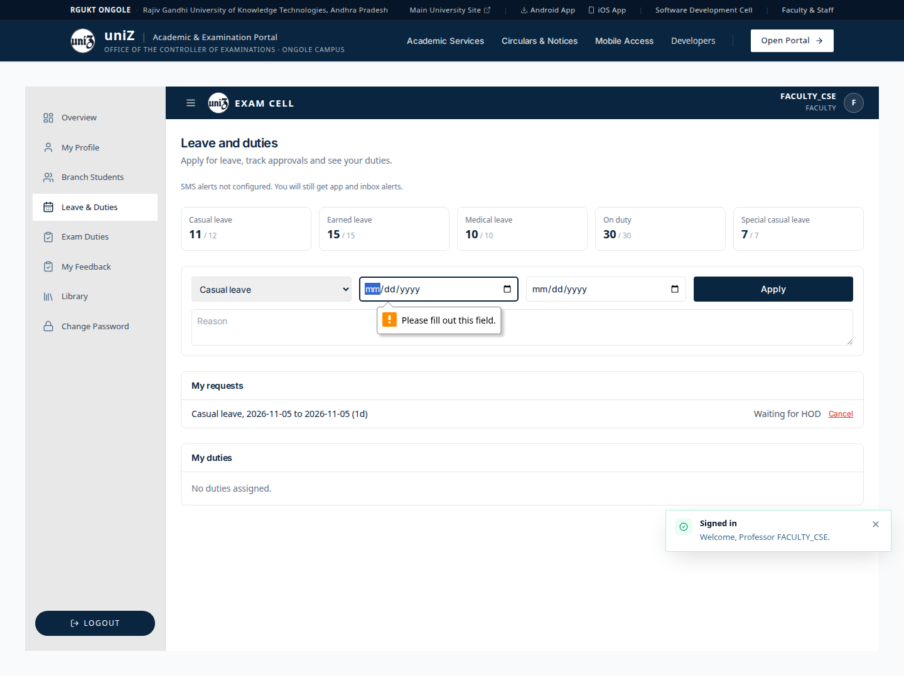
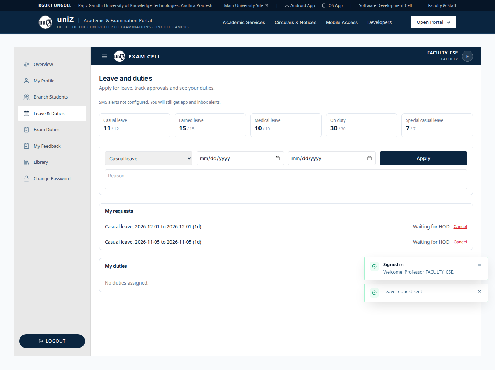
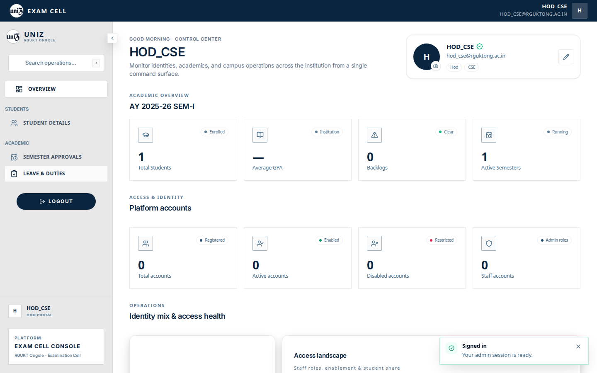
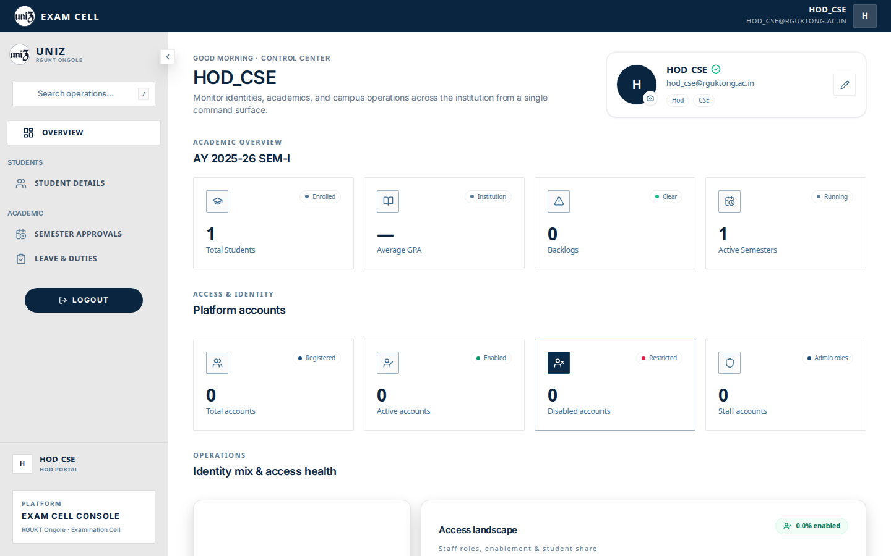
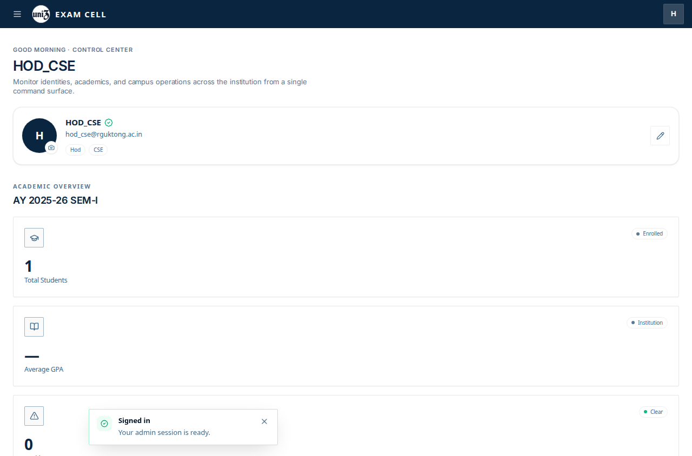
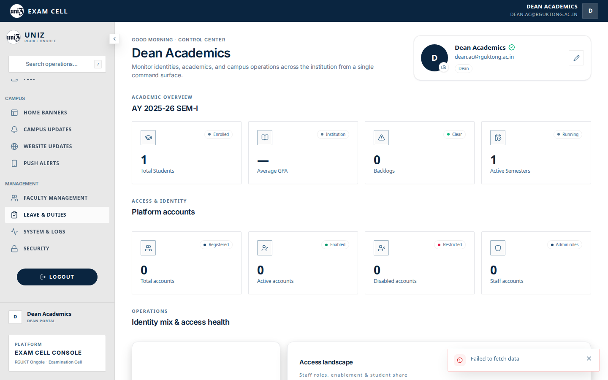
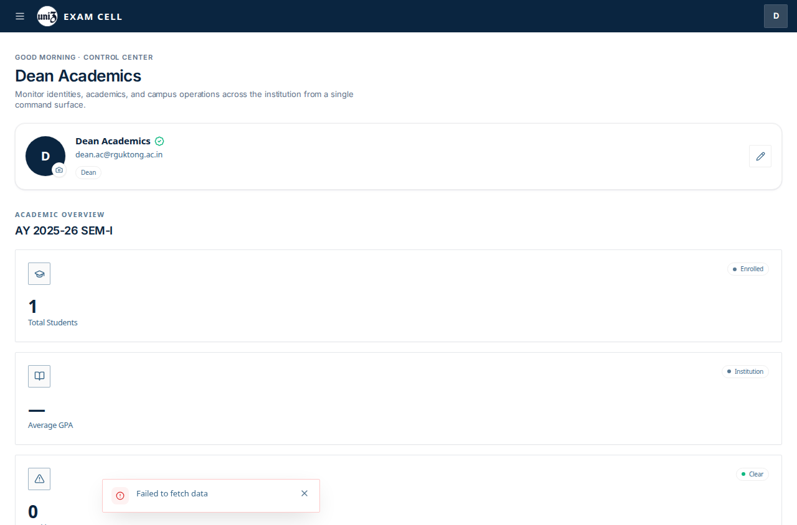

# Leave

Faculty leave is separate from hostel outpass. Outpass stays parked. See [Outpass](outpass.md).

## Faculty

`FACULTY_CSE` opens Leave & Duties on `/faculty`.

1. The page shows balances. In this capture: casual leave 11/12, earned leave 15/15, medical leave 10/10, on duty 30/30, special casual leave 7/7.
2. SMS is not configured. The page says app and inbox alerts still apply.
3. Apply with empty dates is blocked by the required fields.
4. A one-day casual leave for 2026-12-01 with the reason “Fictional personal errand.” toasts “Leave request sent” and appears as “Waiting for HOD”. The earlier fixture request for 2026-11-05 is also waiting for HOD.
5. “My duties” on this page says “No duties assigned.” Exam invigilation is a different screen. See [Exam duties](exam-duties.md).

## HOD and dean

The admin shells list Leave & Duties for `hod_cse` and the dean. That tab id (`leave_review`) has no URL in `adminSectionRoutes.ts`. Choosing it navigates to `/admin`, which resolves back to the overview. The approval queue component is in the dean and HOD switch, and it is not what these clicks display.

## Captured screens

1. Desktop. `01 faculty list desktop`.

2. Desktop. `02 apply validation desktop`.

3. Desktop. `03 apply result desktop`.

4. Desktop. After a real click on Leave & Duties for `hod_cse`, the URL stays `/admin` and the overview remains. The row looks selected because the pointer is still on it. The approval list does not render.

5. Desktop. Clicking this item does not open its panel. `adminSectionRoutes.ts` has no path for this tab, so `setActiveTab` navigates to `/admin` and the overview stays on screen. The row is under the pointer, which is why it looks pressed. File `04 leave duties hod_cse desktop`.

6. Mobile. Clicking this item does not open its panel. `adminSectionRoutes.ts` has no path for this tab, so `setActiveTab` navigates to `/admin` and the overview stays on screen. The row is under the pointer, which is why it looks pressed. File `04 leave duties hod_cse mobile`.

7. Desktop. Clicking this item does not open its panel. `adminSectionRoutes.ts` has no path for this tab, so `setActiveTab` navigates to `/admin` and the overview stays on screen. The row is under the pointer, which is why it looks pressed. File `20 leave duties dean desktop`.

8. Mobile. Clicking this item does not open its panel. `adminSectionRoutes.ts` has no path for this tab, so `setActiveTab` navigates to `/admin` and the overview stays on screen. The row is under the pointer, which is why it looks pressed. File `20 leave duties dean mobile`.

