# Library

Fines are Rs 1 a day. Paying a fine online is coming soon; the desk copy says to collect at the counter and mark paid.

## Student

`/student/library` for `D210001` shows the loan of Demo Algorithms, barcode DEMO-BC-001, issued to that student. `D210002` has no loan.

## Librarian

The `librarian` role does not use the webadmin shell. `/admin` renders Library Desk: issue by copy barcode and borrower id, return by barcode, add a book, CSV import, search, the on-loan list, and unpaid fines. In this capture the on-loan row is D210001, issued 2026-10-30, due 2026-11-13, and unpaid fines say “None.”

## Webadmin shell

The Library item in the webadmin shell has no URL mapping, so the click returns to the overview. Use the librarian account for the desk.

Faculty also has a Library tab on `/faculty`. This demo faculty has no loan.

## Captured screens

1. Desktop. `00 home librarian desktop`.

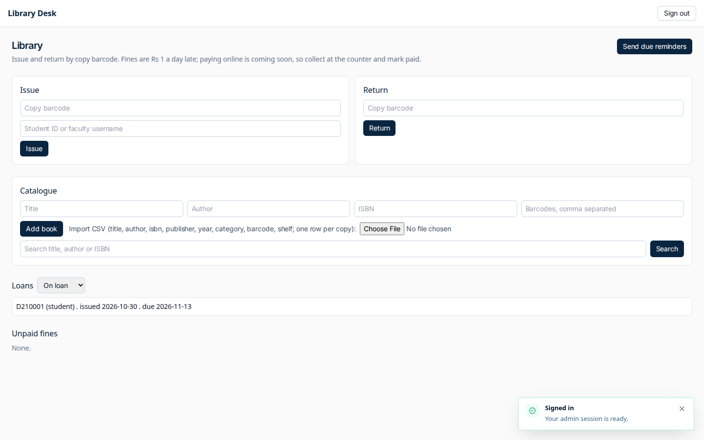

2. Mobile. `00 home librarian mobile`.

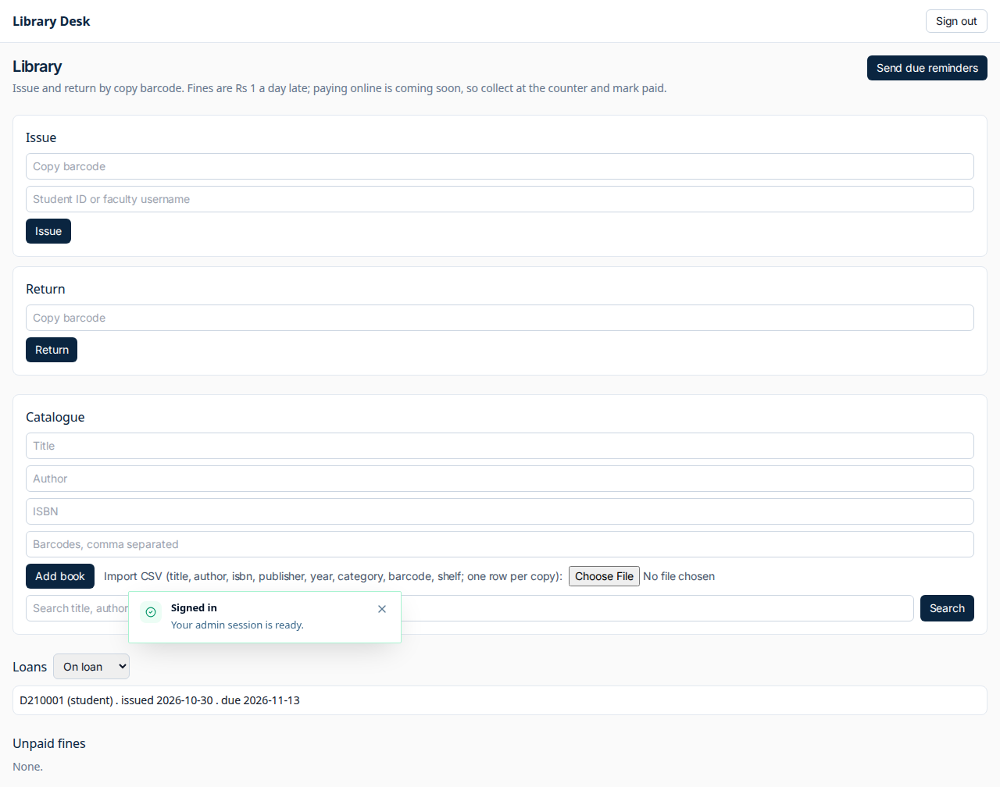

3. Desktop. `01 my library empty desktop`.

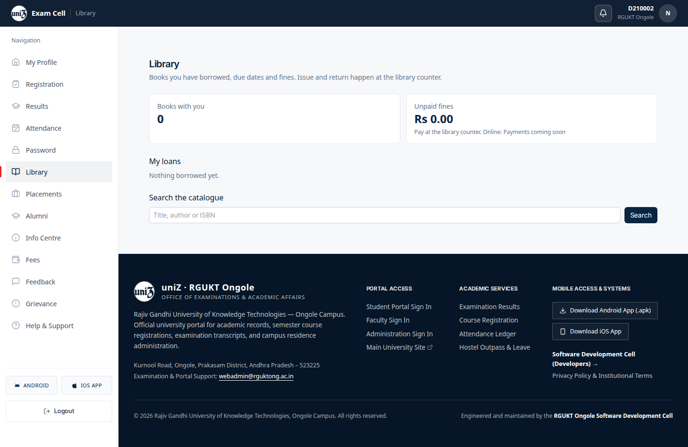

4. Mobile. `01 my library empty mobile`.

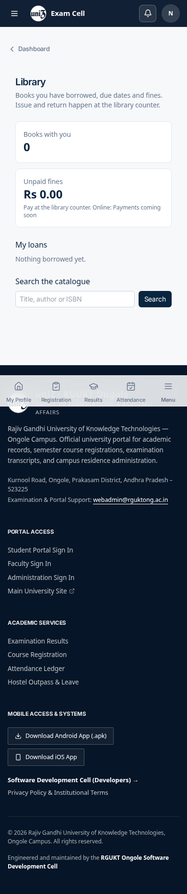

5. Desktop. `01 my library populated desktop`.

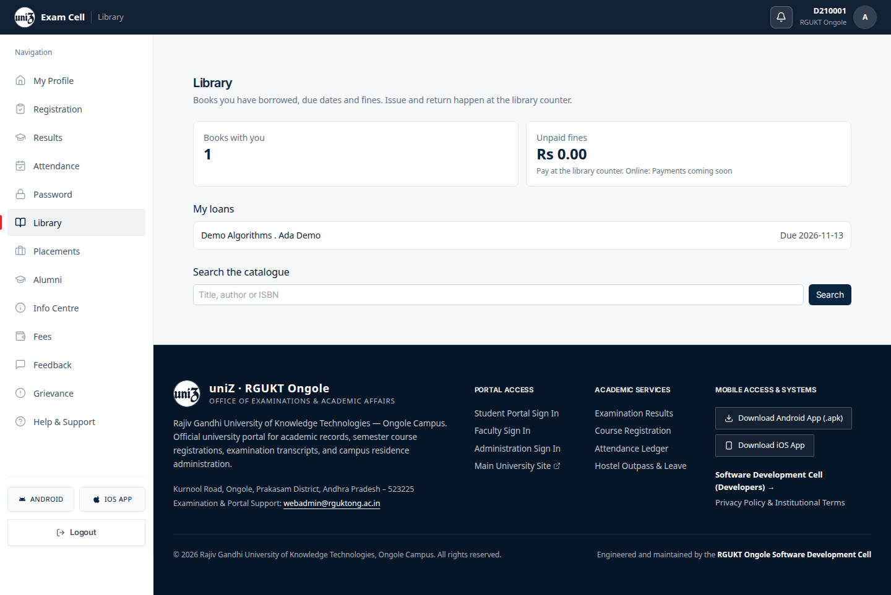

6. Mobile. `01 my library populated mobile`.

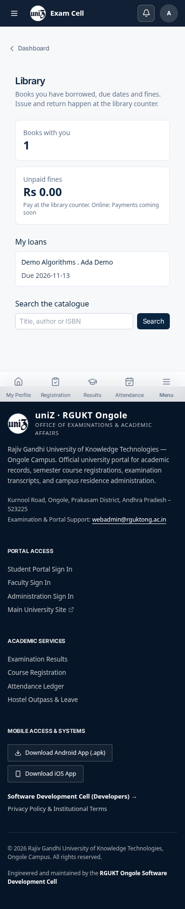

7. Desktop. `02 loading desktop`.

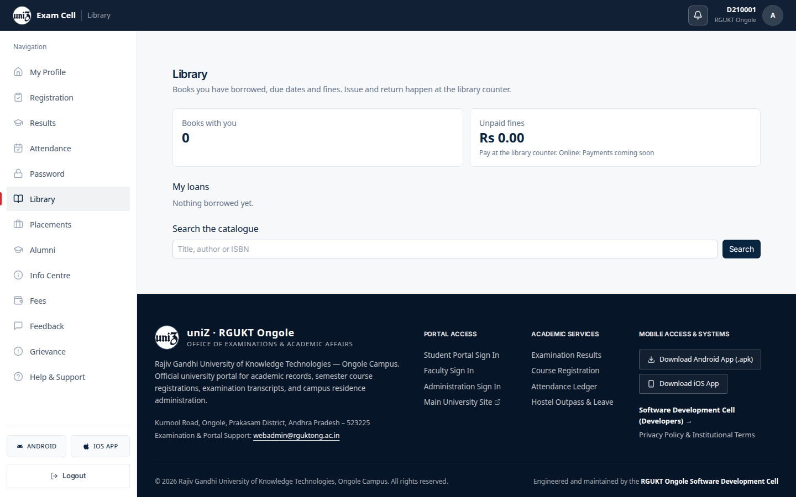

8. Mobile. `02 loading mobile`.

9. Desktop. `03 error desktop`.

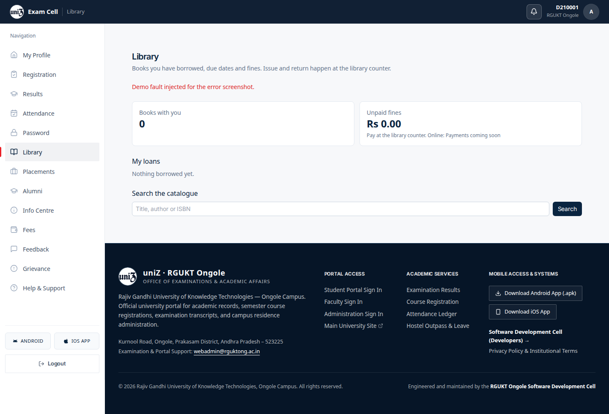

10. Mobile. `03 error mobile`.

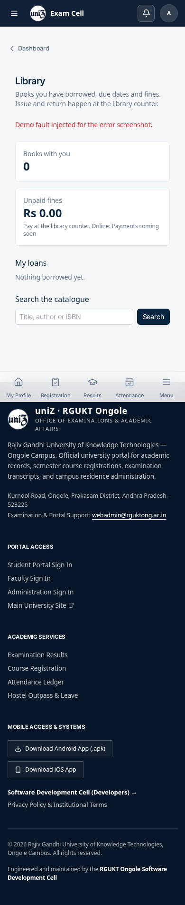

11. Desktop. `04 faculty desktop`.

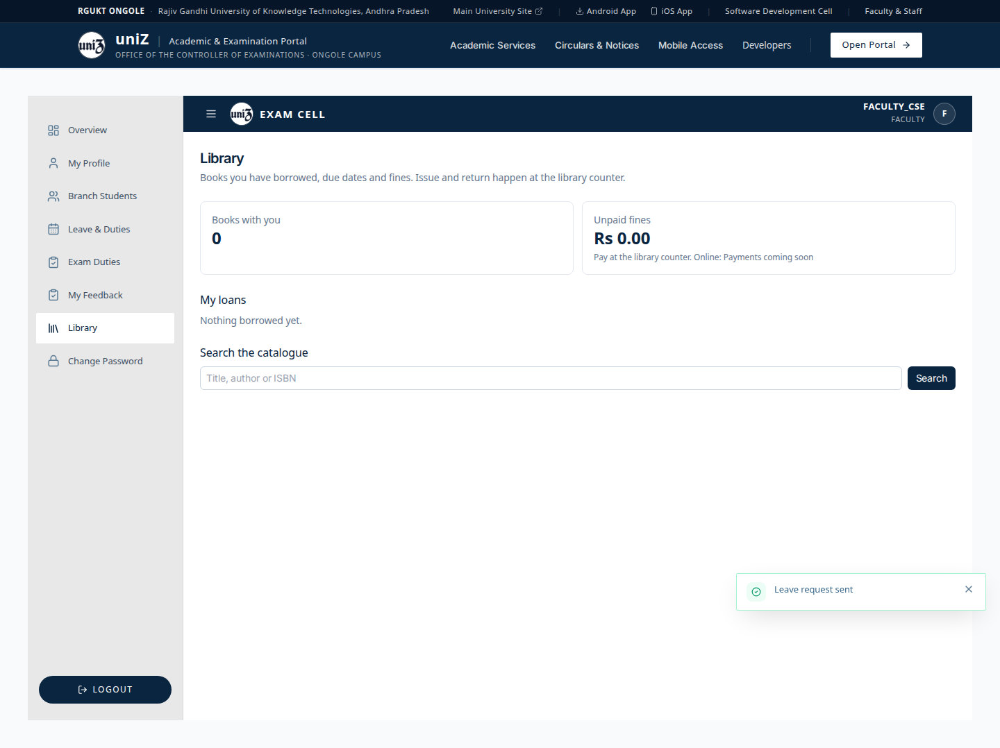

12. Desktop. Clicking this item does not open its panel. `adminSectionRoutes.ts` has no path for this tab, so `setActiveTab` navigates to `/admin` and the overview stays on screen. The row is under the pointer, which is why it looks pressed. File `14 library coe desktop`.

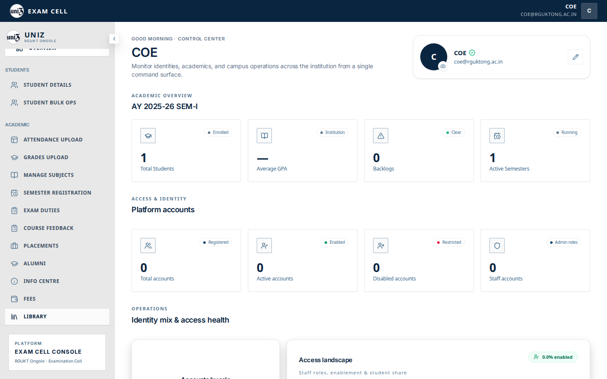

13. Mobile. Clicking this item does not open its panel. `adminSectionRoutes.ts` has no path for this tab, so `setActiveTab` navigates to `/admin` and the overview stays on screen. The row is under the pointer, which is why it looks pressed. File `14 library coe mobile`.

14. Desktop. Clicking this item does not open its panel. `adminSectionRoutes.ts` has no path for this tab, so `setActiveTab` navigates to `/admin` and the overview stays on screen. The row is under the pointer, which is why it looks pressed. File `14 library webadmin desktop`.

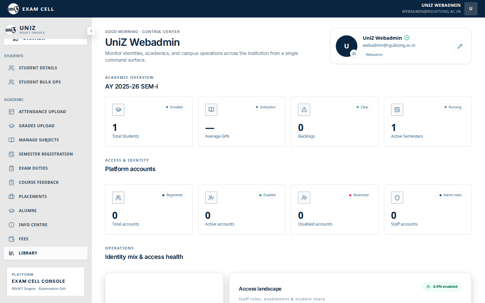

15. Mobile. Clicking this item does not open its panel. `adminSectionRoutes.ts` has no path for this tab, so `setActiveTab` navigates to `/admin` and the overview stays on screen. The row is under the pointer, which is why it looks pressed. File `14 library webadmin mobile`.

