# Notifications

Two different surfaces use this name.

## Student inbox

`/student/notifications` is the inbox: Mark all read, Clear read, Clear all. In this capture, signed in as `D210001`, the inbox body is “All caught up / New alerts will appear here.” A row had been inserted into `NotificationInbox` for that username; it did not appear in the UI during the capture, so the screenshot is the empty inbox.

`/notifications` without a session is the deep-link route.

The student profile notice board is separate. It shows the CMS item “Admission Cycle 2026”.

## Admin

Webadmin campus items that do open, because they have URLs:

- Home Banners (`/admin/campus/banners`)
- Campus Updates (`/admin/campus/updates`)
- Website Updates (`/admin/campus/website`)
- Push Alerts (`/admin/campus/push-alerts`)

`/admin/notifications` is the legacy admin notifications route.

## Public landing

The college site has News & Updates, Tenders, and Careers. With the landing API stopped, each of those pages shows an empty state. See [Landing site](landing.md).

## Captured screens

1. Desktop. `01 deeplink desktop`.

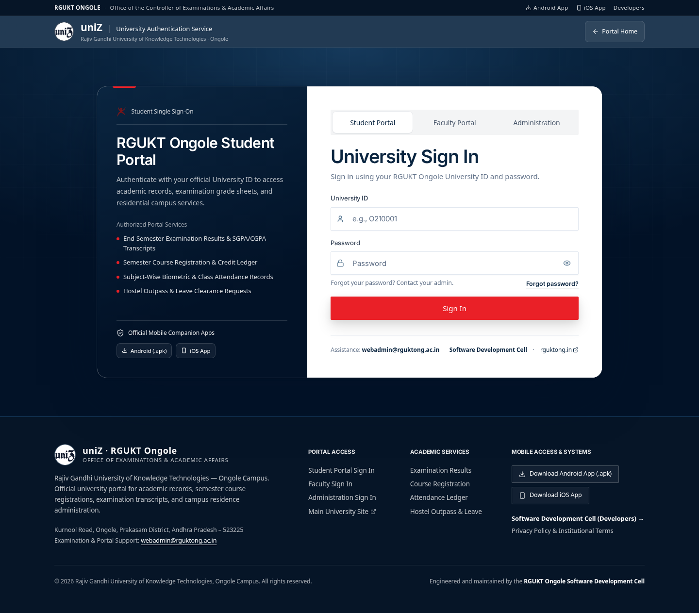

2. Mobile. `01 deeplink mobile`.

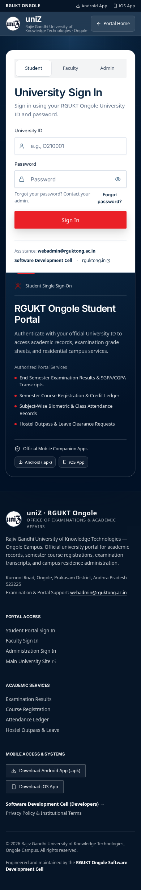

3. Desktop. `02 inbox empty desktop`.

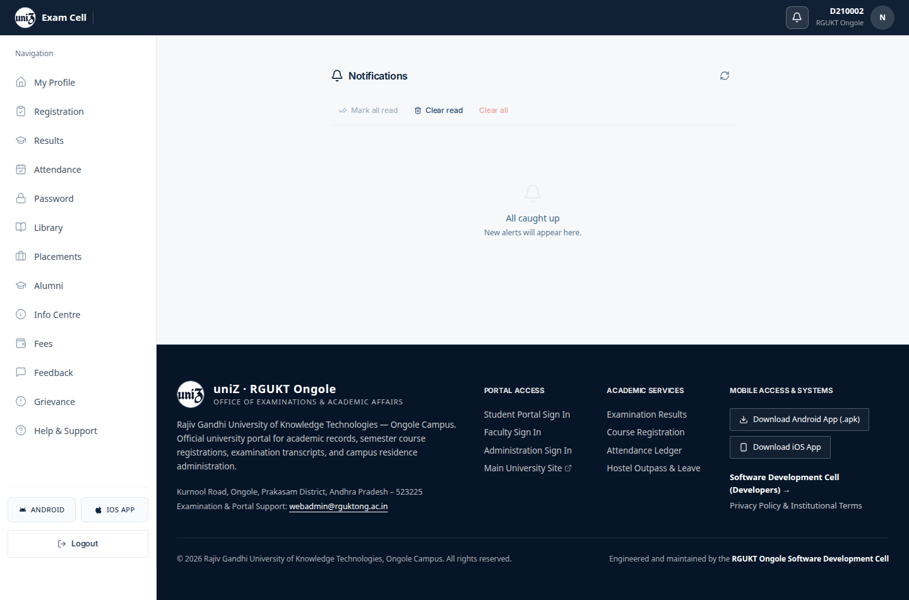

4. Mobile. `02 inbox empty mobile`.

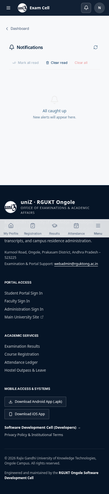

5. Desktop. `02 inbox populated desktop`.

6. Mobile. `02 inbox populated mobile`.

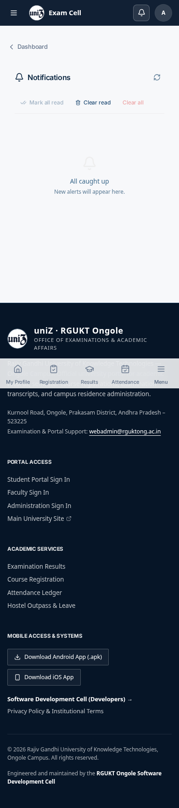

7. Desktop. `03 error desktop`.

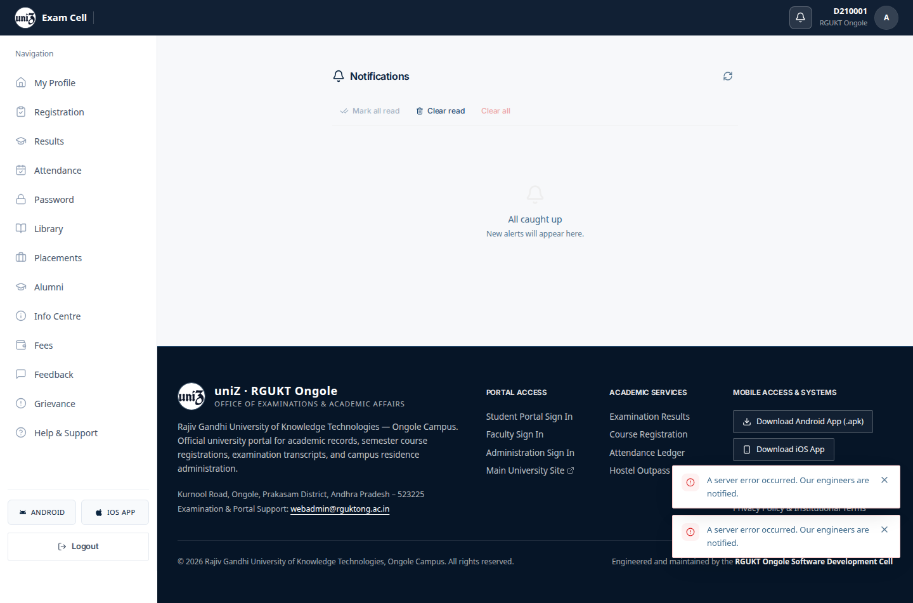

8. Mobile. `03 error mobile`.

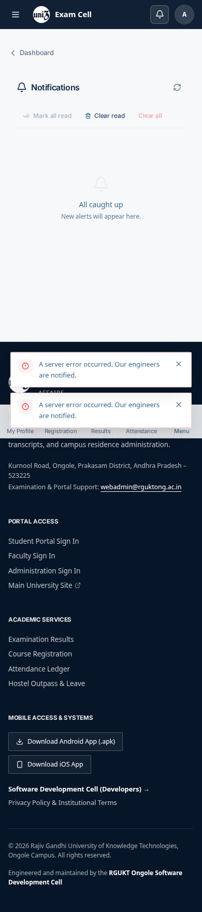

9. Desktop. `04 admin page desktop`.

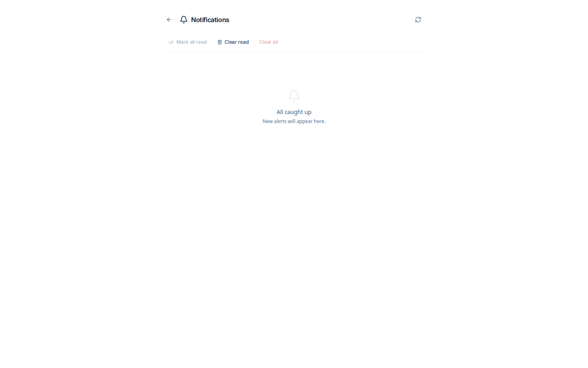

10. Desktop. `09 campus updates director desktop`.

11. Mobile. `09 campus updates director mobile`.

12. Desktop. `11 push alerts director desktop`.

13. Mobile. `11 push alerts director mobile`.

14. Desktop. `16 campus updates coe desktop`.

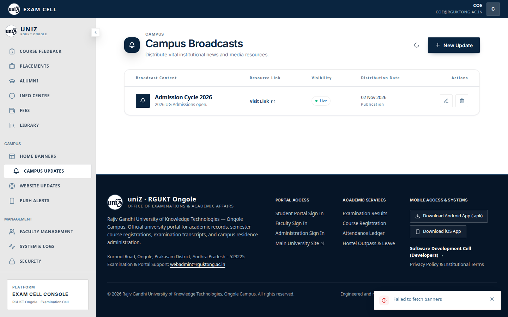

15. Mobile. `16 campus updates coe mobile`.

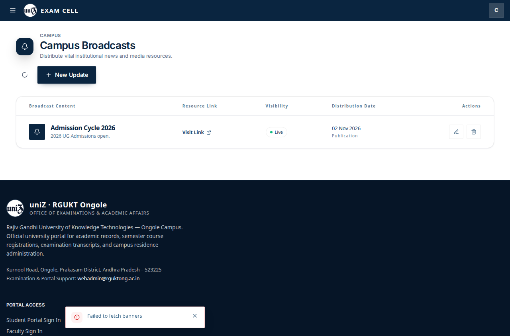

16. Desktop. `16 campus updates dean desktop`.

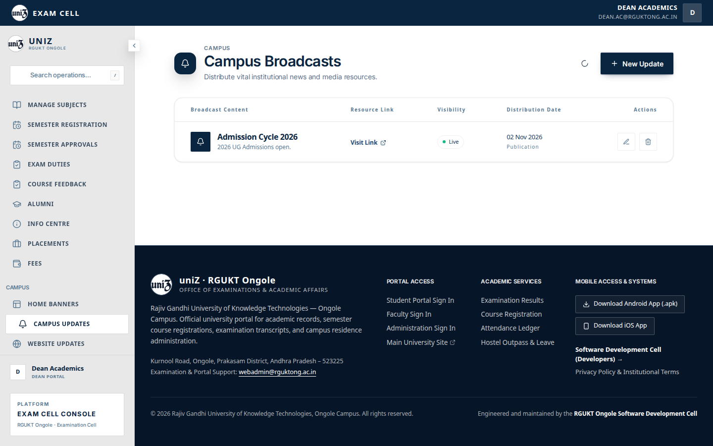

17. Mobile. `16 campus updates dean mobile`.

18. Desktop. `16 campus updates webadmin desktop`.

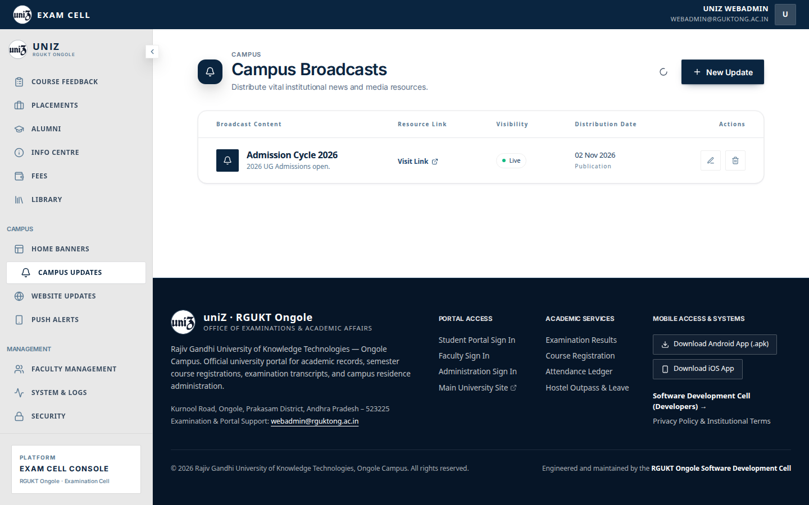

19. Mobile. `16 campus updates webadmin mobile`.

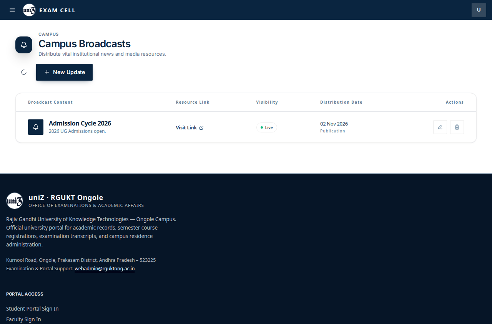

20. Desktop. `18 push alerts coe desktop`.

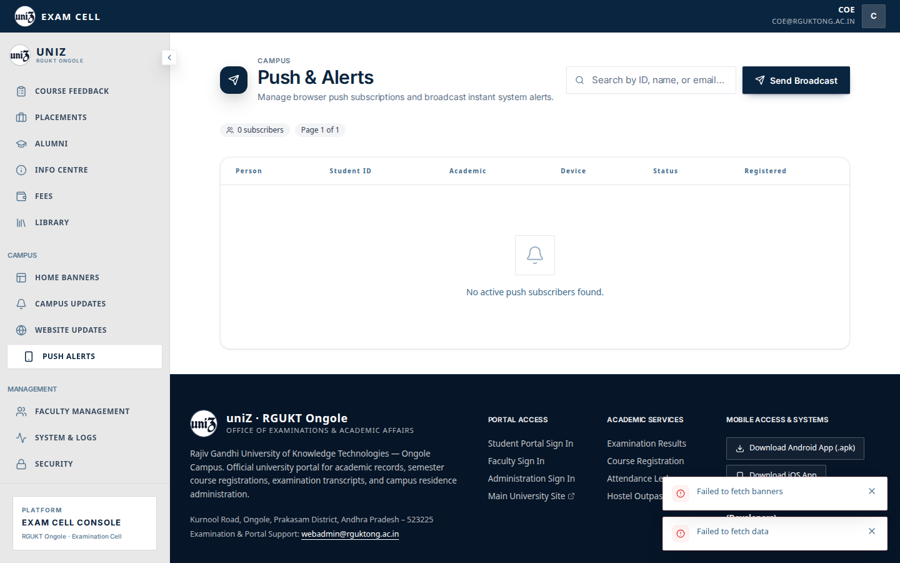

21. Mobile. `18 push alerts coe mobile`.

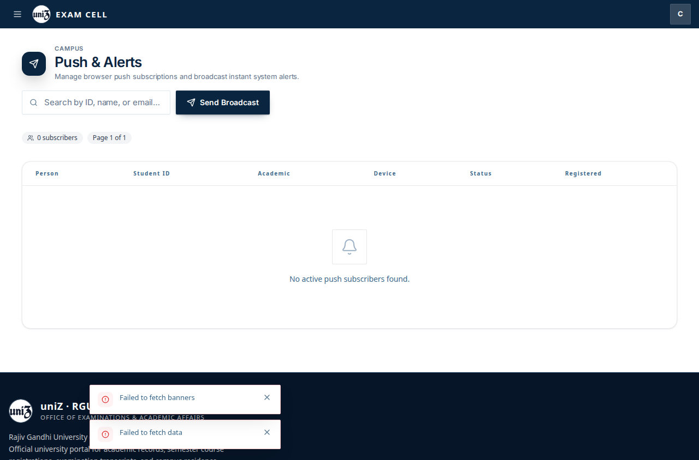

22. Desktop. `18 push alerts dean desktop`.

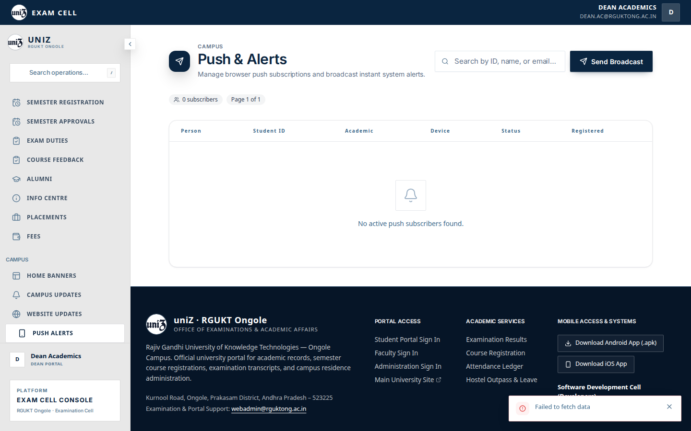

23. Mobile. `18 push alerts dean mobile`.

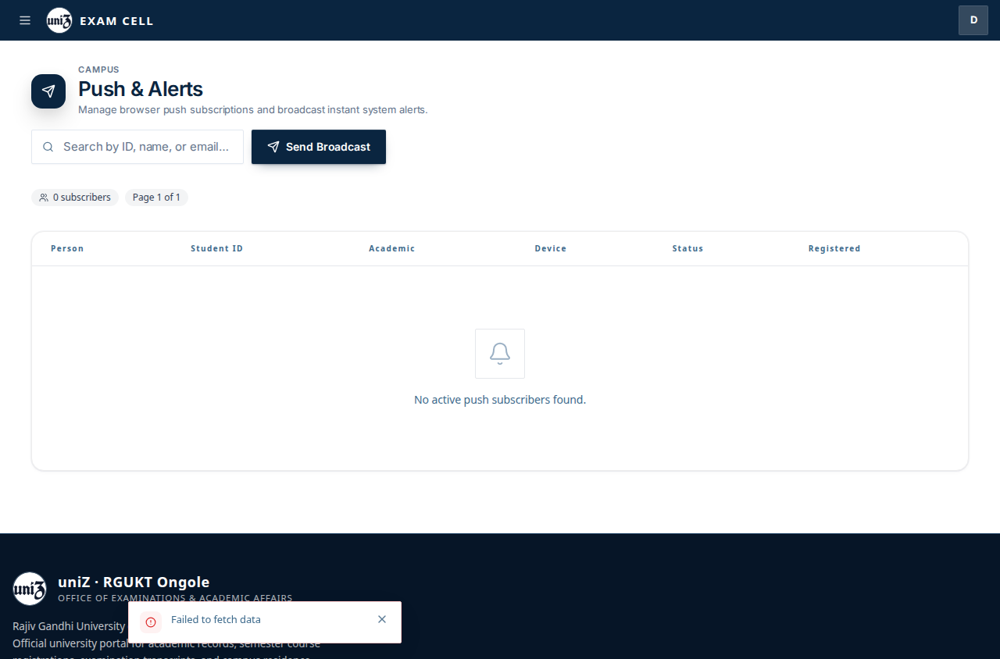

24. Desktop. `18 push alerts webadmin desktop`.

25. Mobile. `18 push alerts webadmin mobile`.

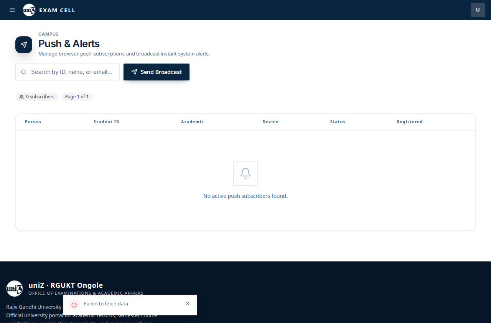
