# Outpass and outing

Parked. This capture did not enable them.

`enableOutingsAndOutpasses` in `apps/uniz-portal/src/config/featureFlags.ts` is false because `OUTPASS_OUTING_ROUTES_MOUNTED` is false. `VITE_ENABLE_OUTPASS_OUTING` cannot turn the UI on while the routes stay commented out in `App.tsx`. `FEATURE_OUTPASS` in `@uniz/shared` is in the parked set and stays false even if the environment variable is `true`.

## What a signed-in user sees

- The student sidebar has no Outing and no Outpass item.
- `/student/outpass` and `/student/outing` render the portal 404.
- `/admin/approveoutpass` and `/admin/approveouting` render the 404. Those routes are commented out.
- Warden and caretaker shells (boys and girls) show Overview only. The approval groups are omitted by `filterOutpassOutingTabs`.
- The security terminal toasts “Outpass and outing are currently disabled by administration.”
- The public portal home and the sign-in marketing copy still mention hostel outpass. That copy is not a working route.

The outpass service was not started for this capture.

## Captured screens

1. Desktop. `00 home caretaker_female desktop`.

2. Mobile. `00 home caretaker_female mobile`.

3. Desktop. `00 home caretaker_male desktop`.

4. Mobile. `00 home caretaker_male mobile`.

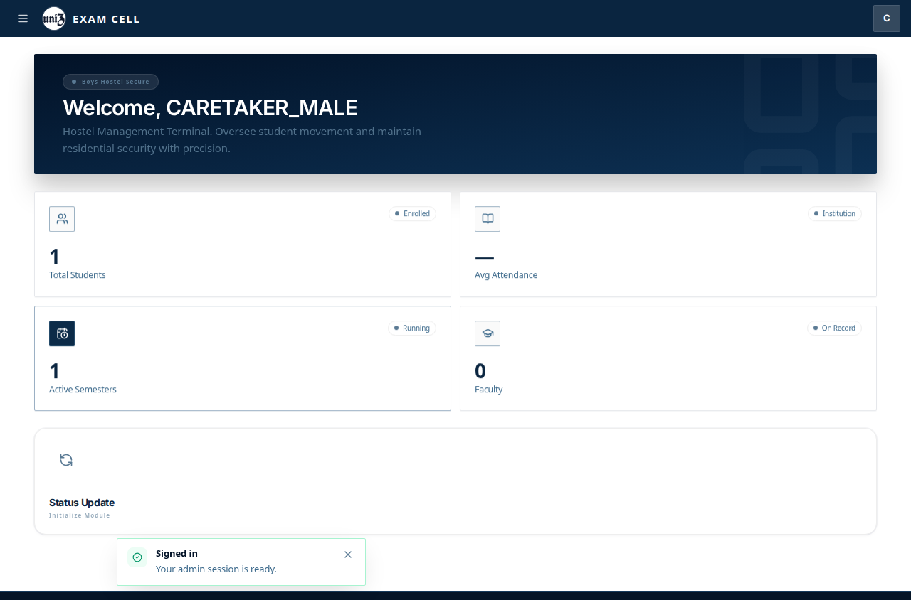

5. Desktop. `00 home warden_female desktop`.

6. Mobile. `00 home warden_female mobile`.

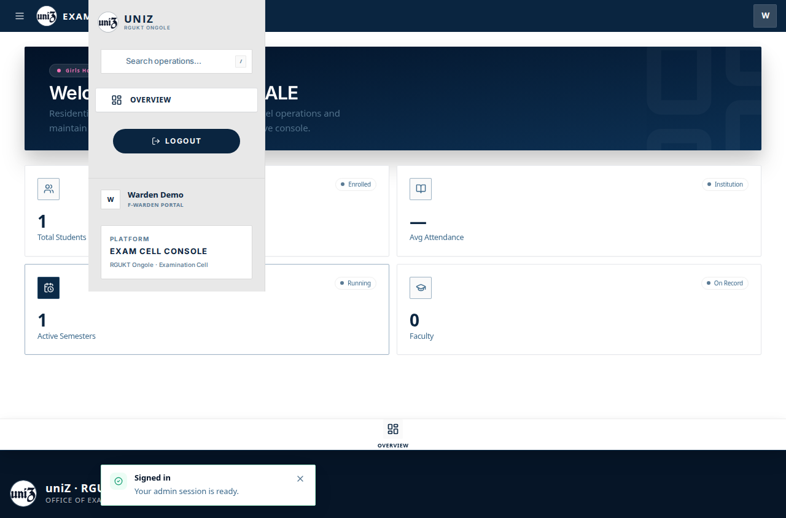

7. Desktop. `00 home warden_male desktop`.

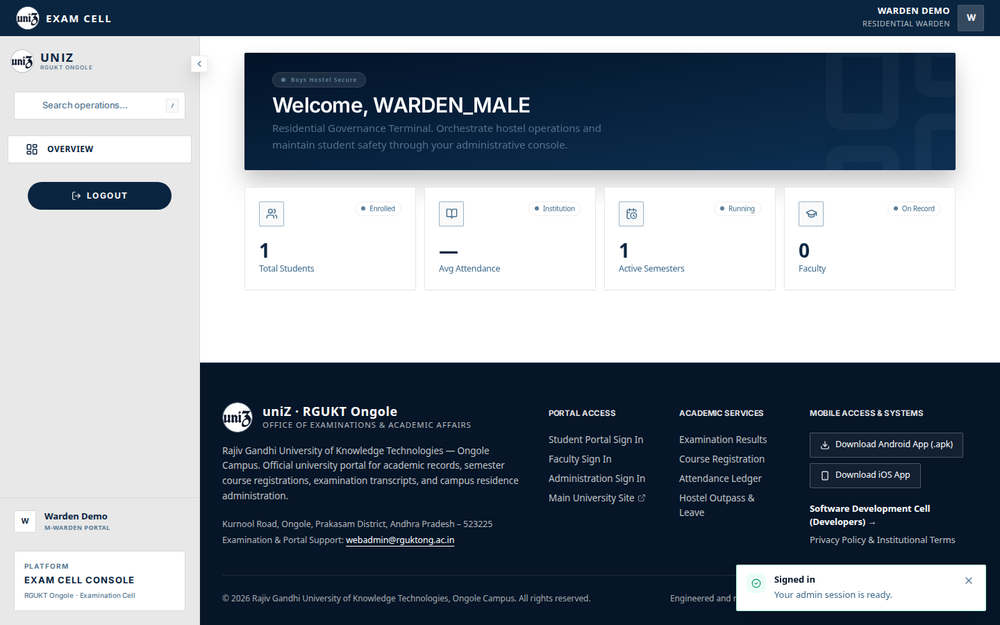

8. Mobile. `00 home warden_male mobile`.

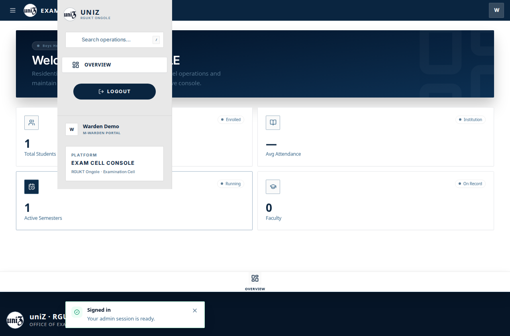

9. Desktop. `01 overview caretaker_female desktop`.

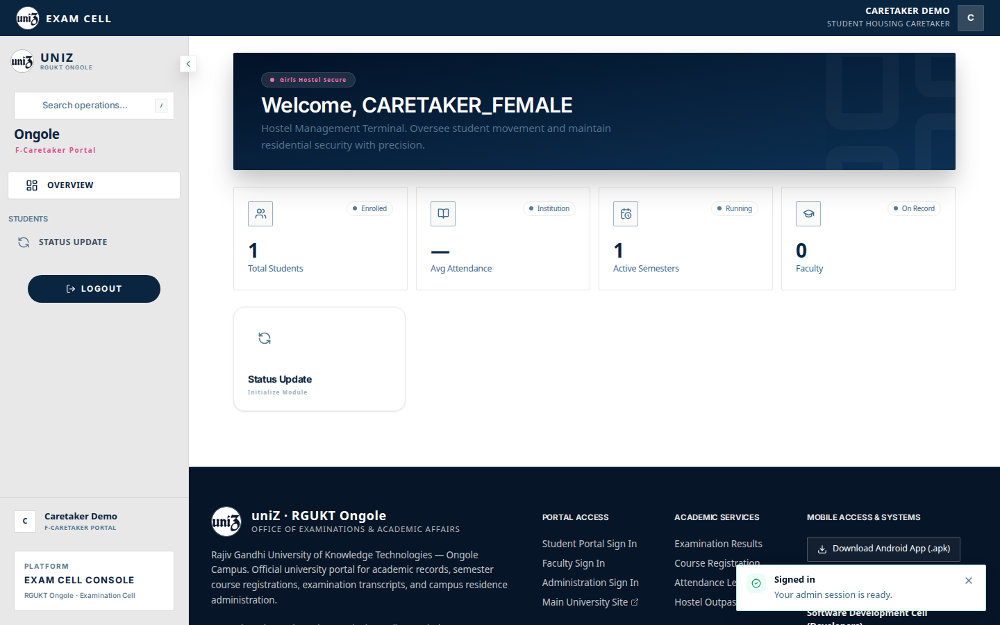

10. Mobile. `01 overview caretaker_female mobile`.

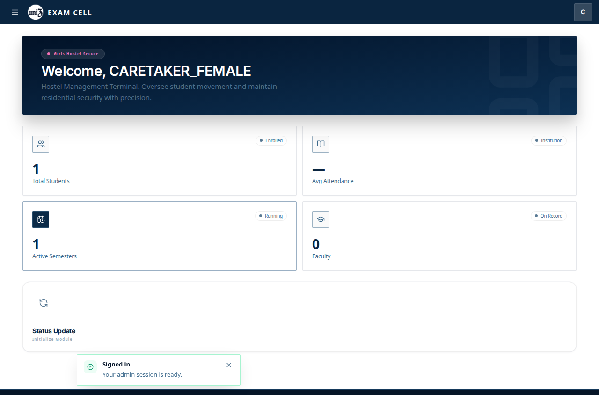

11. Desktop. `01 overview caretaker_male desktop`.

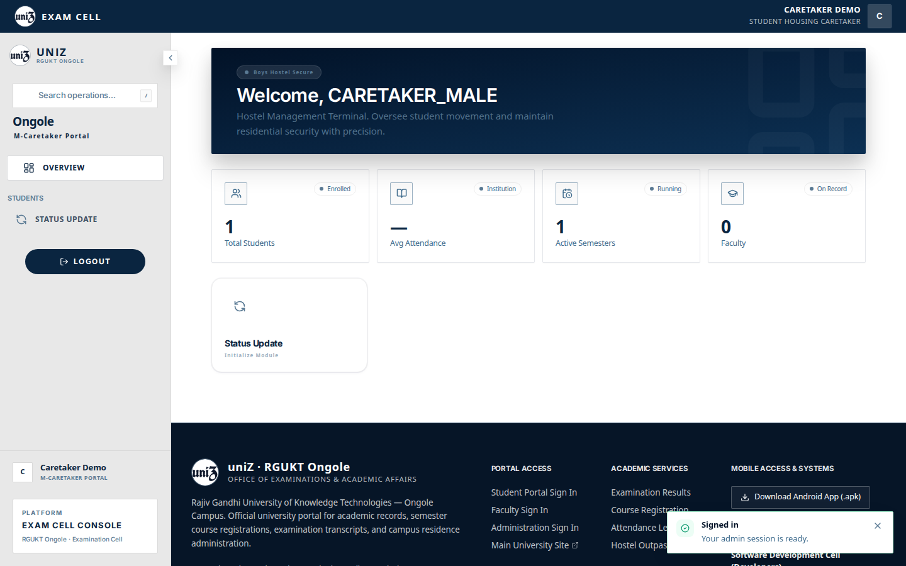

12. Mobile. `01 overview caretaker_male mobile`.

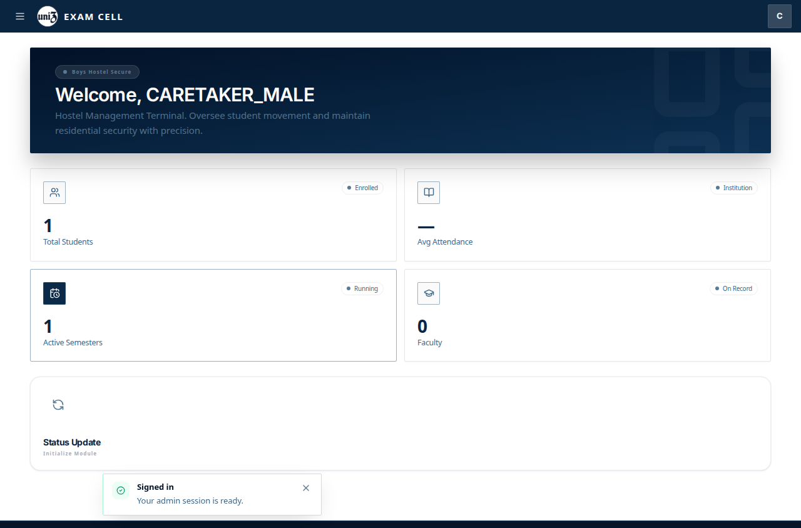

13. Desktop. `01 overview warden_female desktop`.

14. Mobile. `01 overview warden_female mobile`.

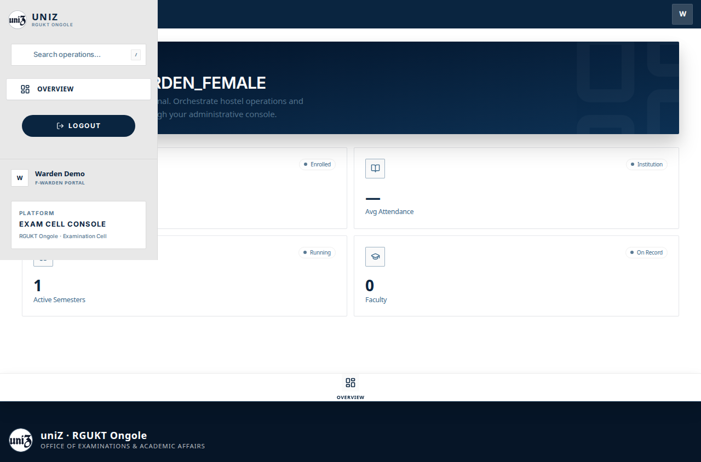

15. Desktop. `01 overview warden_male desktop`.

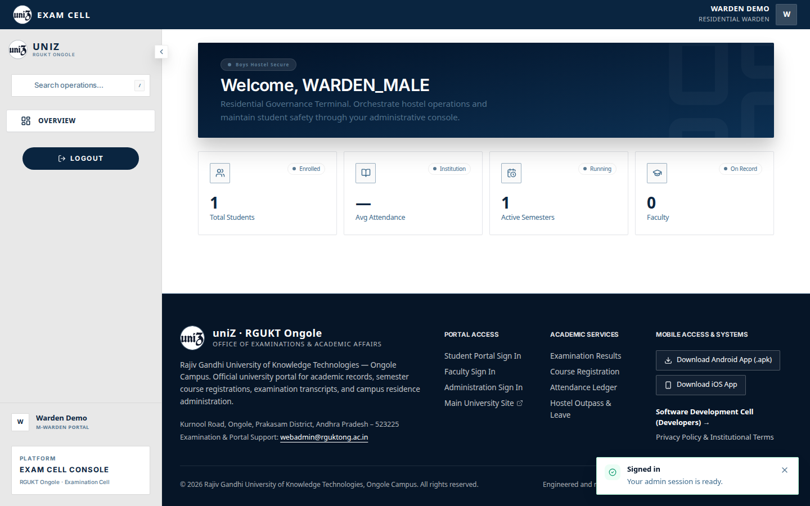

16. Mobile. `01 overview warden_male mobile`.

17. Desktop. `01 student route parked empty desktop`.

18. Mobile. `01 student route parked empty mobile`.

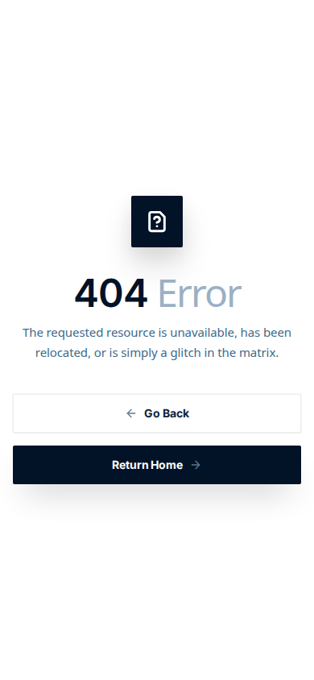

19. Desktop. `01 student route parked populated desktop`.

20. Mobile. `01 student route parked populated mobile`.

21. Desktop. `02 outing route parked empty desktop`.

22. Mobile. `02 outing route parked empty mobile`.

23. Desktop. `02 outing route parked populated desktop`.

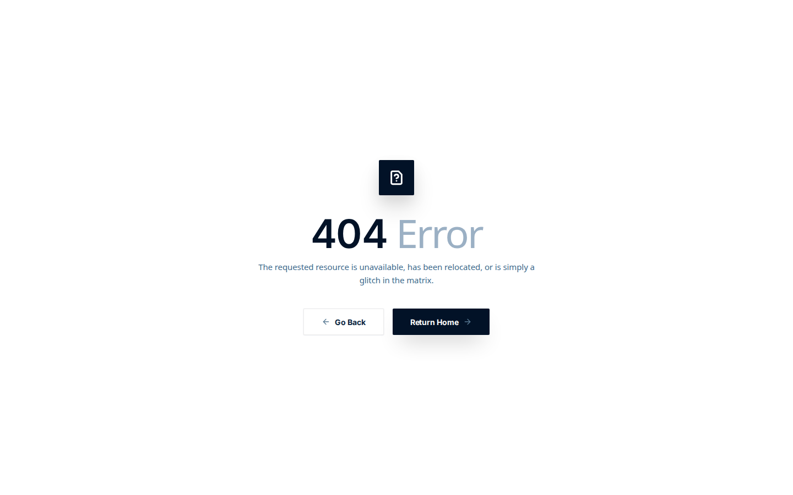

24. Mobile. `02 outing route parked populated mobile`.

25. Desktop. `02 status update caretaker_female desktop`.

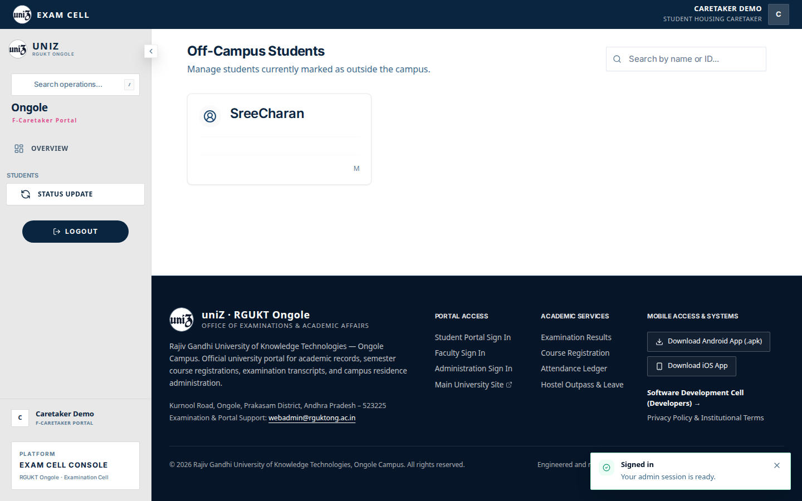

26. Mobile. `02 status update caretaker_female mobile`.

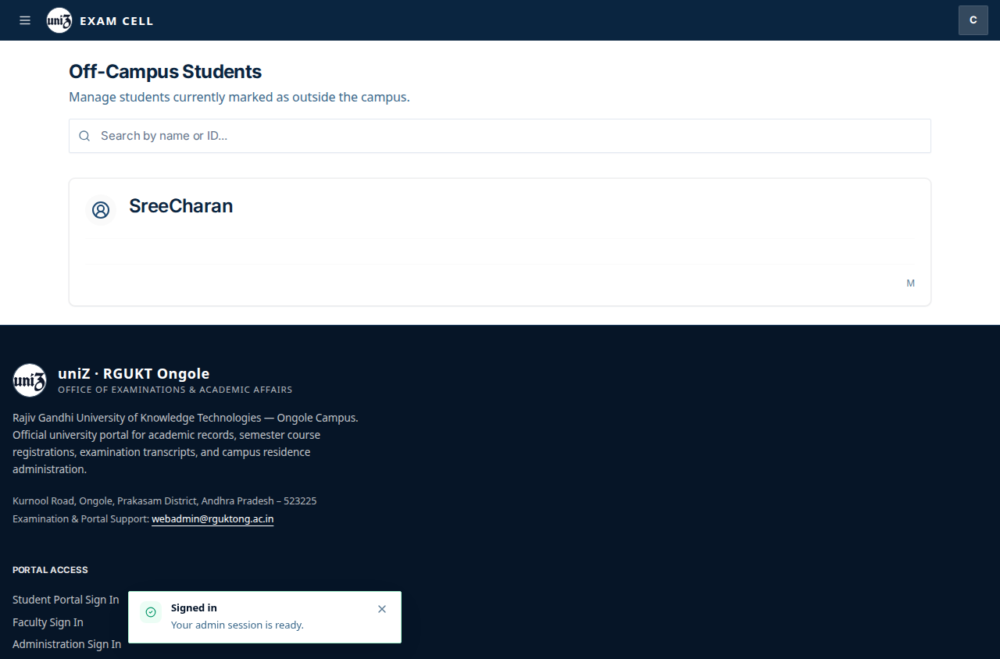

27. Desktop. `02 status update caretaker_male desktop`.

28. Mobile. `02 status update caretaker_male mobile`.

29. Desktop. `03 admin route parked desktop`.

30. Desktop. `04 admin outing parked desktop`.

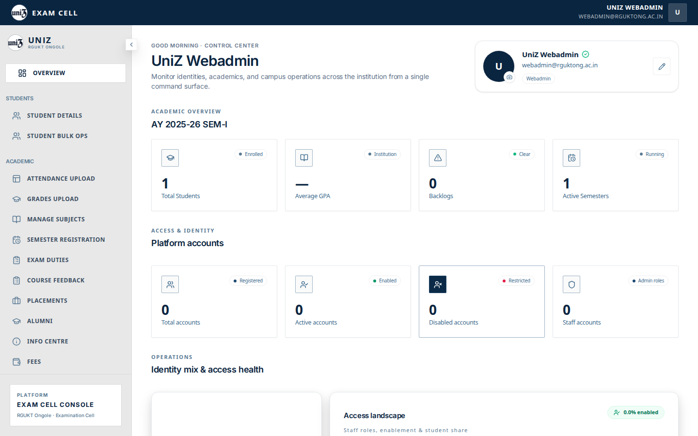

31. Mobile. `admin approveoutpass mobile`.

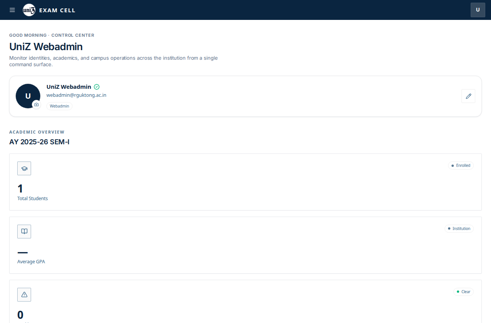
