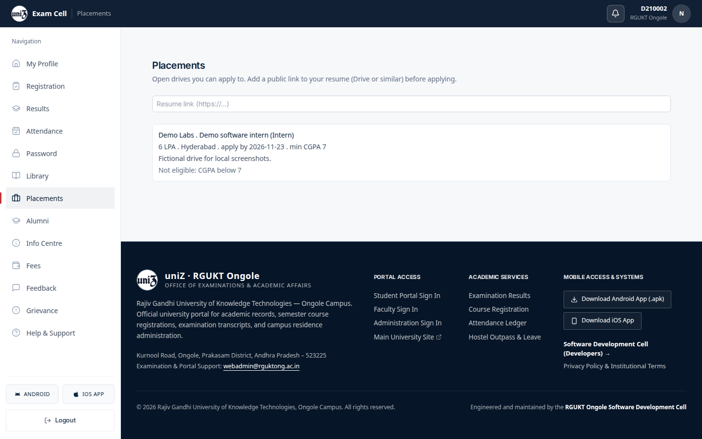
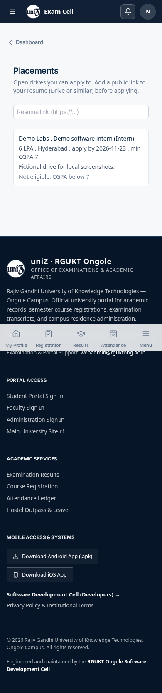
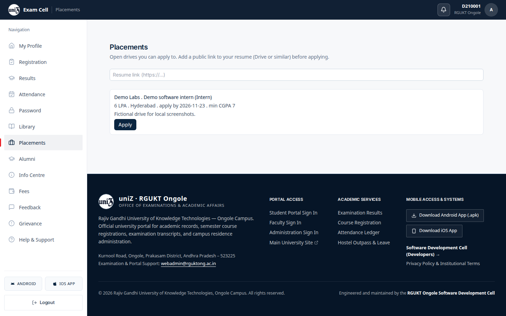
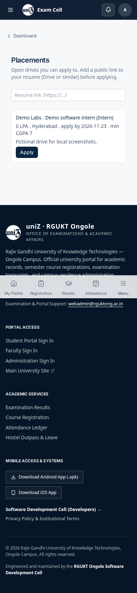
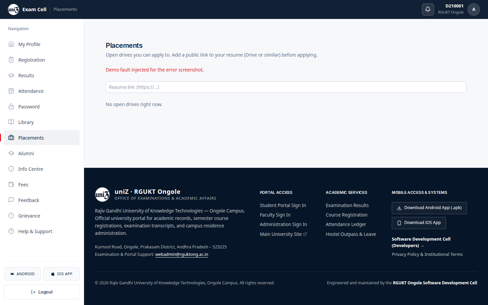
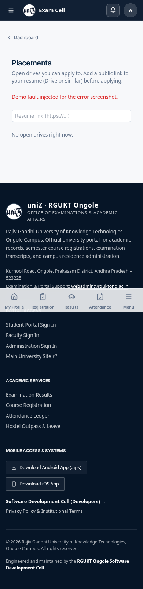
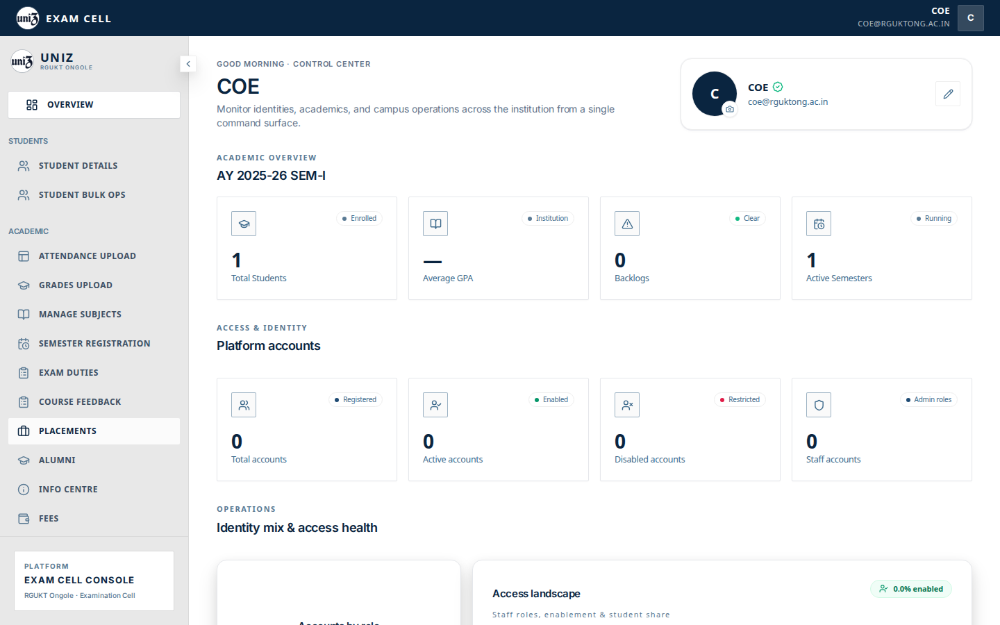
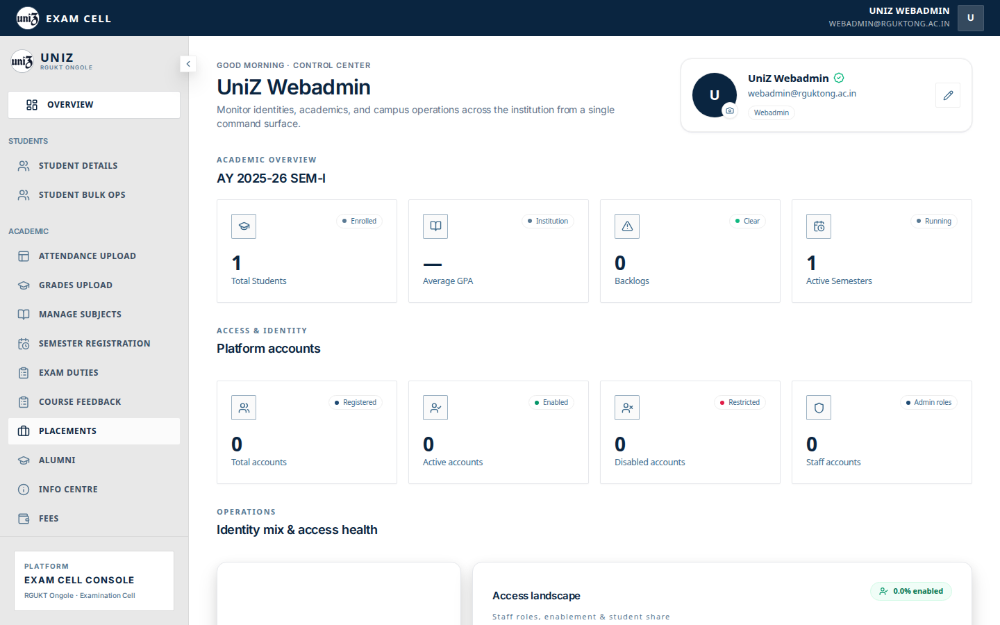
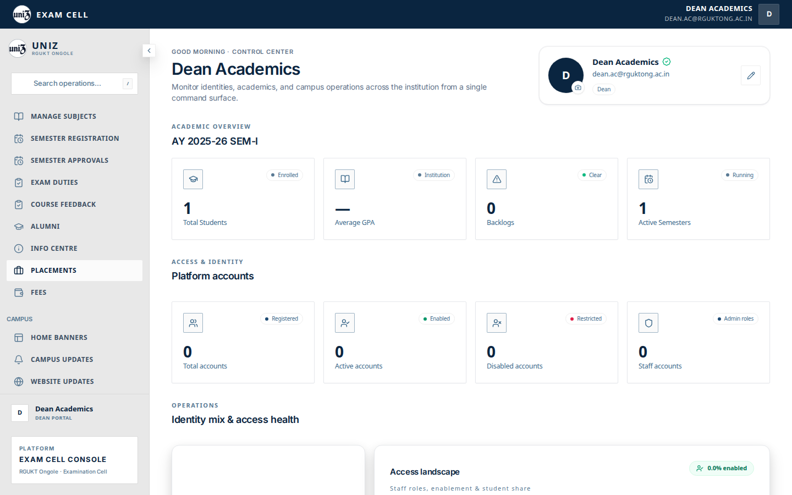
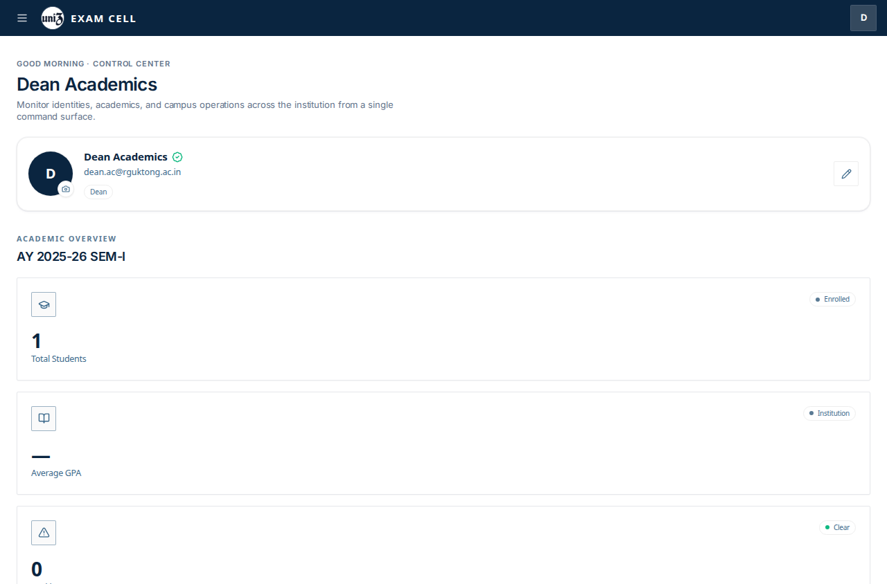

# Placement

## Student

`/student/placement` asks for a public resume link, then lists open drives the student can apply to.

The fixture drive is “Demo Labs · Demo software intern”, 6 LPA, Hyderabad, minimum CGPA 7, deadline 2026-11-23. The description on the card is the local fixture text. Apply is on the card. This capture shows the drive before an application was submitted.

## Admin shell

Webadmin and dean list Placements. The tab has no URL mapping, so the click returns to the overview. The placement admin component is not opened by that click.

## Captured screens

1. Desktop. `01 drives empty desktop`.

2. Mobile. `01 drives empty mobile`.

3. Desktop. `01 drives populated desktop`.

4. Mobile. `01 drives populated mobile`.

5. Desktop. `02 error desktop`.

6. Mobile. `02 error mobile`.

7. Desktop. Clicking this item does not open its panel. `adminSectionRoutes.ts` has no path for this tab, so `setActiveTab` navigates to `/admin` and the overview stays on screen. The row is under the pointer, which is why it looks pressed. File `10 placements coe desktop`.

8. Mobile. Clicking this item does not open its panel. `adminSectionRoutes.ts` has no path for this tab, so `setActiveTab` navigates to `/admin` and the overview stays on screen. The row is under the pointer, which is why it looks pressed. File `10 placements coe mobile`.

9. Desktop. Clicking this item does not open its panel. `adminSectionRoutes.ts` has no path for this tab, so `setActiveTab` navigates to `/admin` and the overview stays on screen. The row is under the pointer, which is why it looks pressed. File `10 placements webadmin desktop`.

10. Mobile. Clicking this item does not open its panel. `adminSectionRoutes.ts` has no path for this tab, so `setActiveTab` navigates to `/admin` and the overview stays on screen. The row is under the pointer, which is why it looks pressed. File `10 placements webadmin mobile`.

11. Desktop. Clicking this item does not open its panel. `adminSectionRoutes.ts` has no path for this tab, so `setActiveTab` navigates to `/admin` and the overview stays on screen. The row is under the pointer, which is why it looks pressed. File `13 placements dean desktop`.

12. Mobile. Clicking this item does not open its panel. `adminSectionRoutes.ts` has no path for this tab, so `setActiveTab` navigates to `/admin` and the overview stays on screen. The row is under the pointer, which is why it looks pressed. File `13 placements dean mobile`.

