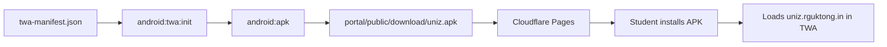

# UniZ organization

How the [uniz-rguktong](https://github.com/uniz-rguktong) GitHub organization is laid out. Aimed at the same clarity you get in large open-source trees (Mozilla, Chromium): one product source of truth, clear module ownership, archived leftovers marked as such.

## Canonical product repo

| Repository | Role |
|------------|------|
| **[uniz-master](https://github.com/uniz-rguktong/uniz-master)** | Entire UniZ platform: APIs, portal, landing, docs, gateway, K3s, CI/CD, **and the Android TWA** |

Everything students use day-to-day ships from `uniz-master`. Contributors clone that one repo.

## Satellite repos

| Repository | Role |
|------------|------|
| **[.github](https://github.com/uniz-rguktong/.github)** | Org profile + default community health files |
| **[uniz-hall-ticket](https://github.com/uniz-rguktong/uniz-hall-ticket)** | Standalone exam hall-ticket utility (separate product surface) |
| **uniz-app** | **Archived** — former Flutter experiment. Android client lives in `uniz-master/apps/uniz-android-twa` |

## Module map (inside uniz-master)

```text
apps/uniz-api              Unified auth + user + academics (production process)
apps/uniz-gateway          Path router, cache, health
apps/uniz-notifications    Inbox, web push, SES mail
apps/uniz-portal           Student / admin SPA → Cloudflare Pages
apps/uniz-landing          Public college site → Cloudflare Pages
apps/uniz-docs             VitePress docs → VPS /docs
apps/uniz-android-twa      Play / sideload TWA (Bubblewrap)
packages/@uniz/shared      Shared TypeScript
infra/kubernetes           K3s manifests
docs/                      Architecture, ops, org, local setup
```

Ownership and review: [github-governance.md](../ops/github-governance.md) · [CONTRIBUTING.md](../../CONTRIBUTING.md).

## Android app lifecycle



No second mobile monorepo. Rebuild the shell only when package ID, icons, or TWA permissions change; portal deploys update the in-app UI.

## Voice & docs standards

- Prefer **one README path** from org profile → `uniz-master` → `STRUCTURE.md` → module README.
- Production secrets never in git — [SECRETS.md](../ops/SECRETS.md).
- Public claims stay factual (capacity, student counts); load-test numbers stay labeled as tests.
