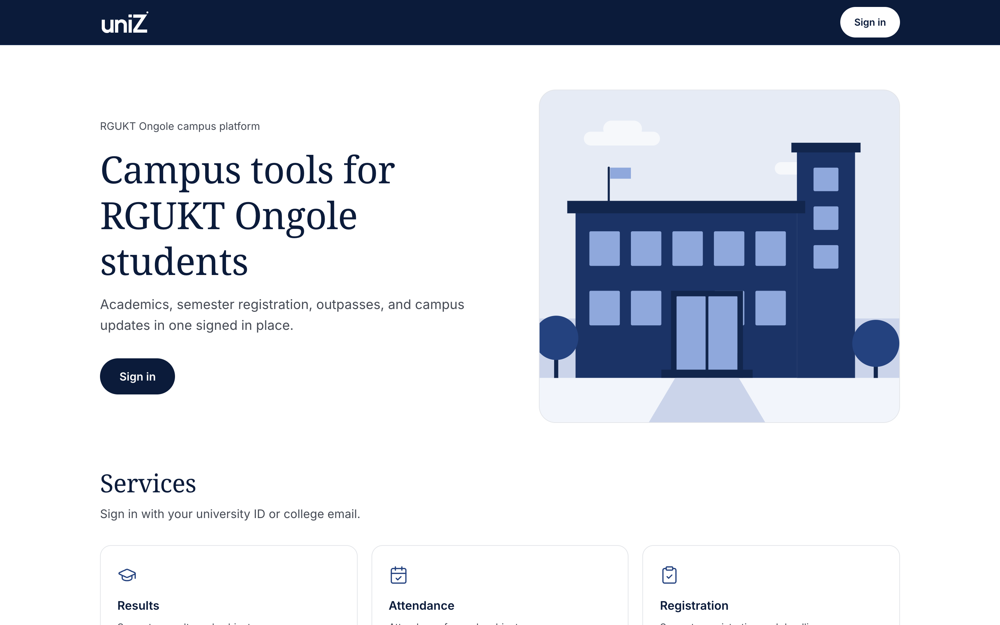
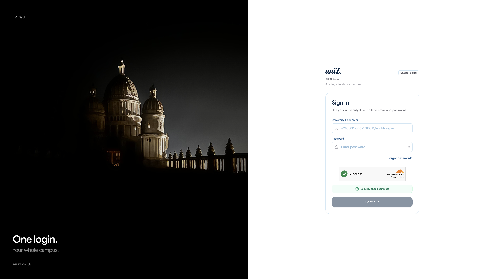

# UniZ UI Feature Guide

**Institution.** RGUKT Ongole  
**Document date.** 15 November 2026  
**Portal.** [https://uniz.rguktong.in](https://uniz.rguktong.in)  
**Technical docs.** [https://api-uniz.rguktong.in/docs/](https://api-uniz.rguktong.in/docs/)  
**Repo mirror.** `apps/uniz-docs/`

---

## How to use this guide

This document is a **UI guidance** inventory: every portal feature and every user-facing action, organized by role. It is not an architecture or API reference.

For each feature you will find: what it is, who can use it, how to open it (navigation + URL from `apps/uniz-portal/src/App.tsx` and admin section routes), every actionable control, and what happens when the control is used. Where a matching page exists under the institutional docs site, a link is included.

> **Technical details.** Implementation and backend behaviour live in [UniZ docs](https://api-uniz.rguktong.in/docs/) (`apps/uniz-docs/`), especially [Roles](https://api-uniz.rguktong.in/docs/roles), [Action flows](https://api-uniz.rguktong.in/docs/system/action-flows), and the Student / Admin / Faculty guides. Prefer those pages for endpoints, storage, and deployment.

**Screenshot policy.** Public pages were captured against the live portal where the route rendered. Authenticated screens are described from React UI source and docs; those sections are marked *Live screenshot pending test account*. No credentials were invented or stored.

**Feature flags.** Outing and outpass student/admin flows are gated by `VITE_ENABLE_OUTPASS_OUTING` (default off). Related routes may be commented out in `App.tsx` while the flag is off.

---

## Role overview

| Role | Audience | Primary UI |
| --- | --- | --- |
| Public | Anyone without a session | Landing, legal, SEO, sign-in |
| Student | Enrolled RGUKT students | Profile, academics, registration, grievance, notifications |
| Faculty | Teaching staff | `/faculty` overview, profile, branch students, password |
| HOD | Head of Department | Dean shell subset: students + semester approvals |
| Caretaker (M/F) | Hostel caretakers | First-level outing/outpass approval, status update |
| Warden (M/F) | Hostel wardens | Second-level outing/outpass approval, status tools |
| SWO / DSW | Student Welfare | Grievances; outing/outpass when enabled |
| Dean | Academic dean | Broad academic + campus admin shell |
| Director | Institution director | Broad academic + campus admin shell |
| Webadmin / COE | Platform / exam admin | Full webadmin shell including bulk ops & logs |
| Security | Gate staff | Check-in/check-out terminal |

Source of truth for authorization semantics: [https://api-uniz.rguktong.in/docs/roles](https://api-uniz.rguktong.in/docs/roles).

---

## Public surfaces

### Home

**What it is.** Public landing page for the UniZ campus portal. Signed-in users are redirected to their role home.

**Who.** Public (unauthenticated)

**Entry path.** Nav: direct visit · URL: `/`

**Actions.**

- **Get started (header / hero)** — Opens student sign-in at `/student/signin`.
- **Download / Install (platform-aware)** — Triggers PWA install when available; on iOS shows Add to Home Screen instructions.
- **Privacy footer link** — Opens `/privacy`.
- **Developers footer link** — Opens `/developers`.
- **Hidden keyboard sequence `admin`** — Navigates to `/admin/signin` (staff entry shortcut).

**Docs.** [https://api-uniz.rguktong.in/docs/](https://api-uniz.rguktong.in/docs/)

### Developers

**What it is.** Public credits page for the student engineering team and open-source contribution callout.

**Who.** Public

**Entry path.** Nav: Home footer → Developers · URL: `/developers`

**Actions.**

- **Back to home** — Returns to `/`.
- **Team / contribution content** — Read-only presentation; external contribution links where present.
- **Legal footer links** — Navigate to privacy and related legal surfaces.

**Docs.** [https://api-uniz.rguktong.in/docs/introduction](https://api-uniz.rguktong.in/docs/introduction)

> Live screenshot pending: production SPA currently soft-falls to home for this path in some builds. Controls listed from `Developers.tsx`.

### Privacy policy

**What it is.** Institutional privacy notice covering account data, academic records, push tokens, and retention.

**Who.** Public

**Entry path.** Nav: Home footer → Privacy · URL: `/privacy`

**Actions.**

- **Back to home** — Returns to `/`.
- **Policy sections (scroll)** — Read-only text blocks for overview, collection, use, push, sharing, security, choices, contact.

> Live screenshot pending: production SPA currently soft-falls to home for this path in some builds. Controls listed from `PrivacyPolicy.tsx`.

### Notification deep link

**What it is.** Bridge route used when a push notification is opened. Routes the user to the correct inbox or to sign-in.

**Who.** Public → then student or admin

**Entry path.** URL: `/notifications` (optional `?n=` highlight id)

**Actions.**

- **Automatic redirect (admin token present)** — Goes to `/admin/notifications` with optional highlight.
- **Automatic redirect (student token present)** — Goes to `/student/notifications` with optional highlight.
- **No token** — Stores pending path and sends user to student sign-in with return URL.

**Docs.** [https://api-uniz.rguktong.in/docs/api/comms/notifications](https://api-uniz.rguktong.in/docs/api/comms/notifications)

### SEO marketing landings

**What it is.** Public marketing/SEO pages for project management, collaboration, task tracking, and blog-style paths.

**Who.** Public

**Entry path.** URLs: `/student-project-management`, `/college-team-collaboration`, `/academic-task-tracker`, `/blog/*`

**Actions.**

- **Back / home navigation** — Returns toward portal home.
- **Primary CTA (Get started / sign in)** — Routes toward student authentication.
- **Feature checklist content** — Read-only marketing copy keyed by pathname.

> Live screenshot pending test capture on each SEO path.

### StudySpace (promotional)

**What it is.** Promotional surface for the StudySpace experiment. Route is currently commented out in `App.tsx`.

**Who.** Public / student (when enabled)

**Entry path.** Intended URL: `/studyspace` (not mounted while commented)

**Actions.**

- **External StudySpace links** — Open the hosted StudySpace experience in a new context.
- **Back / portal navigation** — Return to student shell when mounted under Sidebar.

> Route commented in App.tsx. Page component remains at `pages/promotions/StudySpace.tsx`.

### CampusHub (promotional)

**What it is.** Promotional surface for CampusHub. Route is currently commented out in `App.tsx`.

**Who.** Public / student (when enabled)

**Entry path.** Intended URL: `/campushub` (not mounted while commented)

**Actions.**

- **External CampusHub links** — Open the hosted CampusHub experience.
- **Back / portal navigation** — Return to student shell when mounted under Sidebar.

> Route commented in App.tsx. Page component remains at `pages/promotions/CampusHub.tsx`.

### Student sign-in

**What it is.** Credential entry for students, including Turnstile check and OTP password recovery.

**Who.** Student (public entry)

**Entry path.** Nav: Home → Get started · URL: `/student/signin` · Aliases: `/login`, `/signin` → this route

**Actions.**

- **University ID or email** — Identifies the student account.
- **Password + show/hide** — Enters credentials; visibility toggle reveals text.
- **Forgot password?** — Switches to OTP request step.
- **Cloudflare Turnstile** — Completes bot check before Continue enables.
- **Continue / Sign in** — Authenticates; stores `student_token`; navigates to `/student`.
- **Request OTP** — Sends one-time code to registered channel.
- **OTP digits + Verify** — Confirms ownership of the account.
- **Send via email (fallback)** — Requests email delivery of OTP when push is unavailable.
- **New password + Set new password** — Writes new password hash; returns to sign-in.
- **Back** — Returns toward home / previous step.

**Docs.** [https://api-uniz.rguktong.in/docs/students/login](https://api-uniz.rguktong.in/docs/students/login)

### Admin / staff sign-in

**What it is.** Shared staff sign-in. Role in the login response decides admin vs faculty destination.

**Who.** Admin roles, faculty, security, webadmin

**Entry path.** URL: `/admin/signin` (also reachable via typing `admin` on the home page)

**Actions.**

- **Username + password** — Staff credentials.
- **Forgot password / OTP flow** — Same reset steps as student sign-in.
- **Turnstile + Continue** — Authenticates staff; faculty role stores `faculty_token` and opens `/faculty`; other admin roles store `admin_token` and open `/admin`.
- **Role mismatch guards** — Blocks students from admin portal and vice versa with an error toast.

**Docs.** [https://api-uniz.rguktong.in/docs/admin/overview](https://api-uniz.rguktong.in/docs/admin/overview)

> Live screenshot pending test account. No separate `/faculty/signin` route; faculty use admin sign-in.

### Maintenance interstitial

**What it is.** Shown when `VITE_MAINTENANCE_MODE=true` and no admin token is present.

**Who.** All unauthenticated users

**Entry path.** Any guarded route under MaintenanceGuard

**Actions.**

- **Go Back** — History back.

**Docs.** [https://api-uniz.rguktong.in/docs/ops/feature-flags](https://api-uniz.rguktong.in/docs/ops/feature-flags)

### 404 error page

**What it is.** Catch-all for unknown portal paths.

**Who.** Any

**Entry path.** URL: unmatched `*`

**Actions.**

- **Go Back** — History back.
- **Return Home** — Navigates to `/`.

### PWA install prompt

**What it is.** Global overlay (`InstallPWA`) offering Add to Home Screen / install after load or login on mobile.

**Who.** Any (mobile / non-standalone)

**Entry path.** Global component mounted in `App.tsx`

**Actions.**

- **Install / Add to Home Screen** — Shows native install prompt or iOS share instructions.
- **Dismiss (X)** — Hides the banner; auto-dismisses after a few seconds.

---

## Student portal

### Student shell (sidebar, dock, profile chrome)

**What it is.** Authenticated student chrome: desktop dock, mobile bottom menu, header profile, notifications, logout, optional outpass/outing banner.

**Who.** Student

**Entry path.** Any `/student/*` route rendered through `Sidebar`

**Actions.**

- **Desktop dock items** — Navigate among My Profile, Registration, Results, Attendance, Password, Grievance, Help; optional Outing/Outpass when feature flag on.
- **Logout (dock / header)** — Opens confirm modal; confirm ends session.
- **Notification bell** — Opens `/student/notifications`.
- **Mobile bottom menu: Home / Register / Academics / Grievance / Help** — Primary navigation; Academics expands Results, Attendance, Security (password).
- **Mobile back chevron** — Returns to `/student` from nested pages.
- **Dismiss outpass disabled banner** — Hides the administrative notice for the session view.
- **Pull-to-refresh (touch)** — Reloads the page when pulled from top.

**Docs.** [https://api-uniz.rguktong.in/docs/students/profile](https://api-uniz.rguktong.in/docs/students/profile)

> Live screenshot pending test account.

### Student dashboard / profile

**What it is.** Home profile for the signed-in student: personal details, academic snapshot, seating entry, and (when enabled) outing/outpass request forms.

**Who.** Student

**Entry path.** Nav: My Profile / Home · URL: `/student`

**Actions.**

- **Edit profile** — Enables editable fields (contact/email and similar allowed fields).
- **Save / Save Changes** — Persists profile updates.
- **Cancel** — Exits edit mode without saving.
- **Upload photo (avatar control)** — Uploads image then updates `profile_url`.
- **Tab switches (personal / academic / etc.)** — Show corresponding profile panels.
- **Seating arrangement entry** — Opens seating view within the student experience.
- **Outing / Outpass request toggles (flag on)** — Open request forms with reason, dates/times, submit/cancel.
- **Submit request (flag on)** — Creates outing or outpass request for approval chain.

**Docs.** [https://api-uniz.rguktong.in/docs/students/profile](https://api-uniz.rguktong.in/docs/students/profile)

> Live screenshot pending test account. Nested components: InfoCard, AcademicRecord, StudentAnalytics, ProfileSemesterSubjects, SeatingArrangement.

### Outing requests

**What it is.** List and create short-duration outing requests. Feature-flagged; routes commented when disabled.

**Who.** Student

**Entry path.** Nav: Outing Requests · URL: `/student/outing` · Request form: `/student/outing/requestouting`

**Actions.**

- **New request** — Opens request form.
- **Reason, from/to times** — Describe the outing window.
- **Submit Request** — Sends request into approval queue.
- **Cancel / back** — Returns without submitting.
- **Status chips on list** — Show Approved / Rejected / Pending / Expired.

**Docs.** [https://api-uniz.rguktong.in/docs/students/outpass](https://api-uniz.rguktong.in/docs/students/outpass)

> Disabled when `VITE_ENABLE_OUTPASS_OUTING` is not true. Routes currently commented in App.tsx.

### Outpass requests

**What it is.** List and create multi-day outpass requests. Feature-flagged; routes commented when disabled.

**Who.** Student

**Entry path.** Nav: Outpass Requests · URL: `/student/outpass` · Request form: `/student/outpass/requestoutpass`

**Actions.**

- **New request** — Opens outpass form.
- **Reason, from/to dates** — Describe leave window.
- **Submit Request** — Sends request into caretaker→warden→SWO→dean chain.
- **Cancel / back** — Returns without submitting.

**Docs.** [https://api-uniz.rguktong.in/docs/students/outpass](https://api-uniz.rguktong.in/docs/students/outpass)

> Disabled when feature flag off. Routes currently commented in App.tsx.

### Attendance

**What it is.** Subject-wise attendance view for the student.

**Who.** Student

**Entry path.** Nav: Attendance · URL: `/student/attendance`

**Actions.**

- **Subject / semester filters (if present)** — Narrow the attendance table.
- **Read-only percentages and logs** — No student write actions; disputes go through Grievance.

**Docs.** [https://api-uniz.rguktong.in/docs/students/academics](https://api-uniz.rguktong.in/docs/students/academics)

> Live screenshot pending test account.

### Results (GradeHub)

**What it is.** Published semester results with SGPA/CGPA and PDF export.

**Who.** Student

**Entry path.** Nav: Results · URL: `/student/gradehub`

**Actions.**

- **Semester dropdown** — Select which published semester to load.
- **Fetch / view results** — Loads grades for the selected semester.
- **Output PDF** — Downloads official results PDF.
- **Output Remedial PDF** — Downloads remedial results PDF when applicable.

**Docs.** [https://api-uniz.rguktong.in/docs/students/academics](https://api-uniz.rguktong.in/docs/students/academics)

> Live screenshot pending test account. Grades appear only after administrative publish.

### Current semester

**What it is.** Focused view of the active semester context for the student.

**Who.** Student

**Entry path.** URL: `/student/current-semester`

**Actions.**

- **Semester summary panels** — Read registered/current semester information.
- **Cross-links to registration / results** — Navigate to related academic pages when shown.

**Docs.** [https://api-uniz.rguktong.in/docs/students/academics](https://api-uniz.rguktong.in/docs/students/academics)

> Live screenshot pending test account.

### Course registration

**What it is.** Enroll in core and elective subjects while the registration window is open; later view registered subjects and PDF.

**Who.** Student

**Entry path.** Nav: Registration · URL: `/student/registration`

**Actions.**

- **My subjects tab** — Shows already registered subjects for the current semester.
- **Register tab (when open)** — Opens CourseRegistration for elective selection.
- **Select elective subject cards** — Toggle electives within group limits; cores are pre-selected.
- **Confirm registration** — Submits selected subject IDs; locks further changes.
- **Download PDF** — Downloads registration confirmation PDF from RegisteredSubjectsPanel.
- **Done / complete** — Returns to subjects view after success.

**Docs.** [https://api-uniz.rguktong.in/docs/api/academics/registration](https://api-uniz.rguktong.in/docs/api/academics/registration)

> Live screenshot pending test account. Nested: MySubjects, CourseRegistration, RegisteredSubjectsPanel.

### Grievance

**What it is.** Submit an official campus grievance, optionally anonymously.

**Who.** Student

**Entry path.** Nav: Grievance · URL: `/student/grievance`

**Actions.**

- **Category / details fields** — Describe the issue.
- **Submit Anonymously toggle** — Masks identity when enabled.
- **Submit Official Grievance** — Creates grievance for SWO / admin queue.

**Docs.** [https://api-uniz.rguktong.in/docs/api/requests/grievances](https://api-uniz.rguktong.in/docs/api/requests/grievances)

> Live screenshot pending test account.

### Notifications inbox

**What it is.** In-app notification center for the student portal.

**Who.** Student

**Entry path.** Nav: notification bell · URL: `/student/notifications`

**Actions.**

- **Open notification row** — Shows detail / marks read as implemented.
- **Deep-link highlight (`?n=`)** — Focuses a specific notification from push.

**Docs.** [https://api-uniz.rguktong.in/docs/api/comms/notifications](https://api-uniz.rguktong.in/docs/api/comms/notifications)

> Live screenshot pending test account.

### Help & support

**What it is.** FAQ accordion and contact guidance for the student portal.

**Who.** Student

**Entry path.** Nav: Help & Support · URL: `/student/help`

**Actions.**

- **FAQs tab** — Lists common questions.
- **Expand / collapse FAQ row** — Shows answer text.
- **Contact us tab** — Shows contact channels / mailto links.

> Live screenshot pending test account.

### Reset password (signed-in)

**What it is.** Change password while authenticated.

**Who.** Student

**Entry path.** Nav: Password / Security · URL: `/student/resetpassword`

**Actions.**

- **Current / new password fields** — Enter replacement credentials.
- **Reset / update password button** — Updates password for the student account.

**Docs.** [https://api-uniz.rguktong.in/docs/api/auth/password](https://api-uniz.rguktong.in/docs/api/auth/password)

> Live screenshot pending test account.

### Toaster demo

**What it is.** Internal demo page for toast notifications.

**Who.** Student / developers

**Entry path.** URL: `/student/toast-demo`

**Actions.**

- **Demo toast triggers** — Fire sample toasts; not a production workflow.

> Internal/demo route.

---

## Admin portal — shared chrome & legacy pages

### Admin shell chrome

**What it is.** Shared layout for role dashboards: collapsible sidebar, nav search, avatar profile popup, logout.

**Who.** All admin portal roles using AdminShell

**Entry path.** Any `/admin` section rendered by Webadmin/Dean/Director/SWO/Warden/Caretaker/Security shells

**Actions.**

- **Collapse / expand sidebar** — Toggles nav width.
- **Search operations** — Filters sidebar nav labels.
- **Nav item click** — Navigates to `/admin/<section>` via `useAdminSectionRoute`.
- **Avatar → profile popup** — Opens ProfilePopup for quick profile view/edit.
- **Logout** — Clears admin session.

**Docs.** [https://api-uniz.rguktong.in/docs/admin/overview](https://api-uniz.rguktong.in/docs/admin/overview)

> Live screenshot pending test account.

### Admin notifications

**What it is.** Staff notification inbox page.

**Who.** Admin (authenticated)

**Entry path.** URL: `/admin/notifications`

**Actions.**

- **Open / highlight notification** — Same pattern as student inbox with admin portal.

**Docs.** [https://api-uniz.rguktong.in/docs/api/comms/notifications](https://api-uniz.rguktong.in/docs/api/comms/notifications)

> Live screenshot pending test account.

### Legacy admin hub (fallback)

**What it is.** Card hub used when role is not mapped to a specialized dashboard.

**Who.** Unmapped admin roles

**Entry path.** URL: `/admin`

**Actions.**

- **Quick action cards** — Navigate to approve outing/outpass, security, grades, attendance, curriculum, faculty, students, search, settings, roles, banners, etc., based on role gates.
- **Logout** — Ends session.

> Most production roles resolve to specialized dashboards (Webadmin, Dean, SWO, Warden, Caretaker, Director, Security).

### Add students (legacy page)

**What it is.** Standalone student import page.

**Who.** Dean / webadmin paths

**Entry path.** URL: `/admin/addstudents`

**Actions.**

- **CSV/XLSX uploader** — Import student rows.
- **Submit upload** — Creates student accounts.

**Docs.** [https://api-uniz.rguktong.in/docs/admin/overview](https://api-uniz.rguktong.in/docs/admin/overview)

> Live screenshot pending test account. Prefer Student Bulk Ops in shell.

### Search students (legacy)

**What it is.** Directory search page reused by security search tab.

**Who.** Admin / security

**Entry path.** URL: `/admin/searchstudents`

**Actions.**

- **Search field + submit** — Returns matching students.
- **Open result** — View student directory card.

> Live screenshot pending test account.

### Update student status

**What it is.** Manually update presence/status flags for a student.

**Who.** Caretaker, Warden (status_update), legacy URL

**Entry path.** Nav: Status Update · URL: `/admin/student-status` · Legacy: `/admin/updatestudentstatus`

**Actions.**

- **Search student** — Locate target.
- **Status controls + save** — Apply presence or status change.

**Docs.** [https://api-uniz.rguktong.in/docs/admin/security](https://api-uniz.rguktong.in/docs/admin/security)

> Live screenshot pending test account.

### Settings

**What it is.** Admin settings page.

**Who.** Admin

**Entry path.** URL: `/admin/settings`

**Actions.**

- **Settings form controls + save** — Persist portal settings as implemented.

> Live screenshot pending test account.

### Role management

**What it is.** Assign or inspect administrative roles.

**Who.** Webadmin-capable admins

**Entry path.** URL: `/admin/roles`

**Actions.**

- **Role list / assign controls** — Update role bindings.
- **Save** — Persist role changes.

**Docs.** [https://api-uniz.rguktong.in/docs/roles](https://api-uniz.rguktong.in/docs/roles)

> Live screenshot pending test account.

### Admin profile page

**What it is.** Full-page admin profile (in addition to shell popup).

**Who.** Admin

**Entry path.** URL: `/admin/profile`

**Actions.**

- **Edit profile fields + save** — Update admin profile.
- **Photo upload** — Change avatar.

> Live screenshot pending test account.

### Current semester admin

**What it is.** Admin tool for current-semester configuration.

**Who.** Academic admins

**Entry path.** URL: `/admin/current-semester`

**Actions.**

- **Semester selectors + save** — Configure active semester context.

**Docs.** [https://api-uniz.rguktong.in/docs/admin/semester-registration](https://api-uniz.rguktong.in/docs/admin/semester-registration)

> Live screenshot pending test account.

---

## Admin portal — academic & campus sections

### Overview

**What it is.** Role overview with profile summary, institutional analytics widgets, and photo upload.

**Who.** Webadmin, COE, Dean, Director (and SWO overview reuse)

**Entry path.** Nav: Overview · URL: `/admin`

**Actions.**

- **Upload profile photo** — Uploads image and updates admin profile URL.
- **Edit / Save profile fields** — Updates email, contact, designation, department.
- **Cancel edit** — Discards draft field changes.
- **Analytics panels (read)** — Show institutional counts where loaded.

**Docs.** [https://api-uniz.rguktong.in/docs/admin/overview](https://api-uniz.rguktong.in/docs/admin/overview)

> Live screenshot pending test account. Component: WebadminOverview (+ analytics panels).

### Student details

**What it is.** Search and inspect individual student records; open performance and edit modals where permitted.

**Who.** Webadmin, COE, Dean, HOD (students only), Director

**Entry path.** Nav: Student Details · URL: `/admin/students`

**Actions.**

- **Search students** — Query by ID / name filters.
- **Open student row** — Shows detail / performance modal.
- **Edit student (modal)** — Update permitted demographic/status fields.
- **Save / close modal** — Persist or discard changes.

**Docs.** [https://api-uniz.rguktong.in/docs/admin/overview](https://api-uniz.rguktong.in/docs/admin/overview)

> Live screenshot pending test account. Components: StudentDetails, StudentEditModal, StudentPerformanceModal.

### Student bulk operations

**What it is.** Bulk upload, export, and cohort-wide status actions.

**Who.** Webadmin, COE, Dean, Director

**Entry path.** Nav: Student Bulk Ops · URL: `/admin/students/bulk`

**Actions.**

- **Bulk Upload tab** — Select XLSX/CSV via FileUploader.
- **Download Template** — Downloads Student_Upload_Template.xlsx.
- **Start Uploading** — Begins bulk create and monitors progress.
- **Batch Export tab + field checkboxes** — Choose export columns; Select all / essentials shortcuts.
- **Download the data** — Exports filtered student fields.
- **Actions tab → Mark IN campus** — Bulk set students present on campus.
- **Actions → Mark OUT of campus** — Bulk set students off campus.
- **Actions → Promote academic year** — Advance year cohort (e.g. E1→E2) with confirmation phrase.
- **Actions → Clear pending flags** — Clear stale outpass/outing pending flags.
- **Actions → Suspend / Unsuspend** — Bulk suspend or restore accounts with confirmation.

**Docs.** [https://api-uniz.rguktong.in/docs/admin/overview](https://api-uniz.rguktong.in/docs/admin/overview)

> Live screenshot pending test account.

### Attendance upload

**What it is.** Upload attendance records for academic logging.

**Who.** Webadmin, COE, Dean, Director; also legacy `/admin/addattendance`

**Entry path.** Nav: Attendance Upload · URL: `/admin/attendance` · Legacy: `/admin/addattendance`

**Actions.**

- **Choose file / FileUploader** — Select attendance CSV/XLSX.
- **Upload / submit** — Imports attendance into Academics service.
- **Progress / result messages** — Confirm success or show errors.

**Docs.** [https://api-uniz.rguktong.in/docs/admin/academics](https://api-uniz.rguktong.in/docs/admin/academics)

> Live screenshot pending test account. Component: UploadSection type=attendance.

### Grades upload

**What it is.** Upload grade sheets prior to publish.

**Who.** Webadmin, COE, Dean, Director; also legacy `/admin/addgrades`

**Entry path.** Nav: Grades Upload · URL: `/admin/grades` · Legacy: `/admin/addgrades`

**Actions.**

- **Choose file / FileUploader** — Select grades CSV/XLSX.
- **Upload / submit** — Imports grades.
- **Publish workflows (related semester tools)** — Students see grades only after publish.

**Docs.** [https://api-uniz.rguktong.in/docs/admin/academics](https://api-uniz.rguktong.in/docs/admin/academics)

> Live screenshot pending test account.

### Manage subjects / curriculum

**What it is.** Maintain subject catalog and curriculum mappings.

**Who.** Webadmin, COE, Dean, Director; also `/admin/curriculum`

**Entry path.** Nav: Manage Subjects · URL: `/admin/subjects` · Legacy: `/admin/curriculum`

**Actions.**

- **Add / edit subject fields** — Create or update subject records.
- **Save / delete subject** — Persist catalog changes.
- **Search / filter subjects** — Locate codes and titles.

**Docs.** [https://api-uniz.rguktong.in/docs/admin/academics](https://api-uniz.rguktong.in/docs/admin/academics)

> Live screenshot pending test account. Components: CurriculumManager / SubjectManagement.

### Semester registration builder

**What it is.** Create semesters, attach subjects/electives, publish to students, track registration, delete semesters.

**Who.** Webadmin, COE, Dean, Director

**Entry path.** Nav: Semester Registration · URL: `/admin/semester-registration`

**Actions.**

- **Create semester / open builder** — Starts SemesterBuilder flow.
- **Add subjects from catalog** — Attach core/elective offerings.
- **Manage semester** — Edit allocation details.
- **Publish to Students** — Opens DirectPublishModal; makes registration visible.
- **Track registration** — Opens RegistrationTracking for completion rates.
- **Delete semester** — Irreversible remove after confirm.

**Docs.** [https://api-uniz.rguktong.in/docs/admin/semester-registration](https://api-uniz.rguktong.in/docs/admin/semester-registration)

> Live screenshot pending test account.

### Semester approvals

**What it is.** HOD/Dean review of semester subject allocations and electives before advance/publish.

**Who.** Dean, HOD

**Entry path.** Nav: Semester Approvals · URL: `/admin/semester-approvals`

**Actions.**

- **Select semester card** — Loads allocations and elective groups (HOD scoped to department).
- **Approve / advance actions** — Moves semester through HOD_REVIEW / DEAN_REVIEW states.
- **Registration tracking entry** — Inspect department registration progress.
- **Back** — Returns to list.

**Docs.** [https://api-uniz.rguktong.in/docs/admin/semester-registration](https://api-uniz.rguktong.in/docs/admin/semester-registration)

> Live screenshot pending test account. Component: SemesterApproval.

### Home banners

**What it is.** Manage home-page banners shown on the public/student surfaces.

**Who.** Webadmin, COE, Dean, Director; also `/admin/banners`

**Entry path.** Nav: Home Banners · URL: `/admin/campus/banners`

**Actions.**

- **Add / upload banner image** — Creates a banner asset.
- **Reorder / enable / disable** — Controls which banners display.
- **Delete banner** — Removes banner.
- **Save** — Persists banner configuration.

**Docs.** [https://api-uniz.rguktong.in/docs/admin/overview](https://api-uniz.rguktong.in/docs/admin/overview)

> Live screenshot pending test account.

### Campus updates

**What it is.** Publish campus notices/updates visible to students.

**Who.** Webadmin, COE, Dean, Director

**Entry path.** Nav: Campus Updates · URL: `/admin/campus/updates`

**Actions.**

- **Create update** — Compose title/body.
- **Publish / delete update** — Push or remove notice.

**Docs.** [https://api-uniz.rguktong.in/docs/api/cms/notices](https://api-uniz.rguktong.in/docs/api/cms/notices)

> Live screenshot pending test account.

### Website updates / live editor

**What it is.** Edit institutional website content blocks and publish changes.

**Who.** Webadmin, COE, Dean, Director

**Entry path.** Nav: Website Updates · URL: `/admin/campus/website`

**Actions.**

- **Open live editor** — Edit page content chrome.
- **Save / publish website changes** — Writes CMS content for landing site.
- **Tenders / department staff editors (subsections)** — Maintain related institutional listings.

> Live screenshot pending test account. Components: WebsiteUpdatesSection, WebsiteLiveEditor.

### Push alerts

**What it is.** Send push notifications to subscribed devices.

**Who.** Webadmin, COE, Dean, Director

**Entry path.** Nav: Push Alerts · URL: `/admin/campus/push-alerts`

**Actions.**

- **Compose title/body** — Draft alert payload.
- **Audience / send controls** — Dispatch push via notifications service.
- **History list (if shown)** — Review prior sends.

**Docs.** [https://api-uniz.rguktong.in/docs/api/comms/notifications](https://api-uniz.rguktong.in/docs/api/comms/notifications)

> Live screenshot pending test account.

### Faculty management

**What it is.** Create, search, update, suspend, and bulk-manage faculty accounts.

**Who.** Webadmin, COE, Dean, Director; also `/admin/addfaculty`

**Entry path.** Nav: Faculty Management · URL: `/admin/faculty`

**Actions.**

- **Search faculty** — Locate staff by username/name.
- **Create faculty** — Add single faculty record.
- **Edit / suspend faculty** — Update profile or suspend account.
- **Bulk create / update / delete uploads** — Batch faculty CSV operations.

**Docs.** [https://api-uniz.rguktong.in/docs/faculty/grades](https://api-uniz.rguktong.in/docs/faculty/grades)

> Live screenshot pending test account.

### System & logs

**What it is.** Operational health, upload analytics, and system user insights for platform admins.

**Who.** Webadmin, COE, Dean, Director

**Entry path.** Nav: System & Logs · URL: `/admin/system-logs`

**Actions.**

- **Refresh / inspect log panels** — Read service health and recent activity.
- **Upload health analytics** — Inspect bulk upload job status.

**Docs.** [https://api-uniz.rguktong.in/docs/health](https://api-uniz.rguktong.in/docs/health)

> Live screenshot pending test account.

### Security (password / access section)

**What it is.** Per-admin security controls inside AdminShell (password change and related access settings).

**Who.** Most admin dashboards

**Entry path.** Nav: Security · URL: `/admin/access-control`

**Actions.**

- **Change password fields + submit** — Updates admin password.
- **Related security toggles** — As rendered by SecuritySection.

**Docs.** [https://api-uniz.rguktong.in/docs/api/auth/password](https://api-uniz.rguktong.in/docs/api/auth/password)

> Live screenshot pending test account. Distinct from Security Portal gate terminal.

---

## Admin portal — approvals & welfare

### Approve outings

**What it is.** Process pending short outing requests: approve, reject with reason, or forward.

**Who.** Caretaker, Warden (when outpass/outing flag enabled); SWO request management

**Entry path.** Nav: Approve Outings · URL: `/admin/approve-outings` · Legacy hub: `/admin/approveouting`

**Actions.**

- **Search by ID / name / reason** — Filter pending queue.
- **Approve** — Marks outing approved.
- **Reject (prompt for reason)** — Rejects with message; stops chain.
- **Forward** — Escalates to next approver and removes from current queue.
- **Back** — Returns to previous view.

**Docs.** [https://api-uniz.rguktong.in/docs/admin/approvals](https://api-uniz.rguktong.in/docs/admin/approvals)

> Hidden when outpass/outing feature flag is off. Live screenshot pending test account.

### Approve outpasses

**What it is.** Process pending multi-day outpass requests through the residential approval chain.

**Who.** Caretaker, Warden (flag on); higher roles as configured

**Entry path.** Nav: Approve Outpasses · URL: `/admin/approve-outpasses` · Legacy: `/admin/approveoutpass`

**Actions.**

- **Search** — Filter pending outpasses.
- **Approve** — Approves at current level or finalizes per role.
- **Reject with reason** — Ends request with comment.
- **Forward** — Sends to next level (caretaker→warden→SWO→dean).

**Docs.** [https://api-uniz.rguktong.in/docs/admin/approvals](https://api-uniz.rguktong.in/docs/admin/approvals)

> Feature-flagged. Live screenshot pending test account.

### SWO request management & grievances

**What it is.** SWO operations for outing/outpass queues (when enabled) and grievance resolution.

**Who.** SWO / DSW

**Entry path.** Nav: Overview `/admin`; Grievances `/admin/grievances`; Outing/Outpass logs when flag on

**Actions.**

- **Grievance list open / respond controls** — Review and resolve student grievances.
- **Outing/Outpass RequestManagement (flag on)** — Approve/reject/forward from SWO queue.
- **Security section** — Password/access controls.

**Docs.** [https://api-uniz.rguktong.in/docs/admin/approvals](https://api-uniz.rguktong.in/docs/admin/approvals)

> Live screenshot pending test account. Outing/outpass nav filtered off when flag disabled.

---

## Admin portal — security gate

### Security portal (gate terminal)

**What it is.** Campus gate check-in/check-out terminal with directory search and activity summary.

**Who.** Security

**Entry path.** Role home `/admin` → SecurityPortal · also `/admin/security`

**Actions.**

- **Overview tab** — Shows access-control summary KPIs.
- **Scan / search student ID form** — Looks up student for gate action.
- **Check-In** — Records campus entry for approved movement.
- **Check-Out** — Records campus exit.
- **Search Directory tab** — Embeds SearchStudents directory.
- **Activity Logs tab** — Shows recent gate activity list.
- **Logout / shell nav** — Standard admin chrome.

**Docs.** [https://api-uniz.rguktong.in/docs/admin/security](https://api-uniz.rguktong.in/docs/admin/security)

> Live screenshot pending test account.

---

## Faculty portal

### Faculty portal overview

**What it is.** Single-page faculty dashboard with sidebar tabs for overview, profile, branch students, and password.

**Who.** Faculty; HOD sees HOD labeling

**Entry path.** URL: `/faculty` (after admin sign-in with faculty/teacher role)

**Actions.**

- **Sidebar: Overview / My Profile / Branch Students / Change Password** — Switch active tab (in-page, not separate routes).
- **Collapse sidebar / Menu** — Toggle sidebar width.
- **Quick Access cards** — Jump to Profile, Students, or Password tabs.
- **Sign Out** — Clears faculty session.

**Docs.** [https://api-uniz.rguktong.in/docs/faculty/grades](https://api-uniz.rguktong.in/docs/faculty/grades)

> Live screenshot pending test account.

### Faculty profile

**What it is.** View and edit faculty profile fields and bio.

**Who.** Faculty

**Entry path.** Faculty portal → My Profile tab

**Actions.**

- **Edit Profile** — Enables editable name, contact, designation, profile URL, bio lists.
- **Save** — PUT profile update.
- **Cancel** — Exit edit mode.

**Docs.** [https://api-uniz.rguktong.in/docs/api/profile/faculty](https://api-uniz.rguktong.in/docs/api/profile/faculty)

> Live screenshot pending test account. Username, email, department, system role are read-only.

### Branch students

**What it is.** Search and inspect students in the faculty department; HOD may see broader department tooling.

**Who.** Faculty / HOD

**Entry path.** Faculty portal → Branch Students tab

**Actions.**

- **Search / filter controls** — Filter students by ID, name, year.
- **Open student card** — View student summary via admin view endpoint.
- **Clear filters** — Reset search.

**Docs.** [https://api-uniz.rguktong.in/docs/faculty/attendance](https://api-uniz.rguktong.in/docs/faculty/attendance)

> Live screenshot pending test account. Grade/attendance upload for faculty is primarily documented under admin academics flows and faculty docs; this portal focuses on profile + student directory.

### Faculty change password

**What it is.** OTP-assisted password change for faculty accounts.

**Who.** Faculty

**Entry path.** Faculty portal → Change Password tab

**Actions.**

- **Request OTP** — Sends OTP to registered channel.
- **Verify OTP** — Unlocks new password fields.
- **Set new password** — Commits password reset.
- **Strength meter** — Visual feedback only.

**Docs.** [https://api-uniz.rguktong.in/docs/api/auth/password](https://api-uniz.rguktong.in/docs/api/auth/password)

> Live screenshot pending test account.

---

## Appendix A. Route map

| Path | Surface |
| --- | --- |
| `/` | Public home |
| `/developers` | Developers |
| `/privacy` | Privacy |
| `/notifications` | Push deep link |
| `/student-project-management` | SEO landing |
| `/college-team-collaboration` | SEO landing |
| `/academic-task-tracker` | SEO landing |
| `/blog/*` | SEO blog |
| `/login, /signin` | Redirect → /student/signin |
| `/student/signin` | Student sign-in |
| `/admin/signin` | Admin/faculty sign-in |
| `/student` | Student dashboard |
| `/student/registration` | Registration |
| `/student/gradehub` | Results |
| `/student/attendance` | Attendance |
| `/student/current-semester` | Current semester |
| `/student/grievance` | Grievance |
| `/student/notifications` | Student inbox |
| `/student/help` | Help |
| `/student/resetpassword` | Password |
| `/student/outing*` | Outing (flagged / may be unmounted) |
| `/student/outpass*` | Outpass (flagged / may be unmounted) |
| `/studyspace, /campushub` | Promo pages (currently unmounted) |
| `/faculty` | Faculty dashboard |
| `/admin` | Role dashboard overview |
| `/admin/students` | Student details |
| `/admin/students/bulk` | Student bulk ops |
| `/admin/attendance` | Attendance upload |
| `/admin/grades` | Grades upload |
| `/admin/subjects` | Subjects |
| `/admin/semester-registration` | Semester builder |
| `/admin/semester-approvals` | Semester approvals |
| `/admin/campus/banners` | Banners |
| `/admin/campus/updates` | Campus updates |
| `/admin/campus/website` | Website updates |
| `/admin/campus/push-alerts` | Push alerts |
| `/admin/faculty` | Faculty management |
| `/admin/system-logs` | System & logs |
| `/admin/access-control` | Security section |
| `/admin/grievances` | Grievances |
| `/admin/approve-outings` | Approve outings |
| `/admin/approve-outpasses` | Approve outpasses |
| `/admin/student-status` | Status update |
| `/admin/security` | Security portal page |
| `/admin/notifications` | Admin inbox |
| `/admin/addstudents, addgrades, addattendance, addfaculty` | Legacy standalone tools |
| `/admin/settings, roles, banners, curriculum, profile, searchstudents, updatestudentstatus, current-semester` | Legacy/standalone admin pages |

Admin shell tabs sync to paths via `apps/uniz-portal/src/utils/adminSectionRoutes.ts`.

## Appendix B. Feature → docs URL map

| Topic | Docs URL |
| --- | --- |
| Roles overview | [https://api-uniz.rguktong.in/docs/roles](https://api-uniz.rguktong.in/docs/roles) |
| Student login | [https://api-uniz.rguktong.in/docs/students/login](https://api-uniz.rguktong.in/docs/students/login) |
| Student academics | [https://api-uniz.rguktong.in/docs/students/academics](https://api-uniz.rguktong.in/docs/students/academics) |
| Student outpass | [https://api-uniz.rguktong.in/docs/students/outpass](https://api-uniz.rguktong.in/docs/students/outpass) |
| Student profile | [https://api-uniz.rguktong.in/docs/students/profile](https://api-uniz.rguktong.in/docs/students/profile) |
| Admin overview | [https://api-uniz.rguktong.in/docs/admin/overview](https://api-uniz.rguktong.in/docs/admin/overview) |
| Admin approvals | [https://api-uniz.rguktong.in/docs/admin/approvals](https://api-uniz.rguktong.in/docs/admin/approvals) |
| Admin academics | [https://api-uniz.rguktong.in/docs/admin/academics](https://api-uniz.rguktong.in/docs/admin/academics) |
| Admin security | [https://api-uniz.rguktong.in/docs/admin/security](https://api-uniz.rguktong.in/docs/admin/security) |
| Semester registration | [https://api-uniz.rguktong.in/docs/admin/semester-registration](https://api-uniz.rguktong.in/docs/admin/semester-registration) |
| Faculty grades | [https://api-uniz.rguktong.in/docs/faculty/grades](https://api-uniz.rguktong.in/docs/faculty/grades) |
| Faculty attendance | [https://api-uniz.rguktong.in/docs/faculty/attendance](https://api-uniz.rguktong.in/docs/faculty/attendance) |
| Action flows | [https://api-uniz.rguktong.in/docs/system/action-flows](https://api-uniz.rguktong.in/docs/system/action-flows) |
| Auth login API | [https://api-uniz.rguktong.in/docs/api/auth/login](https://api-uniz.rguktong.in/docs/api/auth/login) |
| Password API | [https://api-uniz.rguktong.in/docs/api/auth/password](https://api-uniz.rguktong.in/docs/api/auth/password) |
| OTP API | [https://api-uniz.rguktong.in/docs/api/auth/otp](https://api-uniz.rguktong.in/docs/api/auth/otp) |
| Registration API | [https://api-uniz.rguktong.in/docs/api/academics/registration](https://api-uniz.rguktong.in/docs/api/academics/registration) |
| Grades API | [https://api-uniz.rguktong.in/docs/api/academics/grades](https://api-uniz.rguktong.in/docs/api/academics/grades) |
| Attendance API | [https://api-uniz.rguktong.in/docs/api/academics/attendance](https://api-uniz.rguktong.in/docs/api/academics/attendance) |
| Grievances API | [https://api-uniz.rguktong.in/docs/api/requests/grievances](https://api-uniz.rguktong.in/docs/api/requests/grievances) |
| Notifications API | [https://api-uniz.rguktong.in/docs/api/comms/notifications](https://api-uniz.rguktong.in/docs/api/comms/notifications) |
| CMS notices | [https://api-uniz.rguktong.in/docs/api/cms/notices](https://api-uniz.rguktong.in/docs/api/cms/notices) |

## Appendix C. Screenshot checklist

| Section | Source |
| --- | --- |
| Home `/` | Live screenshot embedded |
| Student sign-in `/student/signin` | Live screenshot embedded |
| Developers, Privacy (production soft-fallback observed) | Code-derived; re-capture when route serves correctly |
| SEO landings, StudySpace, CampusHub | Code-derived |
| All student authenticated pages | Code-derived — Live screenshot pending test account |
| All admin / faculty authenticated pages | Code-derived — Live screenshot pending test account |
